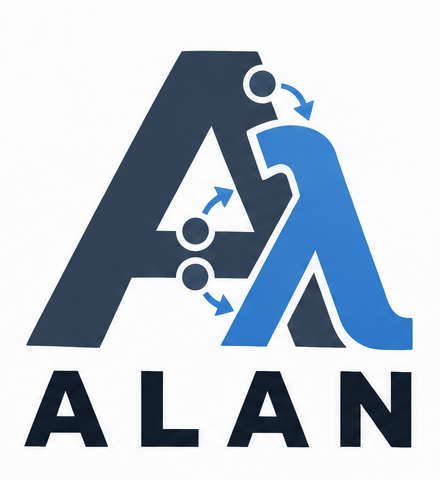

# ALAN



**Agentic Lambda Abstraction Network** is an experimental framework for building agents whose work can be retained, recovered and replayed. Programs compose recursively: a coordinator or supervisor is an ordinary program that receives observations, makes decisions in its own state, and commits effect intents through the same interpreter as other programs.

The repository contains a runnable **single-host Go executor** and an independent bounded semantic model. The executor persists versioned programs, residual computation, observations, intents and lifecycle outcomes in SQLite. The provisional public `author` package compiles named finite steps into retained programs; the `runtime` facade uses the same executor.

ALAN makes each stage of the work explicit:

- **Plan:** compose named, finite steps into retained programs.
- **Execute:** advance eligible work and commit effect intents through the executor.
- **Record:** retain observations, intents and lifecycle outcomes in SQLite.
- **Replay:** verify historical computation without dispatching effects.

This is an early implementation with a provisional API. It is not production-ready. The evidence assistant uses a direct OpenAI Responses adapter. Its [live gate passed](docs/foundational/phase1f/evidence/live-phase1e/report.md) with recorded usage, citations and offline replay. A bounded investigation application composes evidence helpers, synthesis and ordinary review; answer quality is evaluated separately from durability.

## Quick start

Requirements: Go **1.27.3**, CGO enabled, a C compiler, and a local Unix filesystem. Qualification records identify the tested macOS/arm64 platform. The only added Go dependency is pinned `github.com/mattn/go-sqlite3 v1.14.52`, which bundles SQLite.

From the repository root:

```sh
export GOTOOLCHAIN=local
alan_demo_dir=$(mktemp -d)
go build -buildvcs=false -o "$alan_demo_dir/alan" ./cmd/alan
go build -buildvcs=false -o "$alan_demo_dir/alan-resource" ./cmd/alan-resource

"$alan_demo_dir/alan" init --db "$alan_demo_dir/nested.sqlite" --demo nested
"$alan_demo_dir/alan" run --db "$alan_demo_dir/nested.sqlite"
"$alan_demo_dir/alan" inspect --db "$alan_demo_dir/nested.sqlite"
"$alan_demo_dir/alan" replay --db "$alan_demo_dir/nested.sqlite"
```

The ordinary topology is `outer coordinator -> inner supervisor -> worker`. The first worker run fails on explicit input. Inner spends one retry, requests a new worker generation, consumes the retained decision, and sends the successor success input. Outer receives inner's public terminal outcome. Both worker generations use the same program artifact.

`init` refuses to overwrite a store. `run` reopens existing records and advances eligible computation and delivery automatically. Physical recovery renews activation epochs; it does not reset a supervisory budget or create a new logical generation. Only an accepted lifecycle Retry does that. `inspect` shows the retained records; `replay` verifies historical computation without dispatching effects.

To exercise ordinary retry-budget exhaustion:

```sh
"$alan_demo_dir/alan" init --db "$alan_demo_dir/exhausted.sqlite" --demo nested \
  --retry-budget 1 --successor-input fail
"$alan_demo_dir/alan" run --db "$alan_demo_dir/exhausted.sqlite"
"$alan_demo_dir/alan" inspect --db "$alan_demo_dir/exhausted.sqlite"
```

A successful command exit means that invocation completed. The program can still have failed, or the runner can be quiescent with runs waiting for input or unknown external outcomes. Inspect the report and logical outcomes.

## Authoring in Go


The [external consumer](author/testdata/consumer.go) defines a caller and two instances of one ordinary helper using named values, ports, branches and outcomes. It imports only `author`, `runtime` and `schema`. It writes no raw instruction arrays, numeric program counters or SQL. Its test runs creation, recovery and replay in separate processes; recovery loads the retained artifact without recompiling definitions.

```sh
GOTOOLCHAIN=local go test -count=1 -tags integration \
  -run TestExternalConsumerCompileRunReopenReplay -v ./author
```

Artifacts retain compiler/semantic versions, schemas, templates and author-facing position names. The initial data model is a closed record of strings, integers and booleans. Repetition is explicitly bounded; custom Go callbacks do not execute inside deterministic reduction. See the [authoring/effect contract](docs/foundational/phase1e/01-authoring-effects-contract.md) for scope and recovery boundaries.

## Bounded work collections

[`compose.New`](compose/collection.go) builds an ordinary reusable collection from an item template. Work arrives after initialization as an ordered typed list; each accepted item gets its own invocation and original result operation. The same collector runs directly or inside an ordinary wrapper. The [worktree example](examples/worktree/README.md) and [Phase1G runbook](docs/foundational/phase1g/04-runbook.md) show the deterministic CLI and controlled evidence leaf.

The default profile bounds input to8 items, depth3,32 invocations,64 created runs,96 effect reservations and physical capacity1 or2. Recovery retains these shared charges. Unknown work stays pending and is not automatically repeated. Schema4 adds the invocation profile; schema3 and legacy artifacts remain supported without migration. Qualification uses independent item/budget checks, acknowledged process kills and fresh-process recovery; see the [report](docs/foundational/phase1g/evidence/task4/report.md) for source identities, exact schedules and review status.

## Evidence assistant

The reusable [`examples/evidence`](examples/evidence) helper composes an ordinary planner/synthesizer with a retrieval worker. A caller uses its declared request/result port. Planning selects lookup, clarification or insufficient evidence; lookup commits separately; synthesis receives the question and retained evidence. Ordinary branches reject invalid responses, wrong tools and citations that differ from the retained document/version/snippet/start/end. This checks citation provenance, not the truth of every answer sentence.

```sh
go build -buildvcs=false -o "$alan_demo_dir/alan-evidence" ./cmd/alan-evidence
# Set MODEL to an explicitly selected available OpenAI model ID.
"$alan_demo_dir/alan-evidence" init --db "$alan_demo_dir/evidence.sqlite" \
  --question 'How does WAL work?' --model "$MODEL"
# Set OPENAI_API_KEY in the runtime environment before this opt-in paid call.
"$alan_demo_dir/alan-evidence" run --db "$alan_demo_dir/evidence.sqlite"
"$alan_demo_dir/alan-evidence" inspect --db "$alan_demo_dir/evidence.sqlite"
"$alan_demo_dir/alan-evidence" replay --db "$alan_demo_dir/evidence.sqlite"
```

`init` snapshots the bundled nonsensitive corpus, or one explicitly selected `--corpus` file. `run`/`recover` load retained artifacts, corpus bytes and selected configuration. Default per-question ceilings are three model requests and two lookups; the normal path uses two and one. An unknown provider outcome remains unknown across recovery and is not automatically repeated. Replay needs no credential, live registry or source corpus file. See the [application runbook](docs/foundational/phase1e/04-application-runbook.md) for all limits, controlled results and reusable composition.

Controlled HTTP and subprocess tests do not spend money:

```sh
GOTOOLCHAIN=local go test -count=1 -tags integration ./examples/evidence ./cmd/alan-evidence
```

## Bounded investigation

[`examples/investigation`](examples/investigation) is a public-API consumer: it plans two evidence subquestions, sends both to ordinary evidence helpers, synthesizes their results, and asks a separate ordinary reviewer whether to accept, revise or stop. One explicitly authorized revision can gather two more results while retaining earlier evidence. The same component runs directly or inside an ordinary report application that chooses `publish` or `needs_attention` from its public result.

```sh
go build -buildvcs=false -o "$alan_demo_dir/alan-investigate" ./cmd/alan-investigate
"$alan_demo_dir/alan-investigate" init --db "$alan_demo_dir/investigation.sqlite" \
  --question 'For Cedar agent 3.2 in C17, which kernels are supported and what triggers rollback?' \
  --corpus-manifest docs/foundational/phase1f/evaluation/corpus/manifest.json \
  --model "$MODEL" --nested --max-revisions 1 \
  --max-output-tokens 4096 --max-response-bytes 65536 --request-timeout 120s
# Opt-in paid work: configure OPENAI_API_KEY and authorize the spending limit first.
"$alan_demo_dir/alan-investigate" run --db "$alan_demo_dir/investigation.sqlite"
"$alan_demo_dir/alan-investigate" inspect --db "$alan_demo_dir/investigation.sqlite"
"$alan_demo_dir/alan-investigate" recover --db "$alan_demo_dir/investigation.sqlite"
"$alan_demo_dir/alan-investigate" replay --db "$alan_demo_dir/investigation.sqlite"
```

The ceiling is 13 model requests and four lookups with one revision; `--max-revisions 0` permits at most seven and two. `--baseline` uses the simple one-question evidence helper with the shared query-prompt correction with the same corpus. Revision helpers can exclude exact initial citation spans through an optional public request; this does not guarantee complete evidence. Unknown provider outcomes keep their original identities and can block completion; restart does not turn them into new revision requests. Unused statically provisioned helpers may remain waiting. The [runbook](docs/foundational/phase1f/04-runbook.md) includes a spending-controlled qualification command, public component contracts, and inspection guidance.

The [development findings](docs/foundational/phase1f/development-findings.md) retain failed queries and missed evidence. Mechanically valid citations and a reviewer's approval do not establish answer completeness. The [measured evaluation](docs/foundational/phase1f/evaluation-results.md) found 2/4 strict heldout quality successes for investigation versus 1/4 for the simple helper, at higher cost and latency; four synthetic cases do not establish general superiority. All 33 live replay checks passed, with $0.59 estimated token charges across the complete live study. The [Phase1F qualification](docs/foundational/phase1f/02-qualification.md) retains source snapshots, independent reviews and failures.

## External resource example

The fake counter resource is a separate executable with its own durable SQLite store. Start it in a second terminal, using the same `alan_demo_dir` path:

```sh
"$alan_demo_dir/alan-resource" --db "$alan_demo_dir/resource.sqlite" \
  --token local-resource --listen 127.0.0.1:8791
```

Then run the client in the first terminal:

```sh
"$alan_demo_dir/alan" init --db "$alan_demo_dir/external.sqlite" --demo external \
  --endpoint http://127.0.0.1:8791/apply --profile idempotent
"$alan_demo_dir/alan" run --db "$alan_demo_dir/external.sqlite" \
  --max-in-flight 2 --external-timeout 2s
"$alan_demo_dir/alan" inspect --db "$alan_demo_dir/external.sqlite"
"$alan_demo_dir/alan" replay --db "$alan_demo_dir/external.sqlite"
```

The client adds five and waits for its correlated receipt; a separate ordinary peer can progress independently. External transport has bounded concurrency. Additional work stays in the durable intent ledger, and a held external request does not own the scheduler. The [dispatch contract](docs/foundational/phase1d1/01-dispatch-contract.md) defines limits, cancellation, worker ownership and late evidence; its qualification uses explicit hold/progress/release handshakes.

An idempotent reattempt uses the original immutable operation key and parameters. An uncertain non-idempotent attempt is retained as Unknown and is not automatically resent. Computation recovery does not establish exactly-once business effects. Each newly initialized executor store now receives a durable random namespace, so independent stores use different operation keys even when their local execution IDs match. Reopening or renaming a store preserves its keys; copying it preserves the same namespace and is not an independent fork. Concurrent use of copies is unsupported. A new namespace separates runtime operations, not repeated business tasks.

## CLI and execution boundaries

| Command | Purpose |
| --- | --- |
| `init --db PATH --demo nested\|external` | Provision a static example |
| `init --db PATH --provision FILE` | Provision programs, subjects, routes and grants from JSON |
| `run --db PATH` | Recover the store and automatically advance work |
| `input --db PATH --request FILE` | Admit a typed ordinary input while the store has no active executor |
| `inspect --db PATH` | Read a consistent snapshot of retained records |
| `replay --db PATH` | Verify projections and regenerated intent descriptors without live dispatch |

Run budgets default to 10,000 local commits and 10,000 dispatch operations; adjust with `--max-steps` and `--max-dispatch`. `--max-in-flight` bounds external transport (default 2), independently of those budgets. `--external-timeout` bounds an individual request (default 2s). Explicit CLI limits must be positive. Byte limits for programs, projections, observations and generated intent arrays are separate operational settings.

The store uses SQLite WAL and synchronous=FULL, verifies effective settings, and holds a local advisory lock to exclude a second active executor. Individual transactions cover execution commit, admission, authorization, lifecycle decision and outcome settlement. A workflow and its external mutation are never one transaction. Static observation permission does not confer lifecycle authority. Logical CancelRun remains distinct from permanent RetireSubject and from stopping the executor process.

## Tests and research

```sh
GOTOOLCHAIN=local go test -count=1 ./...
GOTOOLCHAIN=local go test -count=1 -tags integration ./...
GOTOOLCHAIN=local go test -count=1 -race -tags integration ./...
GOTOOLCHAIN=local go vet ./...
GOTOOLCHAIN=local go vet -tags integration ./...
go mod verify
gofmt -l author schema runtime effects adapters cmd internal research examples
```

The integration tag includes the external-consumer, application, provider and process qualification gates. Process tests require loopback sockets, child processes and SIGKILL permission. The race suite builds actual child executables with race instrumentation. Tests cover persistence, message correlation, ordinary supervision, replay, independent progress, retained unknown outcomes and acknowledged process-crash boundaries. Deliberately faulty variants and historical counterexamples remain part of qualification.

| Location | Contents |
| --- | --- |
| `author`, `schema`, `runtime` | Provisional compiler, scalar schemas and public executor facade |
| `effects`, `adapters/openai`, `adapters/lookup` | Retained effect protocol, Responses provider and corpus lookup |
| `examples/evidence`, `cmd/alan-evidence` | Ordinary reusable evidence composition and CLI |
| `examples/investigation`, `cmd/alan-investigate` | Bounded investigation, ordinary review/revision and nested report |
| `cmd/alan` | Executor CLI |
| `internal/executor` | Finite interpreter, SQLite authority, scheduler, messaging, lifecycle, external protocol, inspection and replay |
| `cmd/alan-resource`, `internal/fixture` | Separate durable counter endpoint |
| `internal/durabletest`, `internal/investigationtest`, `internal/boundary` | Process controller, independent record checks and observation-only test barriers |
| `research/semantics` | Test-only bounded model, searches, negative controls and selected runtime comparisons |
| `docs/foundational` | Architecture decisions, contracts, qualification records, review findings and source snapshots |

Start with the [foundations](docs/foundational/01-foundations.md), [composition](docs/foundational/02-composition.md), [runtime boundary](docs/foundational/03-runtime-boundary.md), and [decisions](docs/foundational/05-decisions.md). The retained phase packages distinguish [finite semantics](docs/foundational/phase1/02-qualification.md), [nested composition](docs/foundational/phase1b/02-qualification.md), [ordinary supervision](docs/foundational/phase1c/02-qualification.md), and [first durable execution](docs/foundational/phase1d/02-qualification.md). Phase 1D.1's [qualification](docs/foundational/phase1d1/02-qualification.md), [contract](docs/foundational/phase1d1/01-dispatch-contract.md) and [runbook](docs/foundational/phase1d1/04-runbook.md) document the asynchronous dispatch repair and reproduction commands. Original evidence keeps its original source identity; current-source regression is reported separately. The [Phase 1E qualification](docs/foundational/phase1e/02-qualification.md) records the authoring API, controlled model/tool application, recovery and replay, independent reviews, and complete reproducible source package.

## Current limits

This profile supports one host, one active executor per store, static provisioning/grants and one program counter per run. No schema/program migration, history compaction, distributed fencing, dynamic creation, ownership transfer, general delegation, fresh-supervisor child reassociation or managed provider deployment is supplied. This development increment uses schema 3/key version 2 and rejects schema-1 and intermediate schema-2 stores before activation; their retained source archives reproduce the original behavior. Histories grow and startup/replay scan them. Local provenance and storage synchronization assumptions are explicit.

Finite model searches and process-kill tests are evidence for their declared cases. They are not proofs of unbounded fairness, eventual recovery, arbitrary-depth equivalence, power-loss durability or safe repetition of arbitrary business work.

Licensed under [Apache-2.0](LICENSE).
