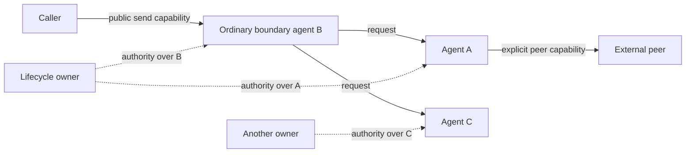

# ALAN recursive composition

Status: research candidate, 24 October 2026. Read [Foundations](01-foundations.md) for the transition model and [Runtime boundary](03-runtime-boundary.md) for the guarantees used here. Composition is closed only for agents whose contracts fit together; arbitrary networks of valid components need not be valid implementations of a desired service.

## What an agent exposes

An agent is an interactive computation exposed through a contract. The minimal observable contract identifies:

- Accepted input and emitted output schemas, including correlation and protocol state.
- Addressing and authority: which capabilities permit sending, observing status, or requesting lifecycle operations.
- Possible terminal results, failures, cancellation outcomes, and effects visible outside the boundary.
- Delivery, ordering, duplication, capacity, and acceptance semantics.
- Any progress promises and their environmental assumptions.

These are obligations of an interface, not mandatory fields of a particular SDK. An agent can be a one-request computation, a long-lived service, or a network behind an interface. Neither an LLM call nor a planning loop is required for agenthood. Their distinctive behavior is expressed by programs and effect requests.

Acceptance, handling, and successful completion are different events. For example, `Accepted(requestID)` can mean durable inbox admission; it does not promise that a tool will finish. Capacity rejection must be visible as rejection or backpressure according to the interface. Silence must not be interpreted as successful admission.

The boundary includes every authorized observable interaction. A child calling an external billing service is externally observable even when its name is hidden from the front-end caller. Hiding a name cannot erase a payment, resource consumption, a failure, or a capability leaked to another party.

## Four distinct identities

| Concept | Meaning | What survives |
| --- | --- | --- |
| Computation | A program and its current semantic state, possibly including a frontier of continuations | Can be represented without a network address |
| Logical agent `a` | A stable lifecycle subject and optionally a public service identity | May span retries and internal replacement |
| Logical execution `x = (a, g)` | One run generation with a particular initial state and history | Survives crash recovery and physical reactivation |
| Physical activation `(x, e)` | A worker attempting to advance execution `x` under epoch `e` | Disposable; may overlap physically with an obsolete worker |

An agent identifier is not a bearer capability. A capability combines a target with enforceable rights and scope. A service capability can bind to logical agent `a`; a run capability binds to `x` and cannot silently address a later generation. Every interface must declare which binding it uses.

Resume preserves `x`; a fresh retry creates `g + 1`. An implementation replacement may preserve the public identity through a facade, but changing the run or program version still requires an explicit transition and a compatibility argument. Equality of identifiers alone establishes no behavioral equivalence.

## A composite as an agent

Represent a composite semantically as:

```text
C = hide H in (B || A1 || ... || An)
```

`B` is an ordinary boundary agent or a static wiring description; `Ai` may themselves be composites. `H` names internal endpoints and internal actions. Parallel composition `||` permits independent component steps and communication steps; it does not imply simultaneous commits or a shared transaction. The network can grow after creation, but every finite execution prefix contains only finitely many created agents under the candidate assumptions.

A dynamic facade `B` is useful when routing, correlation, replacement, or aggregation requires state. It uses the same transition and effect interface as every other agent. Static wiring can avoid a forwarding process where the boundary needs no computation. Neither choice introduces a privileged composite type.

There are two representations to distinguish:

1. The semantic composite configuration contains every member state, mailbox, pending intent, and relevant lifecycle relation.
2. A deployed facade stores only its own routing and protocol state. Children keep their own logs and continue independently when the facade is suspended, subject to the declared policy.

Flattening the first representation into one huge state machine is a semantic encoding. It does not show that the second representation has a global transaction, a global scheduler, or a cheap global snapshot. A facade cannot claim a child state transition committed merely because it committed a request to the child.



This arrangement is legal. Dashed authority relations do not follow the message edges. Creating a composite does not grant its facade authority over every member; that authority must be allocated or delegated explicitly.

## Composition operators and their obligations

| Operator | Ordinary construction | Runtime support actually required | Condition easily overlooked |
| --- | --- | --- | --- |
| Sequential | Store stage and result; start `B` after the accepted result of `A` | Durable state and correlated observations; messaging if separate executions | Duplicate completion must not start `B` twice |
| Conditional | Evaluate a pure predicate and retain the selected branch | Bounded deterministic evaluation | An external predicate, such as a model judgment, first needs a recorded effect result |
| Recursive | Store a call frame or loop state; schedule another local continuation or create a child | Resumable steps; resource admission for new executions | A finite turn must yield even if the overall computation diverges |
| Concurrent | Keep multiple ready/waiting continuations, or create independently scheduled executions | Fair scheduling under stated assumptions; communication; isolation between executions | A waiting branch must not block unrelated runnable branches |
| Asynchronous | Emit an intent, retain correlation state, and handle completion later | Durable intent/completion routing and mailbox admission | Dispatch order does not imply completion order |
| Join | Store results by branch ID and test an explicit completion predicate | Same correlation and persistence support | Specify all/any/quorum, failure treatment, and late-result policy |
| Race | Commit the first admitted acceptable result; request cancellation of losers | Recorded observation order and lifecycle authority if cancellation is required | Winning a race does not undo a loser's external effects |
| Supervision | Observe failure, evaluate policy, request retry/cancel/transfer | Runtime validation and serialization of lifecycle operations | Ordinary policy cannot manufacture authority or detect failures perfectly |

These constructions are derivations at the programming level. Independent scheduling, durable commits, validated authority, and external interaction remain semantic obligations of the execution substrate. Counting all of them as one generic `perform` function would reduce API names, not obligations.

Local concurrency serializes changes to one execution state. Distinct continuations can remain pending together, and different executions can run in parallel. If a proposed language promises parallel shared-memory mutation within one execution, it needs an additional memory model; that is outside this candidate.

## Constructing Control without a special runtime type

Consider a Control agent with a public `Start(goal, requestID)` input and `Progress`, `Succeeded`, `Failed`, and `Cancelled` outputs. It plans, starts workers, evaluates their replies, revises the plan, and supervises recovery. Its ordinary state is:

```text
(phase, goal, plan, pendingByID, resultsByID, budget,
 ownerCapabilities, replyCapability, terminalDecision)
```

The following is semantic pseudocode, not production code:

```text
Start(goal, r):
  record r and goal; request planner effect p; wait for p

PlannerResult(p, plan):
  validate plan against budget and available capabilities
  request creation of independent workers for admitted tasks
  record each creation operation ID and task correlation

Created(operationID, workerCapability, lifecycleCapability):
  record the returned capabilities
  send the task with a fresh correlation and reply capability
  remain receptive to other creations, replies, and cancellation

WorkerReply(taskID, outcome):
  ignore a previously consumed reply ID
  record outcome; evaluate completion and revision predicates
  if more work is needed and budget permits, request it
  if the contract's completion predicate holds, commit one terminal decision

WorkerFailure(taskID, reason):
  evaluate ordinary retry, replacement, or escalation policy
  request the authorized lifecycle action; await its committed result

CancelRequest:
  request cancellation of owned work according to the public policy
  reconcile outstanding effects; report the contract's cancellation status
```

Every line reduces to bounded state transitions, intent emission, and later observations. Planner calls are external effects unless the planner is a pure internal computation. Workers can be other Control compositions without changing the runtime API. The root's own runtime cancellation can stop it without running its cancellation handler; therefore graceful cleanup must not be the only enforcement mechanism. See the separate local and group cancellation policies below.

For a concrete interleaving, `Control` receives a plan for `W1` and `W2`, commits both creation intents, then processes `Created(W2)` before `Created(W1)`. `W1` waits on a tool while `W2` returns a result. Control records `W2` and can launch `W3` while `W1` remains suspended. A subsequent planner result may revise the remaining work. No stack-shaped continuation or privileged scheduler agent is needed.

This construction exposes a sufficiency boundary. If Control requires an atomic change spanning all workers, an instantaneous global snapshot, cancellation that rolls back an arbitrary tool, or a failure detector that always knows whether a worker died, the listed primitives cannot supply that promise. A protocol with additional assumptions or a weaker contract is necessary. Calling the missing operation “orchestration” does not derive it.

## Lifecycle policy of a composite

The candidate runtime cancels a named lifecycle subject. Cancellation does not automatically traverse communication edges or recursively cancel all agents ever created by that subject. A composite requiring structured cancellation must explicitly define its membership, authority, and completion rule.

One ordinary policy maintains a durable member ledger. It stops admitting work, requests cancellation of owned members, and waits for recorded acknowledgments before declaring group quiescence. If the facade remains active, it can run this policy itself. A permanently cancelled facade cannot resume it, and the facade's outer owner does not automatically inherit member authority.

For cancellation that must survive facade retirement, provision a surviving ordinary cleanup agent `G` before starting members. One concrete arrangement gives `G` ownership of members and makes it execute creation requests received from the facade; it durably records creation operation IDs before dispatch and delegates the facade's required member rights. `G` holds the ledger and can recover its own execution independently. Another arrangement can leave the facade as owner while granting `G` explicit member authority and ledger access that survive facade retirement; those grants must be valid under each member's current ownership revision. Neither arrangement derives rights from parentage.

When the facade closes, `G` stops accepting new creation requests, suppresses creation intents with no authorized attempt, and reconciles attempts already authorized. A creation can succeed after the facade closes: `G` looks up its retained operation ID, records the resulting member, and cancels or transfers it according to policy. It does not treat a missing creation receipt as proof that no child exists. Group quiescence requires every admitted creation to be settled and each resulting member to have its declared disposition; an unknown outcome prevents that claim.

This provides eventual group cancellation only if a surviving principal has the ledger, current member authority, recoverable creation outcomes, and eventual execution/delivery. `G` itself requires an explicitly authorized recovery principal if it is permanently retired. Without these arrangements, local cancellation of the facade is the only guarantee. The runtime does not invent a custodian, grant inherited authority, or atomically stop the group.

A stronger requirement—no member may commit after the instant its ancestor is cancelled—would require a common cancellation barrier checked by every affected commit, or an equivalent coordination protocol. That requirement is open, rather than smuggled into the word “child.” An agent's parentage is not an implicit distributed transaction.

Failure escalation is a message to an explicitly authorized observer or owner. It can report a failed run or a suspicion of failure. Supervisors themselves have an owner or an explicitly designated administrative recovery principal; the base case is declared, not an infinite hierarchy assumed to recover itself.

## Closure and substitutability

Let `Obs_I(P)` describe behaviors of `P` visible at interface `I`, hiding only permitted internal actions. A useful safety refinement candidate is:

```text
Obs_I(implementation) ⊆ AllowedBehaviors(I)
```

Finite output traces alone are insufficient: a program that accepts a request and then waits forever can share every finite output prefix of a working service. Termination, divergence, refusals or capacity rejection, and required progress must be represented separately when the contract observes them.

For replacement, a contextual formulation is stronger: `P ≈_I Q` only if every admissible context using interface `I` cannot distinguish them under the chosen observation and fairness model. This is a definition to instantiate, not a theorem already proved for ALAN. Weak bisimulation or a failures/divergences treatment are candidates; choosing one can change which optimizations are valid.

Recursive closure needs at least these conditions:

1. Inputs, outputs, and capabilities are compatible, including protocol order rather than just payload types.
2. Private identities are fresh and remain unobservable unless deliberately exported.
3. Internal actions can be hidden without hiding required external effects or failures.
4. Scheduling assumptions survive nesting; one suspended child does not suspend the whole network.
5. Admission, duplicate handling, cancellation, and failure policies are defined at the boundary.
6. Resource use and progress obligations compose under explicit environmental assumptions.

Under those conditions, the network can be represented as another labeled transition system with the same kind of external interface. Showing that it satisfies a particular agent contract still needs a refinement argument. Syntactic closure of transition systems is much weaker than closure of termination, bounded resource usage, or availability.

Two agents that each answer every input can create an infinite ping-pong when connected. Each transition is valid and each input gets a response, yet the network never quiesces. Protocol budgets, decreasing measures, or restrictions on feedback can address particular cases; universal termination checking cannot be assumed.

## Replacement without exposing internals

A facade can replace an internal worker while preserving its public endpoint if it resolves the old worker's outstanding request ownership, effects, and response routing. A typical protocol quiesces admission to that worker, records a replacement generation, transfers or resolves pending work, switches routing, and handles late replies by their original generation and correlation.

If an external peer holds a direct capability to the old worker, that capability is part of the observable boundary. Transparent replacement then requires explicit forwarding or revocation semantics, or a contract that allows the old capability to expire. The facade cannot silently redefine what the peer's run-bound capability denotes.

Preserving schemas is necessary but insufficient. A replacement that changes output order, duplicate suppression, externally visible effects, failure behavior, or progress guarantees may violate substitutability. Case 9 in [Adversarial cases](04-adversarial-cases.md) makes this failure concrete.

## Outstanding composition obligations

- Prove a congruence result for the selected observation equivalence under parallel composition and hiding, with dynamic capabilities.
- Specify whether fairness is weak or strong and which accepted events remain continuously enabled despite competing arrivals.
- Define composite cancellation and completion when a member's external effect remains unknown.
- Show that generation-aware routing prevents late replies from satisfying a new request.
- Establish conditional liveness for a bounded Control composition and exhibit the assumptions it needs from workers and tools.

These obligations remain open. The proposal supplies constructions and counterexamples, not a general compositional correctness theorem.
