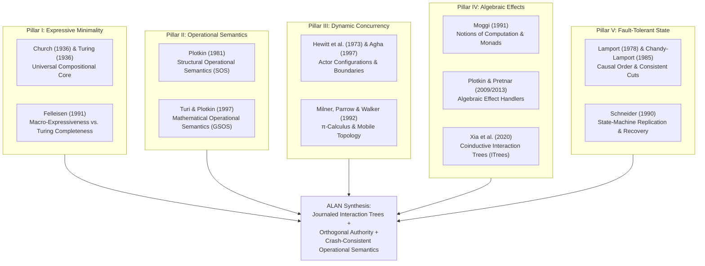
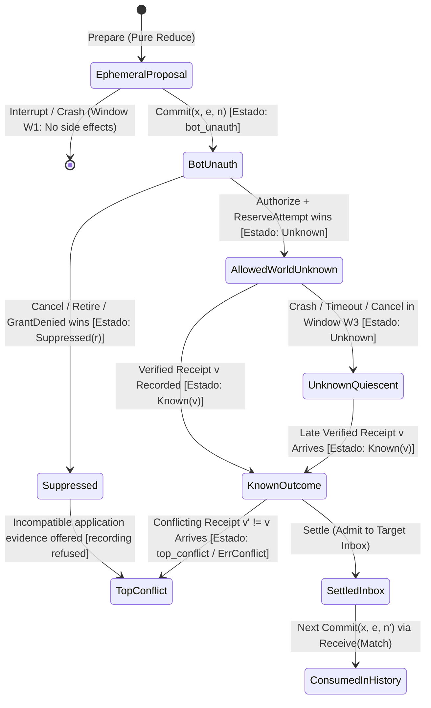

# Retainable Interactive Computation: Operational Semantics, Algebraic Effects, and Crash-Consistent Recovery in the Agentic Lambda Abstraction Network (ALAN)

**Abstract.** Contemporary frameworks for autonomous and language-model-driven agents are overwhelmingly engineered as ad hoc orchestration libraries: they embed control flow inside opaque host-language closures, conflate probabilistic model completions with authoritative state transitions, and rely on the incidental survival of an operating-system process to carry residual computation forward. When a process fails mid-execution, or when a higher-order coordinator must supervise, bound, retry, or cancel a subordinate agent, the computation itself possesses no independent mathematical existence.

This monograph develops the theoretical foundations of **ALAN (Agentic Lambda Abstraction Network)**, a programming-language and computation-model architecture whose central thesis is that *agentic computation must be a first-class, retainable mathematical object*. Rather than treating agents as black-box callbacks connected by workflow arrows, ALAN formulates an agent as a version-bound, finite-step interactive transition system whose residual control, typed environment, correlation obligations, and pending effect intents are explicitly reified as serializable projections.

We situate ALAN at the intersection of five classical traditions in theoretical computer science and distributed systems: (I) Church, Turing, and Felleisen's theory of computability versus *macro-expressiveness*; (II) Plotkin and Turi's *structural* and *mathematical operational semantics* (SOS and bialgebraic GSOS); (III) Milner, Hewitt, and Agha's calculi of *mobile processes and actor configurations*; (IV) Moggi, Plotkin, Pretnar, and Xia et al.'s *algebraic effects and coinductive Interaction Trees*; and (V) Schneider, Lamport, and Chandy's theory of *fault-tolerant state machines, causal ordering, and consistent cuts*.

Synthesizing these five pillars, we present four groups of definitions, arguments, and implementation evidence. Their qualification status is stated separately; the general congruence and dependent recovery simulations remain open obligations:
1. **Relative Macro-Expressiveness of Agent Control ($\Lambda_{\text{ALAN}}$):** Applying Felleisen's (1991) formal expressibility framework, we prove that supervision, bounded retry policies, scatter-gather concurrency, and iterative review-revision are *macro-eliminable* into ordinary finite instructions, *if and only if* the runtime boundary reifies terminal outcomes and lifecycle transitions as typed, provenance-tagged observations. We pair this positive derivation with historical falsification traces from ALAN's development showing where expressiveness strictly breaks when observation namespaces are conflated, and prove termination and cursor-conservation theorems for ALAN's snapshot-cursor collection calculus (`foreach`/`next`/`loop`).
2. **Split-phase effect authority.** The language factors a request into $\mathsf{Emit}$ and $\mathsf{Receive}$. The journal distinguishes intent commitment, first source permission, and reservation from worker launch and world application. Result recording, settlement and consumer selection also have separate boundaries. The information order in §5 names the historical application proposition. Under trusted dispatch, source closure before first permission suppresses the original mutation. A current-authority gate orders each dispatch admission against revocation. A separate host acknowledgment drains admitted work. An admitted worker can still enter its physical call after revocation.
3. **Orthogonal Authority Graphs and Contextual Contracts:** We distinguish provenance, communication and lifecycle authority, together with computation, subject, generation and activation identities. Section 4.5 defines budget-indexed, interface-scoped failure/divergence bisimulation ($\approx^{\Delta}_{I,\mathcal{B}}$) with exact matched debits and dual readiness. Its proposed general congruence theorem remains unproved: shared-resource interference, invocation admission and the relation to concrete scheduling require additional arguments. Phase 1I investigates the weaker, separately checked preservation of selected behavioral-contract guarantees in explicitly bounded contexts.
4. **Two Recovery Regimes and Their Limits:** Proposition 6.1 gives the non-idempotent missing-receipt obstruction to unconditional symmetric recovery. Retained state, replay and conservative uncertainty are distinct from full future contextual equivalence. Section 6 separates these safety facts from proposed symmetric and directed simulation claims whose peer-independence, endpoint, scheduling and resource premises remain to be discharged; retry expenditure and external effects cannot be hidden to restore equivalence.

---

## 1. Introduction: The Ontological Crisis of Agentic Computation

### 1.1 Orchestration Frameworks versus Models of Computation

The rapid proliferation of large language models (LLMs) has catalyzed an industry of software frameworks purporting to build "autonomous agents." Viewed through the lens of programming-language theory, however, nearly all contemporary agent frameworks are variations on a single, fragile idiom: *imperative host-language orchestration*. In such systems, an "agent" is a Python, TypeScript, or Go closure that loops over a mutable prompt buffer, invokes an external HTTP endpoint to sample tokens from a probabilistic model, parses tool-call strings from the completion, and executes arbitrary host callbacks in-place.

This architecture suffers from a foundational ontological confusion. It conflates three layers that must be kept mathematically distinct:
1. **Probabilistic Epistemic Proposals:** A language model completion is not a computation step; it is an untrusted, nondeterministic external observation sampled from a stochastic oracle.
2. **Deterministic Residual Control:** The logic that validates an observation against a schema, updates local state, enforces budget ceilings, and selects the next branch of work is a pure, finite state transition.
3. **Authoritative World Transitions:** Admitting a message to a peer's inbox, mutating an external database, or incrementing the execution generation of a failed child computation are irreversible distributed commitments subject to partial failure, message reordering, and process death.

When a conventional agent framework embeds all three layers inside the call stack of a live OS process, the *continuation* of the agent—what remains to be done, which obligations are outstanding, and what authority the agent holds—is implicitly encoded in ephemeral instruction pointers, heap pointers, and open TCP sockets. If the executor process receives `SIGKILL` after dispatching an external tool request but before recording its receipt, the residual computation vanishes. Restarting the process from scratch either blindly repeats external mutations (violating safety) or abandons the workflow without knowing what occurred in the outside world.

### 1.2 Durable Workflows versus Durable Computation

A natural objection is that industrial "durable execution" engines (such as Temporal or Azure Durable Functions) already address process crashes via event-sourced replay. Yet a rigorous examination reveals a decisive gulf between **durable workflow bookkeeping** and **durable computation**:

| Dimension | Conventional Agent / Workflow Engines | ALAN (Retainable Interactive Computation) |
| :--- | :--- | :--- |
| **Representation of Control** | Opaque host-language coroutine / closure stack; invisible to the runtime except by re-executing host code from step $0$. | Explicit, version-bound instruction array $P_v$ and serializable projection $\sigma = \langle \mathit{pc}, \rho, \mathit{status}, \kappa \rangle$. |
| **Status of Supervision** | Privileged runtime mechanism (hardcoded retry policies, supervisor trees, or special orchestrator nodes). | Ordinary program in the same calculus; consumes typed terminal observations and emits lifecycle intents. |
| **Effect Granularity** | Two-state activity model (`Started` $\to$ `Completed`/`Failed`), masking the gap between commit, authorization, and physical application. | Five-phase factorization ($\mathsf{Prepare} \to \mathsf{Commit} \to \mathsf{Authorize} \to \mathsf{Apply} \to \mathsf{Settle}$) with explicit $\mathsf{Suppressed}$ and $\mathsf{Unknown}$ states. |
| **Identity Model** | Flat workflow/run ID; restarting a failed workflow either mutates history or loses causal continuity with in-flight effects. | Four-tier hierarchy: Computation $(P_v,\sigma)$, Logical Subject $a$, Generation $x=(a,g)$, Activation Epoch $(x,e)$, plus Ownership Revision $w$. |
| **Authority Topology** | Coupled to the creation hierarchy (parent implicitly owns, messages, and cancels child). | Orthogonal graphs: Provenance ($\mathcal{G}_{\text{prov}}$) $\perp$ Communication ($\mathcal{G}_{\text{comm}}$) $\perp$ Lifecycle Authority ($\mathcal{G}_{\text{life}}$). |
| **Equivalence Theory** | Ad hoc testing; no formal congruence guarantees when replacing a leaf activity with a nested sub-network. | Grounded in Structural Operational Semantics (Plotkin) and Bialgebraic Mathematical Operational Semantics (Turi & Plotkin). |

ALAN (**Agentic Lambda Abstraction Network**) begins from a radically different premise: **ALAN is a programming-language and computation-model project, not an LLM orchestration project.** Its central ambition is to make agentic computation a first-class mathematical object—something that can be composed recursively, suspended, persisted in a relational ledger, inspected as static data, resumed across process deaths, supervised by ordinary peer computations, and reasoned about via structural operational rules without relying on the accidental survival of a running process.

### 1.3 The Five Intellectual Pillars and Three Necessary Extensions

To construct a mathematically sound theory for ALAN, we do not invent a calculus *ex nihilo*. Instead, we synthesize five foundational pillars of computer science, augmented by three critical extensions required by durability and asynchronous distribution:



1. **Pillar I (Church, Turing, Felleisen — Small Compositional Core & Expressiveness):** Church (1936) and Turing (1936) establish that arbitrary effective computation can emerge from a minimal compositional core rather than a proliferating taxonomy of special-purpose machines. Felleisen (1991) provides the sharper analytical instrument required for language design: two languages can both be Turing-complete (or finite-state approximations thereof) while differing strictly in *macro-expressiveness*—whether a construct can be locally derived without global program rewriting or violation of observable invariants.
2. **Pillar II (Plotkin, Turi — Mathematical Execution Semantics):** Plotkin (1981) replaces informal prose descriptions of state machines with deductive transition rules $\langle P, S \rangle \xrightarrow{\alpha} \langle P', S' \rangle$. Turi and Plotkin (1997) characterize when operational transition rules induce a compositional denotational semantics via bialgebras, providing the exact mathematical criteria needed to justify ALAN's recursive composition claim.
3. **Pillar III (Milner, Hewitt, Agha — Concurrency and Evolving Topology):** An agentic computation is not a closed $\lambda$-term reducing to normal form in isolation; it communicates asynchronously, spawns subordinate invocations from observed data, and races or joins concurrent branches. Hewitt et al. (1973), Agha et al. (1997), and Milner, Parrow & Walker (1992) force us to confront execution identity, name extrusion, capability scope, and compositional equivalence under parallel composition and hiding.
4. **Pillar IV (Moggi, Plotkin & Pretnar, Xia et al. — Separation of Computation and Effects):** Moggi (1991) and Plotkin & Pretnar (2009, 2013) separate pure value computation from the algebraic description and handler interpretation of side effects. Xia et al. (2020) formulate **Interaction Trees (ITrees)**—coinductive trees built from pure returns ($\mathsf{Ret}$), silent internal steps ($\mathsf{Tau}$), and visible environment queries with indexed response continuations ($\mathsf{Vis}(e, k)$). ITrees provide the closest denotational ancestor to ALAN's retained programs.
5. **Pillar V (Schneider, Lamport, Chandy & Lamport — Survivability Across Executor Disappearance):** Traditional programming-language semantics assumes an immortal evaluator. By integrating Lamport's (1978) causal happens-before relation, Chandy and Lamport's (1985) consistent global cuts, and Schneider's (1990) deterministic state-machine replication with a novel *split-phase effect journal*, ALAN extends operational semantics into a regime where the physical executor can vanish at any instruction or I/O boundary.

| Foundational Work | Core Mathematical Mechanism | Role in ALAN's Formal Architecture |
| :--- | :--- | :--- |
| **Church (1936)**; **Turing (1936)** | $\lambda$-definability; universal state machines | Justification for a uniform compositional core without privileged agent classes |
| **Felleisen (1991)** | Macro-expressiveness ($\preceq_{\text{macro}}$) vs. global encoding | Proving that supervision and coordination are derived constructs, while typed outcome admission is essential |
| **Plotkin (1981)** | Structural Operational Semantics (SOS) | Exact transition rules for `Reduce`, `Admit`, `AuthorizeAttempt`, `DecideLifecycle`, and `Settle` |
| **Turi & Plotkin (1997)** | Bialgebraic GSOS & compositional congruence | Conditions under which composite agents $C = \mathsf{hide}\; H \;\mathsf{in}\; (B \parallel A_1 \parallel \dots \parallel A_n)$ preserve public contracts |
| **Hewitt et al. (1973)**; **Agha et al. (1997)** | Actor configurations, receptionists, and external names | Explicit network boundaries, asynchronous mailbox admission, and independent scheduling |
| **Milner, Parrow & Walker (1992)** | $\pi$-calculus, scope extrusion, bisimulation congruence | Bounded template invocation (`compose`), capability scoping, and counterexamples to naive equivalence |
| **Moggi (1991)** | Computational $\lambda$-calculus ($\lambda_c$) and monads | Distinguishing pure state values $V$ from effectful computations $T(V)$ |
| **Plotkin & Pretnar (2009/2013)** | Algebraic effects and effect handlers | Separating durable intent emission (`Request`/`Emit`) from runtime adapter interpretation (`Prepare`/`Execute`) |
| **Xia et al. (2020)** | Coinductive Interaction Trees ($\mathsf{ITree}_{E,R}$) | Representing retained recursive/iterative programs as event trees interpretable by both `Run` and `Replay` |
| **Lamport (1978)**; **Chandy & Lamport (1985)** | Causal partial order ($\prec$) and consistent global snapshots | Per-execution observation serialization, generation-bound message routing, and replay cuts |
| **Schneider (1990)** | Deterministic state-machine replication & log replay | Journaled transition reconstruction, extended by ALAN to handle non-idempotent external ambiguity ($\mathsf{Unknown}$) |

### 1.4 Distinguishing Engineering Synthesis from Mathematical Contributions

A rigorous programming-languages monograph must draw a sharp line between **architectural engineering synthesis**—where known theoretical mechanisms are combined cleanly in an executable artifact—and **novel semantic construction**—where existing formalisms break down or require new definitions and theorems. We state this demarcation explicitly:

1. **What Is Engineering Synthesis of Established Theory:**
   - *Pure Finite-Step Operational Reduction:* Formulating local instruction execution (`Reduce` in [`internal/executor/program.go`](file:///Users/jacob/dev/personal/alan/internal/executor/program.go)) as a deterministic small-step transition function $\delta_v$ is a direct instantiation of Plotkin's (1981) Structural Operational Semantics.
   - *Free-Monad / Interaction-Tree Representation of Split-Phase Programs:* At the pure syntax and local reduction level, factoring an external call into an `emit` instruction followed by a `receive` instruction does *not* require a new coinductive tree functor beyond Xia et al.'s (2020) $\mathsf{ITree}_{E,R}$. Rather, it is a standard syntactic lowering (a free-monad homomorphism $\mathcal{S} : \mathsf{ITree}_{E,R} \to \mathsf{ITree}_{E_{\text{split}}, R}$) into an Interaction Tree over a split-phase signature $E_{\text{split}} = \mathsf{Emit} \uplus \mathsf{Receive}$.
   - *Deterministic Log Replay and Fencing Tokens:* Re-evaluating deterministic transitions from an append-only history log (`Replay` in [`internal/executor/replay.go`](file:///Users/jacob/dev/personal/alan/internal/executor/replay.go)) and fencing stale worker processes via monotonically increasing epoch numbers $e \mapsto e+1$ synthesize Schneider's (1990) state-machine approach and Burrows's (2006) Chubby lock-sequencer model.

2. **Where Existing Formalisms Break and What This Paper Contributes Mathematically:**
   - **The Asynchronous Handler Gap Between $\mathsf{Emit}$ and $\mathsf{Receive}$ (§5.2–5.3):** In Plotkin & Pretnar's effect handlers and Xia et al.'s `interp : (E ~> M) -> ITree E R -> M R`, even if a program is lowered to $\mathsf{ITree}_{E_{\text{split}}, R}$, the handler $h : E_{\text{split}} \leadsto \mathsf{StateT}(\mathcal{D}, M)$ interprets each event *atomically* inside the evaluator's thread of control. It cannot model an effect that has been committed by the program, authorized by the store, and transmitted over the network while a concurrent supervisor issues `CancelRun` or the OS delivers `SIGKILL`. Our semantic contribution in Section 5 is the **Split-Phase Journaled Handler Algebra ($\mathcal{H}_{\text{journal}}$)**, which models the gap between `Emit` and `Receive` as a concurrent coalgebraic protocol over a four-stage consistent epistemic poset $\mathbb{O}_{\text{eff}}^{\text{cons}}$ completed by a conflict element $\top_{\text{conflict}}$ into the bounded lattice $\widehat{\mathbb{O}}_{\text{eff}}$, together with the **first-permission suppression theorem and physical-launch counterexample (Theorem 5.4)**.
   - **The Exact Expressiveness Boundary for Non-Privileged Supervision (§2.4):** Rather than merely asserting that supervisors are ordinary programs, we use Felleisen's (1991) macro-eliminability relation ($\preceq_{\text{macro}}$) to prove both a positive theorem (supervision is locally macro-eliminable when terminal and lifecycle outcomes are admitted as provenance-tagged inbox observations) and a matching negative theorem (supervision is provably *inexpressible* in the Phase 1C boundary $\Lambda_{\text{ALAN}}^{-}$ where terminal delivery updated an external table without inbox admission).
   - **Congruence Under Shared External Effects, Dual Refusals, and Bounded Envelopes (§4.5):** Standard weak Milner bisimulation fails to be a congruence for ALAN composites because of three domain-specific interactions: (i) shared root resource budgets $\mathcal{B}(r)$, (ii) the separation between asynchronous *mailbox admission refusals* (`target_closed`) and synchronous *continuation `receive` readiness*, and (iii) interleaved mutations on shared external endpoints $\mathcal{W}_\ell$. Section 4.5 formulates **Budget-Indexed Interface-Scoped Failure/Divergence Bisimulation ($\approx^{\Delta}_{I,\mathcal{B}}$)** and records the missing interference, invocation, hiding and scheduler arguments for the proposed general congruence claim. Finite contract-relative qualification is a separate result category.
   - **The Impossibility of Unconditional Symmetric Crash Bisimulation and the Two-Regime Recovery Theorem (§6.3–6.5):** When an executor crashes in the in-flight window $W_3$ of a non-idempotent external effect, the recovery operator faces a fundamental epistemic dilemma: re-sending violates at-most-once world safety, whereas withholding re-transmission halts the waiting continuation (or forces a supervisor onto a recovery branch). We prove that **unconditional symmetric forward bisimulation across unreconciled non-idempotent Window-$W_3$ crashes is impossible (Proposition 6.1)**, and distinguish conservative recovery safety from the stronger **Two-Regime claim (Theorem 6.6)**. Symmetric and directed simulation require the additional independence and contextual obligations stated in §6; absence of a missing non-idempotent receipt alone does not establish them.

---

## 2. Pillar I: Computational Universality, Bounded Realizability, and Felleisen Expressiveness

### 2.1 Beyond the Turing Tarpit: Why Universality Is Necessary but Insufficient

A recurring fallacy in agent system design is what we may call the *Universality Fallacy*: the claim that because a framework can encode a while-loop and a conditional branch (and is therefore Turing-complete over unbounded memory), its primitive set is architecturally sufficient.

Church's $\lambda$-calculus (1936), Turing's machine $\mathcal{M}_U$ (1936), and Minsky's (1961, Theorem Ia) two-register counter machine establish that an austere set of operations—increment-and-jump, decrement-and-branch-on-zero—suffices to compute any partial recursive function $\varphi_e : \mathbb{N} \rightharpoonup \mathbb{N}$, provided two idealizations hold:
1. Registers hold arbitrary-precision unbounded natural numbers $\mathbb{N}$;
2. Execution is permitted an unbounded number of transition steps without external interruption.

In a durable, concurrent agent system, both idealizations are false, and even if granted, they leave the central language-design questions unanswered:
- **Bounded Realizability vs. Asymptotic Universality:** An actual ALAN deployment operates under explicit operational resource bounds $\mathcal{L} = (\text{MaxProgramBytes}, \text{MaxDataBytes}, \text{MaxObservationBytes}, \text{MaxOutputBytes})$ (defaulting to $1\text{ MiB}$ each in [`internal/executor/program.go`](file:///Users/jacob/dev/personal/alan/internal/executor/program.go#L97-L101)) and signed 64-bit checked arithmetic (`int64` with explicit overflow trapping into `ErrLimit` at lines 227–229 and 343–345). In this regime, an unbounded host callback that loops forever does not exhibit "Turing universality"—it violates the finite-step scheduling invariant, starves peer executions, and prevents the runtime from reaching a durable checkpoint.
- **Computational Power vs. Expressive Power:** As Felleisen (1991) demonstrated in *On the Expressive Power of Programming Languages*, any two Turing-complete languages $\mathcal{L}_1$ and $\mathcal{L}_2$ are inter-translatable via global Gödel numbering (whole-program simulation). Yet whole-program encoding destroys program structure, collapses concurrency into a single sequential interpreter loop, and fails to preserve observational behavior in arbitrary contexts.

To evaluate whether ALAN requires a new primitive—or whether constructs such as `OneShot`, `Conditional`, `Supervisor`, `Coordinator`, and `Collection` can be derived from a minimal core—we must instantiate Felleisen's formal framework for interactive configurations.

### 2.2 Formalizing Felleisen Macro-Expressiveness for Interactive Calculi

Let $\mathcal{L} = (\mathsf{Syn}_{\mathcal{L}}, \mathsf{Conf}_{\mathcal{L}}, \longrightarrow_{\mathcal{L}}, \mathsf{Obs}_{\mathcal{L}})$ be an interactive programming language with syntax $\mathsf{Syn}_{\mathcal{L}}$, configuration space $\mathsf{Conf}_{\mathcal{L}}$, transition relation $\longrightarrow_{\mathcal{L}}$, and an observation predicate $\mathsf{Obs}_{\mathcal{L}} : \mathsf{Conf}_{\mathcal{L}} \to \mathcal{O}$ that extracts externally visible outcomes (emitted external/message intents, terminal status, and resource charges).

**Definition 2.1 (Contextual Equivalence in $\mathcal{L}$).** Two syntactic terms $P, Q \in \mathsf{Syn}_{\mathcal{L}}$ are *contextually equivalent*, written $P \simeq_{\mathcal{L}} Q$, if for every syntactic context $C[\cdot]$ such that $C[P]$ and $C[Q]$ are well-formed closed configurations,
$$\mathsf{Obs}_{\mathcal{L}}(C[P]) = \mathsf{Obs}_{\mathcal{L}}(C[Q]).$$

**Definition 2.2 (Felleisen Macro-Eliminability, after Felleisen 1991, Def. 3.3–3.4).** Let $\mathcal{L}$ be a sublanguage of $\mathcal{L}^+ = \mathcal{L} \cup \{F(\cdot_1, \dots, \cdot_k)\}$ obtained by adjoining a $k$-ary syntactic constructor $F$. We say that $F$ is *macro-expressible* (or *derived*) in $\mathcal{L}$, written $\mathcal{L}^+ \preceq_{\text{macro}} \mathcal{L}$, if there exists a syntactic translation $\mathcal{T} : \mathsf{Syn}_{\mathcal{L}^+} \to \mathsf{Syn}_{\mathcal{L}}$ such that:
1. **Identity on Core Syntax:** $\mathcal{T}(p) = p$ for all atomic primitives $p \in \mathcal{L}$;
2. **Homomorphic Compositionality (Locality):** For every constructor $G \in \mathcal{L}$, $\mathcal{T}(G(t_1, \dots, t_m)) = G(\mathcal{T}(t_1), \dots, \mathcal{T}(t_m))$, and for $F$ itself, $\mathcal{T}(F(t_1, \dots, t_k)) = \Phi_F[\mathcal{T}(t_1), \dots, \mathcal{T}(t_k)]$ for some fixed multi-hole $\mathcal{L}$-context $\Phi_F[\cdot_1, \dots, \cdot_k]$;
3. **Conservative Observational Preservation:** For all programs $P, Q \in \mathsf{Syn}_{\mathcal{L}^+}$, $P \simeq_{\mathcal{L}^+} Q \iff \mathcal{T}(P) \simeq_{\mathcal{L}} \mathcal{T}(Q)$, and for every closed $P \in \mathsf{Syn}_{\mathcal{L}^+}$, $\mathsf{Obs}_{\mathcal{L}^+}(P) = \mathsf{Obs}_{\mathcal{L}}(\mathcal{T}(P))$.

If no such local homomorphic translation $\Phi_F$ exists, then $F$ is an *essential expressive primitive* over $\mathcal{L}$ ($\mathcal{L} \prec_{\text{macro}} \mathcal{L}^+$).

### 2.3 Case Study A: `OneShot` versus `Conditional`

Early architectural discussions around agent frameworks often propose two leaf agent archetypes: `OneShot` (execute a single function/step) and `Conditional` (branch between two sub-agents $A$ and $B$). Using Definition 2.2, we can settle their exact mathematical relationship (formalizing the analysis in [`docs/foundational/01-foundations.md`](file:///Users/jacob/dev/personal/alan/docs/foundational/01-foundations.md#L110-L133) and Audit Finding S1 in [`docs/foundational/05-decisions.md`](file:///Users/jacob/dev/personal/alan/docs/foundational/05-decisions.md#L123)).

**Theorem 2.3 (Inexpressibility of `Conditional` in Trace-Fixed Total `OneShot` Calculi).**
*Let $\mathcal{L}_{\text{fixed}}$ be a language generated by atomic `OneShot` leaves $L_i$ and sequential composition $P ; Q$, where each leaf $L_i$ is total, terminates normally without input-dependent failure or early exit, and emits a fixed nonempty sequence of observable effect labels $\vec{\alpha}(L_i) \in \Act^+$ independent of input data $\rho$. Let $\mathcal{L}_{\text{fixed}}^+$ adjoin $\mathsf{Conditional}(p, A, B)$, which evaluates a non-constant state predicate $p(\rho) \in \{\mathsf{true}, \mathsf{false}\}$ and executes $A$ if $p(\rho) = \mathsf{true}$ and $B$ if $p(\rho) = \mathsf{false}$. Then $\mathcal{L}_{\text{fixed}} \prec_{\text{macro}} \mathcal{L}_{\text{fixed}}^+$.*

*Proof.* By structural induction on any closed term $M \in \mathsf{Syn}_{\mathcal{L}_{\text{fixed}}}$, we establish the invariant that the observable effect-label trace $\pi(M, \rho) \in \Act^*$ emitted by $M$ on initial data environment $\rho$ is constant with respect to $\rho$:
- *Base case ($M = L_i$):* By totality and trace-fixity of leaves, $\pi(L_i, \rho) = \vec{\alpha}(L_i)$ for all $\rho_1, \rho_2$.
- *Inductive step ($M = P ; Q$):* Because $P$ is total and terminates normally without input-dependent failure or early exit on every environment $\rho$, $P$ always emits its complete trace $\pi(P, \rho)$ and passes control to $Q$ in some resulting environment $\rho'$. By the induction hypothesis, $\pi(P, \rho_1) = \pi(P, \rho_2) = \vec{u}$ and $\pi(Q, \rho'_1) = \pi(Q, \rho'_2) = \vec{v}$. Thus $\pi(P ; Q, \rho) = \vec{u} \cdot \vec{v}$ is independent of $\rho$.

Now consider $W = \mathsf{Conditional}(p, L_{\text{left}}, L_{\text{right}}) \in \mathcal{L}_{\text{fixed}}^+$ where $\vec{\alpha}(L_{\text{left}}) = [\mathtt{left}] \ne [\mathtt{right}] = \vec{\alpha}(L_{\text{right}})$ and $p(\rho_{\top}) = \mathsf{true}, p(\rho_{\bot}) = \mathsf{false}$. Since $\pi(W, \rho_{\top}) = [\mathtt{left}] \ne [\mathtt{right}] = \pi(W, \rho_{\bot})$, no term $\mathcal{T}(W) \in \mathcal{L}_{\text{fixed}}$ can satisfy $\mathsf{Obs}_{\mathcal{L}_{\text{fixed}}}(\mathcal{T}(W))(\rho) = \mathsf{Obs}_{\mathcal{L}_{\text{fixed}}^+}(W)(\rho)$ for both $\rho_{\top}$ and $\rho_{\bot}$. $\blacksquare$

*Remark 2.4 (Why Totality and Non-Failure Are Essential to Theorem 2.3).* As discovered during ALAN's foundational source audit (Finding S1), if leaves $L_i$ are allowed input-dependent failure or divergence, then sequential composition $P ; Q$ can truncate the observed trace prefix depending on whether $P$ faults on $\rho$. Thus the induction requires explicit totality and normal termination. Conversely, in ALAN's actual instruction calculus ([`internal/executor/program.go`](file:///Users/jacob/dev/personal/alan/internal/executor/program.go#L347-L361)), a single deterministic reduction step can inspect $\rho$ and select the successor program counter $\mathit{pc}' \in \{\mathit{Target}, \mathit{Otherwise}\}$. Under that reducer basis, `Conditional` is locally macro-eliminable via `branch` and `jump` (as lowered by [`author.IfEqual`](file:///Users/jacob/dev/personal/alan/author/compile.go)). Neither `OneShot` nor `Conditional` is a privileged agent class in ALAN; both reduce to ordinary instructions.

### 2.4 Case Study B: Macro-Eliminability of Supervision and the Phase 1C Falsification

A central architectural claim of ALAN is that **a supervisor is not a privileged runtime entity**: an inner supervisor or outer coordinator is compiled into the exact same instruction set (`set`, `add`, `branch`, `jump`, `receive`, `emit`, `end`) and executed by the exact same pure reducer [`executor.Reduce`](file:///Users/jacob/dev/personal/alan/internal/executor/program.go#L292-L488) as a leaf worker.

These supervision statements concern the core instruction calculus. The current public author constructors expose a smaller vocabulary: Phase 1K separately tests terminal-observation access through a raw public-runtime artifact and qualifies the ordinary authoring boundary. A host-side inspection result is not automatically an observation available to a retained program.

Using Felleisen's framework, we can make this claim mathematically precise—and explain why ALAN's Phase 1C investigation uncovered a genuine expressiveness boundary.

**Theorem 2.5 (Macro-Eliminability of Bounded Supervision over Typed Lifecycle & Terminal Observations).**
*Let $\mathcal{L}_{\text{ALAN}}$ be the core ALAN instruction calculus with `set`, `add`, `branch`, `jump`, `receive`, `emit`, and `end`, operating over a runtime boundary that admits:*
1. *Typed terminal observations $o_{\text{term}}$ with $\mathit{kind} = \mathtt{"terminal"}$, $\mathit{provenance} = \mathtt{"runtime\text{-}terminal"}$, carrying child source $a_{\text{child}}$, generation $g$, obligation $\mathit{obl}$, and terminal status $\mathit{outcome} \in \{\mathtt{"succeeded"}, \mathtt{"failed"}, \mathtt{"cancelled"}, \mathtt{"abandoned"}\}$;*
2. *Typed lifecycle intents $\iota_{\text{life}}$ with $\mathit{kind} = \mathtt{"lifecycle"}$, operation $\mathit{op} \in \{\mathtt{"Retry"}, \mathtt{"CancelRun"}, \mathtt{"AbandonRun"}, \mathtt{"RetireSubject"}\}$, and correlated lifecycle settlement observations $o_{\text{life}}$ with $\mathit{kind} = \mathtt{"lifecycle"}$, $\mathit{provenance} = \mathtt{"runtime\text{-}lifecycle"}$, correlated to $\mathit{Operation} = \mathsf{id}(\iota_{\text{life}})$.*

*Then a higher-level supervisory construct $\mathsf{Supervise}(a_{\text{child}}, B_{\text{retry}}, \mathit{obl}, P_{\text{init}}, P_{\text{succ}})$—which dispatches initial work $P_{\text{init}}$ to generation $1$ of $a_{\text{child}}$, retries on committed failure up to budget $B_{\text{retry}} \in \mathbb{N}$ using successor work $P_{\text{succ}}$, and propagates terminal success or exhaustion—is locally macro-expressible in $\mathcal{L}_{\text{ALAN}}$ without adding any supervisor-specific opcode or runtime dispatch role.*

*Constructive Proof (The ALAN `NestedProvision` Encoding).* We exhibit the exact translation $\Phi_{\mathsf{Supervise}}$ implemented in [`internal/executor/examples.go`](file:///Users/jacob/dev/personal/alan/internal/executor/examples.go#L52-L69). Initialize local projection data $\rho_0 = \{\mathtt{spent} \mapsto 0, \mathtt{limit} \mapsto B_{\text{retry}}, \mathtt{expected} \mapsto 1, \mathtt{revision} \mapsto 1, \mathtt{pending} \mapsto \mathtt{""}\}$. The 15-instruction encoding is:

```text
pc  0: receive(kind="message", prov="ordinary-message", src=Outer, gen=1, obl="inner-start") -> [started]
pc  1: emit(kind="message", target=Worker, gen=Ref("expected"), obl="worker-work", payload=P_init)
pc  2: receive(kind="terminal", prov="runtime-terminal", src=Worker, gen=Ref("expected"), obl=obl) -> [outcome]
pc  3: branch(Ref("outcome") == "succeeded", target=13, otherwise=4)
pc  4: branch(Ref("outcome") == "failed",    target=5,  otherwise=14)
pc  5: branch(Ref("spent")   == Ref("limit"), target=14, otherwise=6)
pc  6: emit( dst="pending", kind="lifecycle", target=Worker, gen=Ref("expected"), obl=obl,
             payload={"operation": "Retry", "revision": Ref("revision")},
             updates={"spent": Offset("spent", +1)} )
pc  7: receive(kind="lifecycle", prov="runtime-lifecycle", src=Worker, gen=Ref("expected"),
               obl=obl, op=Ref("pending")) -> [accepted, reason, successor, disposition]
pc  8: branch(Ref("accepted") == true, target=9, otherwise=14)
pc  9: set(dst="expected", A=Ref("successor"))
pc 10: set(dst="pending",  A="")
pc 11: emit(kind="message", target=Worker, gen=Ref("expected"), obl="worker-work", payload=P_succ)
pc 12: jump(target=2)
pc 13: end(outcome="succeeded")
pc 14: end(outcome="failed")
```

Observe three critical properties of $\Phi_{\mathsf{Supervise}}$:
1. **Atomic Budget Conservation (`pc = 6`):** The `emit` instruction simultaneously commits the `Retry` lifecycle intent, records its unique intent ID `[Inner, 1, seq, 0]` into register `pending`, and increments `spent` by $+1$ in a single atomic `Reduce` transition ([`program.go`](file:///Users/jacob/dev/personal/alan/internal/executor/program.go#L449-L469)). Consequently, a physical crash after `pc = 6` cannot reset `spent` or lose the correlation handle `pending`.
2. **Exact Operation Correlation (`pc = 7`):** The `receive` instruction at `pc = 7` matches `Operation: Ref("pending")`. Stale or duplicate notifications from earlier generations or unrelated operations are rejected by `Reduce` with `ErrIneligible` ([`program.go`](file:///Users/jacob/dev/personal/alan/internal/executor/program.go#L386-L388)).
3. **Historical Falsification when Typed Outcome Admission Is Omitted:** In ALAN's initial Phase 1 model, `DeliverTerminal` updated an external delivery ledger without inserting a typed `"terminal"` observation into the observer's inbox. As documented in the Phase 1C findings ([`docs/foundational/05-decisions.md`](file:///Users/jacob/dev/personal/alan/docs/foundational/05-decisions.md#L195)), under that restricted runtime boundary $\mathcal{L}_{\text{ALAN}}^{-}$, `Supervise` was *provably not expressible* because no instruction in $\mathcal{L}_{\text{ALAN}}^{-}$ could conditioned its control flow on a child's terminal status! Restoring typed terminal and lifecycle observation admission rendered $\mathsf{Supervise}$ macro-expressible without adding a single supervisor-specific opcode. $\blacksquare$

### 2.5 Case Study C: Bounded Data-Dependent Iteration and Snapshot Cursors (Phase 1G)

While static finite loops (`author.Repeat(count, body...)`) can be macro-expanded at compile time by unrolling `body` `count` times, post-initialization work collections (`compose.New` in [`compose/collection.go`](file:///Users/jacob/dev/personal/alan/compose/collection.go#L25-L104)) receive an ordered list of $m$ items ($0 \le m \le M$) at runtime. Unrolling statically to $M$ with conditional guards bloats program size exponentially under nesting ($O(M^d)$) and obscures iteration state in durable projections. Conversely, allowing unrestricted backward jumps (`jump` to $\mathit{target} \le \mathit{pc}$) destroys guaranteed termination of local reduction and allows programs to jump into the middle of an active loop without initializing its cursor.

In Phase 1G (`CollectionSemanticVersion`), ALAN introduces four structured collection instructions—`foreach`, `next`, `loop`, and `append`—backed by a map of durable **Snapshot Cursors** $\kappa : \mathbb{N}_{\mathit{pc}} \rightharpoonup \mathsf{Cursor}$ inside the run's `Projection` ([`internal/executor/collections.go`](file:///Users/jacob/dev/personal/alan/internal/executor/collections.go#L8-L224)), where:
$$\mathsf{Cursor} \triangleq \langle \mathit{Snapshot} : \mathsf{Value}_{\text{list}},\; \mathit{Index} : \mathbb{N} \rangle.$$

```text
pc_start:     foreach(A=Ref("items"), Collection=Schema, Otherwise=pc_exit)
pc_start + 1: next(Target=pc_start, Bind={field_1: dst_1, ...})
              ... loop body instructions (pc_start + 2 .. pc_exit - 2) ...
pc_exit - 1:  loop(Target=pc_start)
pc_exit:      ... continuation after loop ...
```

We now prove that ALAN's static validator (`validateCollections` and `validateCursors` in [`collections.go`](file:///Users/jacob/dev/personal/alan/internal/executor/collections.go#L26-L157)) and small-step reducer (`reduceCollection` in [`collections.go`](file:///Users/jacob/dev/personal/alan/internal/executor/collections.go#L168-L223)) guarantee both **Snapshot Isolation under Body Mutation** and **Strong Termination of Local Reduction**.

**Theorem 2.6 (Laminar Cursor Conservation and Strong Termination of Structured Loops).**
*Let $P$ be any program passing `validateProgram(P)` under `CollectionSemanticVersion`, with code length $L = |P.\mathtt{Code}|$, maximum loop-snapshot capacity $M = \max_c c.\mathtt{MaxItems}$, where $c$ ranges over the `Collection` schemas of `foreach` instructions (set $M=0$ if there are no loops), and actual finite loop nesting depth $d$. The public authoring compiler additionally enforces $d \le \mathtt{author.MaxNesting}$; the raw program validator does not impose that cap. Then for any valid open projection $\sigma_0 = \langle \mathit{pc}_0, \rho_0, \mathtt{"open"}, \kappa_0 \rangle$:*
1. **Snapshot Invariance:** *Any mutation to the source list variable $\rho[\mathtt{items}]$ inside the loop body (e.g., via `set` or `append`) leaves the active cursor's $\kappa[\mathit{pc}_{\text{start}}].\mathit{Snapshot}$ invariant across all iterations of that loop.*
2. **Cursor Well-Bracketedness:** *At every reachable open projection $\sigma$, a cursor entry $\kappa[\mathit{pc}_{\text{start}}]$ exists if and only if $\mathit{pc}_{\text{start}} < \sigma.\mathit{pc} < P.\mathtt{Code}[\mathit{pc}_{\text{start}}].\mathtt{Otherwise}$. Executing `end` clears all cursors, even when its program counter remains inside a loop interval.*
3. **Strong Termination Bound:** *Every sequence of successful local reductions $\sigma_0 \longrightarrow \sigma_1 \longrightarrow \dots$ has length at most $L \cdot (M + 2)^d$. A maximal sequence ends with terminal status, a blocked `receive`, or a rejected reduction. Excluding rejection requires the additional assumption that all executed operands, schemas, resource checks, and successor program counters are valid; `validateProgram(P)` alone does not establish this assumption. The bound counts successful instruction reductions, not unsuccessful receive polling or elapsed external waiting.*

*Proof.*
(1) When $\sigma.\mathit{pc} = \mathit{pc}_{\text{start}}$ (`foreach`), line 181 of [`collections.go`](file:///Users/jacob/dev/personal/alan/internal/executor/collections.go#L181) evaluates $v = \mathsf{eval}(\mathtt{in.A}, \sigma.\mathtt{Data})$ and stores a deep copy $\kappa'[\mathit{pc}_{\text{start}}] = \mathsf{Cursor}\{\mathit{Snapshot}: v.\mathsf{Clone}(), \mathit{Index}: 0\}$. Subsequent `next` steps at $\mathit{pc}_{\text{start}}+1$ read exclusively from $\kappa[\mathit{pc}_{\text{start}}].\mathit{Snapshot}$ (lines 187–202) and clone it forward without consulting $\sigma.\mathtt{Data}$.

(2) By `validateCollections` (lines 66–125 of [`collections.go`](file:///Users/jacob/dev/personal/alan/internal/executor/collections.go#L66-L125)), every `foreach` at $\mathit{pc}_{\text{start}}$ with exit $\mathit{pc}_{\text{exit}} = \mathtt{Otherwise}$ has `next(Target=pc_start)` at $\mathit{pc}_{\text{start}}+1$ and `loop(Target=pc_start)` at $\mathit{pc}_{\text{exit}}-1$; all loops are strictly nested or disjoint (no crossed intervals $\mathit{pc}_1 < \mathit{pc}_2 < \mathit{exit}_1 \le \mathit{exit}_2$); and no `branch` or `jump` outside $(\mathit{pc}_{\text{start}}, \mathit{pc}_{\text{exit}})$ can target an instruction inside $(\mathit{pc}_{\text{start}}, \mathit{pc}_{\text{exit}})$. Thus a newly entered loop body has a cursor created by its `foreach`; an initially active loop has one by `validateCursors`. On an outward forward exit, `cleanCursors` (lines 158–167) deletes every exited cursor. It also clears all cursors on `end`, so the interval equivalence is asserted only for open projections.

(3) On a stretch of forward instructions, the natural-valued distance $L-\sigma.\mathit{pc}$ strictly decreases. The former coordinate $\sigma.\mathit{pc}$ had the wrong sign. Merely replacing it in the active-cursor tuple does not give a ranking that decreases at every instruction: `loop` jumps backward without changing any cursor index, and the following `next` performs the increment in a separate reduction. For example, in the five-instruction program `foreach; next; set; loop; end`, with a one-element snapshot already bound, the `set` step $2\to3$ increases the old tuple $(0,2)\to(0,3)$, while the `loop` step $3\to1$ increases the sign-corrected tuple $(0,L-3)=(0,2)\to(0,L-1)=(0,4)$. Loop entry and exit also change the active tuple's dimension. We therefore use a structural instruction-count argument rather than assert a global per-step lexicographic rank.

For one activation of a loop with immutable snapshot length $n\le M$, `next` binds at most $n$ elements and performs at most one final exhaustion check; `loop` executes at most once per bound element. To justify finiteness without assuming it, induct on laminar loop depth. At depth zero all nonterminal steps advance the program counter, so each instruction executes at most once. At greater depth, the induction hypothesis makes each strictly nested loop activation finite; after collapsing those activations, each body pass contains only forward control flow up to the enclosing `loop` or an outward exit. Thus there are at most $M$ body passes and $M+1$ executions of `next` per activation. An outward branch or early `end` only shortens this traversal.

The same count applies when $\sigma_0$ starts inside an active loop. At its `next`, at most $n-\mathit{Index}$ bindings remain. Inside its body, `validateCursors` requires $\mathit{Index}\ge1$, so the current partial pass plus the remaining passes number at most $1+n-\mathit{Index}\le n$. Each nested header is encountered at most once per enclosing body pass. Applying these bounds from outermost to innermost gives at most $(M+1)^d$ executions of any fixed instruction, including the final exhaustion checks. Summing over the $L$ instructions yields at most $L(M+1)^d\le L(M+2)^d$ successful reductions. A failed check adds no successful reduction, and waiting at `receive` adds none without an eligible observation. This proves the stated bound without claiming successful completion or a bound on external waiting. $\blacksquare$

**Bounded adaptive application (Phase 1H).** `examples/adaptive` uses the existing public authoring operations to accept seed work after initialization and derive each ordered successor frontier from the preceding round's returned outcomes. A single retained three-token `ForEach` controls at most three rounds, with at most eight application-accepted leaf items across the obligation. Each round emits its item invocations, consumes all required outcomes through their original operation handles, checks the complete candidate frontier for identity collisions and remaining capacity, and retains a one-row decision before emitting successor work. Application work IDs are distinct from runtime operation identities. The full accepted-frontier count is retained before its first item intent; runtime invocation, created-run and external-attempt charges remain separate facts.

The scalar policy maps returned observations 0/1/2 to zero/one/two ordered children, using the finite integer identity scheme in the application contract. The historical paired controlled cases used the same request and retained artifacts: changing only gamma's returned observation from 2 to 0 changed frontiers `[1,2,3] / [7,10,11] / [31]` into `[1,2,3] / [7]`. Direct and wrapped deployment use the identical adaptive artifact at maximum leaf depths 2 and 3. Additional rounds do not increase invocation depth. Request round/work limits persist under the shared root envelope of 32 accepted invocations, 64 created runs and 96 external reservations, with physical capacity 1 or 2; the fixed root run is separate provisioning cost.

Protocol success does not mean exhaustive application completion. Work- or round-limit stops return `complete=false` with the entire unperformed frontier; only exhaustion returns `complete=true`. A required unknown outcome blocks the round barrier and remains spent, even if a sibling has a known failure. Neither an unknown outcome nor an absent response is converted into observation zero or permission for replacement work. Root closure may prevent any application reply. The effectful profile directly reuses the existing two-member evidence helper, accepts questions of at most 512 UTF-8 bytes, and consumes only its returned disposition for branching; complete answers and citations remain inspectable in the original retained outcomes. It establishes no answer-quality or semantic-completeness claim.

These are bounded implementation results, not a general expressiveness or recovery proof. The source-bound Task2 report records passing controlled direct/nested and paired-result cases and byte/profile checks at manifest `fd7ab336…`; those results predate the rebase onto `56892cb…` and do not qualify the rebased source. Process recovery, unknown/closure schedules, isolated replay, independent faulty-application rejection, final suites and review are qualified separately by source-tagged records under `docs/foundational/phase1h`; only records matching the relevant source establish that source's tested status. Replay checks retained protocol consistency; the independent expected-work ledger checks whether the application follows the intended frontier policy.

---

## 3. Pillar II: Structural and Mathematical Operational Semantics

### 3.1 The Formal Syntax and State Domains of $\Lambda_{\text{ALAN}}$

Following Plotkin's (1981) *Structural Approach to Operational Semantics*, we define the syntax and semantic domains of ALAN's execution kernel (`internal/executor`) as an explicit mathematical system rather than prose conventions.

#### 3.1.1 Values, Schemas, and Operands
Let $\mathsf{Val}$ be the closed sum of typed values (`schema.Value` in [`schema/schema.go`](file:///Users/jacob/dev/personal/alan/schema/schema.go)):
$$v \in \mathsf{Val} \;::=\; \mathsf{Int}(n) \;\mid\; \mathsf{Str}(s) \;\mid\; \mathsf{Bool}(b) \;\mid\; \mathsf{List}(\vec{r})$$
where $n \in [-2^{63}, 2^{63}-1] \cap \mathbb{Z}$, $s \in \Sigma_{\text{UTF-8}}^*$ (under `CollectionSemanticVersion` and author schemas), $b \in \{\mathsf{true}, \mathsf{false}\}$, and $\vec{r} = [r_0, \dots, r_{m-1}]$ is a finite ordered list of flat scalar records $r_i : \mathsf{FieldID} \rightharpoonup (\mathsf{Int} \cup \mathsf{Str} \cup \mathsf{Bool})$ satisfying capacity bounds $m \le \mathit{MaxItems}$, $\|\vec{r}\|_{\text{json}} \le \mathit{MaxBytes}$, and optional primary-key uniqueness $i \ne j \implies r_i[\mathit{UniqueKey}] \ne r_j[\mathit{UniqueKey}]$.

An operand $e \in \mathsf{Opd}$ is either a literal value, a variable reference, or an integer-offset reference:
$$e \in \mathsf{Opd} \;::=\; \mathsf{Lit}(v) \;\mid\; \mathsf{Ref}(x) \;\mid\; \mathsf{Offset}(x, \Delta), \qquad x \in \mathsf{VarID},\; \Delta \in \mathbb{Z}_{64}.$$

Given a data environment $\rho : \mathsf{VarID} \rightharpoonup \mathsf{Val}$, operand evaluation $\llbracket e \rrbracket_\rho \in \mathsf{Val} \cup \{\bot_{\text{err}}, \bot_{\text{limit}}\}$ (`eval` in [`program.go`](file:///Users/jacob/dev/personal/alan/internal/executor/program.go#L204-L233)) is defined by:
$$\frac{\mathsf{valid}(v)}{\llbracket \mathsf{Lit}(v) \rrbracket_\rho = v} \qquad \frac{x \in \operatorname{dom}(\rho) \quad \mathsf{valid}(\rho(x))}{\llbracket \mathsf{Ref}(x) \rrbracket_\rho = \rho(x)} \qquad \frac{\llbracket \mathsf{Ref}(x) \rrbracket_\rho = \mathsf{Int}(n) \quad -2^{63} \le n + \Delta < 2^{63}}{\llbracket \mathsf{Offset}(x, \Delta) \rrbracket_\rho = \mathsf{Int}(n + \Delta)}$$
with signed 64-bit overflow yielding $\bot_{\text{limit}}$ (`ErrLimit`).

#### 3.1.2 Instructions and Retained Programs
A retained program $P = \langle v_{\text{sem}}, \vec{I}, \mathcal{M}_{\text{auth}} \rangle$ consists of an immutable semantic version binding $v_{\text{sem}} \in \{\mathtt{"alan/1d/v1"}, \mathtt{"alan/1e/v1"}, \mathtt{"alan/1g/v1"}\}$, a non-empty zero-indexed instruction array $\vec{I} = [I_0, \dots, I_{L-1}]$, and optional author schema metadata $\mathcal{M}_{\text{auth}}$. Each instruction $I_{\mathit{pc}} \in \mathsf{Instr}$ belongs to one of the ten closed instruction forms ([`program.go`](file:///Users/jacob/dev/personal/alan/internal/executor/program.go#L45-L64)):

$$
\begin{aligned}
I \in \mathsf{Instr} \;::=\; &\; \mathsf{Set}(\mathit{dst}, e_A, \tau_{\text{opt}}) \;\mid\; \mathsf{Add}(\mathit{dst}, e_A, e_B) \;\mid\; \mathsf{Branch}(e_A, e_B, \mathit{pc}_{\top}, \mathit{pc}_{\bot}) \;\mid\; \mathsf{Jump}(\mathit{pc}_{\text{target}}) \\
\mid\; &\; \mathsf{Receive}(\mathcal{M}, \beta) \;\mid\; \mathsf{Emit}(\mathit{dst}_{\text{opt}}, \mathcal{E}, \Upsilon) \;\mid\; \mathsf{End}(\mathit{outcome}) \\
\mid\; &\; \mathsf{ForEach}(e_{\text{list}}, \tau_{\text{list}}, \mathit{pc}_{\text{exit}}) \;\mid\; \mathsf{Next}(\mathit{pc}_{\text{hdr}}, \beta) \;\mid\; \mathsf{Loop}(\mathit{pc}_{\text{hdr}}) \;\mid\; \mathsf{Append}(\mathit{dst}, \Upsilon)
\end{aligned}
$$

where:
- $\mathcal{M} = \langle \mathit{kind}, \mathit{prov}, e_{\text{src}}, e_{\text{gen}}, e_{\text{obl}}, e_{\text{op}} \rangle$ is a 6-tuple receive correlation guard (`Match`);
- $\beta : \mathsf{FieldID} \rightharpoonup \mathsf{VarID}$ is an injective payload-to-register binding map (`Bind`, where $f_1 \ne f_2 \implies \beta(f_1) \ne \beta(f_2)$ so binding order is deterministic);
- $\mathcal{E} = \langle \mathit{kind}, e_{\text{target}}, e_{\text{gen}}, e_{\text{obl}}, \Pi \rangle$ is an effect template (`Effect`) with payload expressions $\Pi : \mathsf{FieldID} \rightharpoonup \mathsf{Opd}$;
- $\Upsilon : \mathsf{VarID} \rightharpoonup \mathsf{Opd}$ is a map of simultaneous atomic local register updates (`Updates`, disjoint from $\mathit{dst}$);
- $\mathit{outcome} \in \{\mathtt{"succeeded"}, \mathtt{"failed"}\}$.

### 3.2 Small-Step Structural Operational Semantics of Pure Local Reduction ($\delta_v$)

Let $x = (a, g) \in \mathsf{RunID}$ be a logical execution identity, $n \in \mathbb{N}^+$ the next commit sequence number, and $\sigma = \langle \mathit{pc}, \rho, \mathit{status}, \kappa \rangle$ an open projection ($\mathit{status} = \mathtt{"open"}$). The pure single-step reduction relation
$$P, x, n, \mathcal{L} \vdash \langle \sigma, o_{\text{opt}} \rangle \xrightarrow{\;\delta_v\;} \langle \sigma', \vec{\iota} \rangle$$
is defined by the following deductive SOS rules (corresponding one-for-one with [`executor.Reduce`](file:///Users/jacob/dev/personal/alan/internal/executor/program.go#L292-L488)):

$$\textbf{(R-Set)} \quad \frac{I_{\mathit{pc}} = \mathsf{Set}(\mathit{dst}, e_A, \tau_{\text{opt}}) \quad o_{\text{opt}} = \mathsf{None} \quad \llbracket e_A \rrbracket_\rho = v \quad \tau_{\text{opt}}(v) = \mathsf{ok} \quad \sigma' = \mathsf{clean}_P(\langle \mathit{pc}+1, \rho[\mathit{dst} \mapsto v], \mathtt{"open"}, \kappa \rangle)}{P, x, n, \mathcal{L} \vdash \langle \sigma, \mathsf{None} \rangle \xrightarrow{\;\delta_v\;} \langle \sigma', [] \rangle}$$

$$\textbf{(R-Add)} \quad \frac{I_{\mathit{pc}} = \mathsf{Add}(\mathit{dst}, e_A, e_B) \quad o_{\text{opt}} = \mathsf{None} \quad \llbracket e_A \rrbracket_\rho = \mathsf{Int}(n_1) \quad \llbracket e_B \rrbracket_\rho = \mathsf{Int}(n_2) \quad -2^{63} \le n_1 + n_2 < 2^{63}}{P, x, n, \mathcal{L} \vdash \langle \sigma, \mathsf{None} \rangle \xrightarrow{\;\delta_v\;} \langle \mathsf{clean}_P(\langle \mathit{pc}+1, \rho[\mathit{dst} \mapsto \mathsf{Int}(n_1+n_2)], \mathtt{"open"}, \kappa \rangle), [] \rangle}$$

$$\textbf{(R-Branch)} \quad \frac{I_{\mathit{pc}} = \mathsf{Branch}(e_A, e_B, \mathit{pc}_{\top}, \mathit{pc}_{\bot}) \quad o_{\text{opt}} = \mathsf{None} \quad \llbracket e_A \rrbracket_\rho = v_A \quad \llbracket e_B \rrbracket_\rho = v_B \quad \mathit{pc}' = \begin{cases} \mathit{pc}_{\top} & \text{if } v_A \equiv v_B \\ \mathit{pc}_{\bot} & \text{otherwise} \end{cases}}{P, x, n, \mathcal{L} \vdash \langle \sigma, \mathsf{None} \rangle \xrightarrow{\;\delta_v\;} \langle \mathsf{clean}_P(\langle \mathit{pc}', \rho, \mathtt{"open"}, \kappa \rangle), [] \rangle}$$

$$\textbf{(R-Receive)} \quad \frac{\begin{array}{c} I_{\mathit{pc}} = \mathsf{Receive}(\mathcal{M}, \beta) \quad o_{\text{opt}} = \mathsf{Some}(o) \quad o.\mathit{Run} = x \quad \|o\|_{\text{json}} \le \mathcal{L}.\mathit{MaxObs} \\ \langle o.\mathit{Kind}, o.\mathit{Prov}, o.\mathit{Src}, o.\mathit{SrcGen}, o.\mathit{Obl}, o.\mathit{Op} \rangle = \langle \mathcal{M}.\mathit{kind}, \mathcal{M}.\mathit{prov}, \llbracket \mathcal{M}.e_{\text{src}} \rrbracket_\rho, \llbracket \mathcal{M}.e_{\text{gen}} \rrbracket_\rho, \llbracket \mathcal{M}.e_{\text{obl}} \rrbracket_\rho, \llbracket \mathcal{M}.e_{\text{op}} \rrbracket_\rho \rangle \\ \mathsf{schemaValid}_P(\mathit{pc}, o.\mathit{Payload}) \quad \rho' = \mathsf{bindPayload}(\rho, \beta, o.\mathit{Payload}) \end{array}}{P, x, n, \mathcal{L} \vdash \langle \sigma, \mathsf{Some}(o) \rangle \xrightarrow{\;\delta_v\;} \langle \mathsf{clean}_P(\langle \mathit{pc}+1, \rho', \mathtt{"open"}, \kappa \rangle), [] \rangle}$$

$$\textbf{(R-Emit)} \quad \frac{\begin{array}{c} I_{\mathit{pc}} = \mathsf{Emit}(\mathit{dst}_{\text{opt}}, \mathcal{E}, \Upsilon) \quad o_{\text{opt}} = \mathsf{None} \quad \mathit{id} = \mathtt{json}([a, g, n, 0]) \\ \iota = \langle \mathit{ID}: \mathit{id},\; \mathit{Run}: x,\; \mathit{Seq}: n,\; \mathit{Ord}: 0,\; \mathit{Kind}: \mathcal{E}.\mathit{kind},\; \mathit{Target}: \llbracket \mathcal{E}.e_{\text{target}} \rrbracket_\rho,\; \mathit{Gen}: \llbracket \mathcal{E}.e_{\text{gen}} \rrbracket_\rho,\; \mathit{Obl}: \llbracket \mathcal{E}.e_{\text{obl}} \rrbracket_\rho,\; \mathit{Payload}: \llbracket \Pi \rrbracket_\rho \rangle \\ \mathsf{authorIntentValid}_P(\iota) \quad \rho_1 = \rho[\forall (k \mapsto e_u) \in \Upsilon : k \mapsto \llbracket e_u \rrbracket_\rho] \quad \rho_2 = \rho_1[\mathit{dst}_{\text{opt}} \mapsto \mathsf{Str}(\mathit{id})] \quad \|[\iota]\|_{\text{json}} \le \mathcal{L}.\mathit{MaxOut} \end{array}}{P, x, n, \mathcal{L} \vdash \langle \sigma, \mathsf{None} \rangle \xrightarrow{\;\delta_v\;} \langle \mathsf{clean}_P(\langle \mathit{pc}+1, \rho_2, \mathtt{"open"}, \kappa \rangle), [\iota] \rangle}$$

$$\textbf{(R-End)} \quad \frac{I_{\mathit{pc}} = \mathsf{End}(\mathit{out}) \quad o_{\text{opt}} = \mathsf{None} \quad (\mathit{out} = \mathtt{"succeeded"} \implies \mathsf{outputSchemaValid}_P(\rho))}{P, x, n, \mathcal{L} \vdash \langle \sigma, \mathsf{None} \rangle \xrightarrow{\;\delta_v\;} \langle \langle \mathit{pc}, \rho, \mathit{out}, \emptyset \rangle, [] \rangle}$$

where every rule additionally enforces $\|\sigma'\|_{\text{json}} \le \mathcal{L}.\mathit{MaxData}$.

**Lemma 3.1 (Purity and Strong Determinism of $\delta_v$).**
*For any valid program $P$, run identity $x = (a,g)$, sequence $n \in \mathbb{N}^+$, operational limits $\mathcal{L}$, open projection $\sigma$, and optional observation $o_{\text{opt}}$, the relation $\xrightarrow{\;\delta_v\;}$ is a partial function: if $P, x, n, \mathcal{L} \vdash \langle \sigma, o_{\text{opt}} \rangle \xrightarrow{\;\delta_v\;} \langle \sigma'_1, \vec{\iota}_1 \rangle$ and $P, x, n, \mathcal{L} \vdash \langle \sigma, o_{\text{opt}} \rangle \xrightarrow{\;\delta_v\;} \langle \sigma'_2, \vec{\iota}_2 \rangle$, then $\sigma'_1 = \sigma'_2$ and $\vec{\iota}_1 = \vec{\iota}_2$ (up to canonical JSON byte identity).*

*Proof.* Inspection of rules **(R-Set)** through **(R-End)** (and the collection rules of Theorem 2.6) shows that each opcode $I_{\sigma.\mathit{pc}}$ matches at most one rule; all operand evaluations $\llbracket e \rrbracket_\rho$ read exclusively from the immutable input map $\rho$; map updates $\beta$ in **(R-Receive)** are validated for destination injectivity (`validateProgram`, lines 166–171 of [`program.go`](file:///Users/jacob/dev/personal/alan/internal/executor/program.go#L166-L171)); and updates $\Upsilon$ in **(R-Emit)** are evaluated against the pre-state $\rho$ and required to be disjoint from $\mathit{dst}_{\text{opt}}$ (lines 449–468). Canonical Go `encoding/json` serialization sorts map keys lexicographically, ensuring byte-identical representations. $\blacksquare$

### 3.3 Global Open Transition System ($\Gamma \xrightarrow{\alpha} \Gamma'$)

While $\delta_v$ defines pure local reduction, an agentic system lives in an open environment of concurrent executions, message queues, lifecycle authorities, and external resources. We therefore embed $\delta_v$ into a global labeled transition system over configurations $\Gamma$:

$$
\Gamma \xrightarrow{\;\alpha\;} \Gamma', \qquad \alpha \in \Act_{\text{global}} = \Act_{\text{reduce}} \cup \Act_{\text{admit}} \cup \Act_{\text{auth}} \cup \Act_{\text{ext}} \cup \Act_{\text{life}} \cup \Act_{\text{term}} \cup \Act_{\text{inv}}.
$$

Let us state the global SOS rules governing the runtime boundary (implemented across `internal/executor/store.go`, `lifecycle.go`, `messages.go`, `external.go`, and `invocation.go`):

1. **Prepare vs. Commit and Stale-Epoch Fencing:**
   $$\textbf{(G-Prepare)} \quad \frac{\Gamma.\mathsf{Runs}[x] = \langle P_v, e, n, \sigma \rangle \quad \sigma.\mathit{status} = \mathtt{"open"} \quad P_v, x, n+1, \mathcal{L} \vdash \langle \sigma, o_{\text{opt}} \rangle \xrightarrow{\;\delta_v\;} \langle \sigma', \vec{\iota} \rangle}{\Gamma \xrightarrow{\;\mathsf{Prepare}(x, e, n+1, o_{\text{opt}})\;} \Gamma[\mathsf{Prop} \cup \{ \langle x, e, n+1, o_{\text{opt}}, \sigma', \vec{\iota} \rangle \}]}$$

   $$\textbf{(G-Interrupt)} \quad \frac{p = \langle x, e, n+1, o_{\text{opt}}, \sigma', \vec{\iota} \rangle \in \Gamma.\mathsf{Prop}}{\Gamma \xrightarrow{\;\mathsf{Interrupt}(p)\;} \Gamma[\mathsf{Prop} \setminus \{p\}]}$$

   $$\textbf{(G-Commit)} \quad \frac{\begin{array}{c} p = \langle x=(a,g), e, n+1, o_{\text{opt}}, \sigma', \vec{\iota} \rangle \in \Gamma.\mathsf{Prop} \quad \Gamma.\mathsf{Subj}[a] = \langle g_{\text{curr}}, \mathit{owner}, w, \mathit{retired} \rangle \\ g = g_{\text{curr}} \quad \neg \mathit{retired} \quad \Gamma.\mathsf{Runs}[x] = \langle P_v, e_{\text{curr}}, n_{\text{curr}}, \sigma \rangle \quad e = e_{\text{curr}} \quad n = n_{\text{curr}} \quad \sigma.\mathit{status} = \mathtt{"open"} \\ (o_{\text{opt}} = \mathsf{Some}(o) \implies o \in \Gamma.\mathsf{Obs}[x] \land o.\mathit{consumed} = \bot) \quad \neg \mathsf{scopeClosed}(\Gamma, x) \end{array}}{\Gamma \xrightarrow{\;\mathsf{Commit}(x, e, n+1)\;} \Gamma'}$$
   where $\Gamma'$ atomically marks $o.\mathit{consumed} \leftarrow n+1$, updates $\Gamma'.\mathsf{Runs}[x] \leftarrow \langle P_v, e, n+1, \sigma' \rangle$, appends $\langle n+1, e, w, o_{\text{opt}}, \sigma', \vec{\iota} \rangle$ to $\Gamma'.\mathsf{Hist}[x]$, inserts $\vec{\iota}$ (tagged with source revision $w$) into $\Gamma'.\mathsf{Int}$, and—if $\sigma'.\mathit{status} \ne \mathtt{"open"}$—freezes a terminal obligation in $\Gamma'.\mathsf{Term}[x]$ for all observers granted at revision $w$.

   *Notice what **(G-Interrupt)** and **(G-Commit)** accomplish:* Any pre-commit crash or timeout (`Interrupt`) discards only the volatile proposal $p \in \mathsf{Prop}$, leaving the observation $o$ unconsumed (`o.consumed = nil`) and the run sequence at $n$. Furthermore, if an old worker activation holds a proposal at stale epoch $e < e_{\text{curr}}$, **(G-Commit)** rejects it because $e \ne e_{\text{curr}}$ (**Invariant I1**).

2. **Source Authorization Serialized Against Closure:**
   $$\textbf{(G-Authorize)} \quad \frac{\begin{array}{c} \iota \in \Gamma.\mathsf{Int} \quad \iota.\mathit{ID} \notin \operatorname{dom}(\Gamma.\mathsf{Att}) \quad x = \iota.\mathit{Run} = (a, g) \\ \Gamma.\mathsf{Subj}[a] = \langle g_{\text{curr}}, \mathit{owner}, w_{\text{curr}}, \mathit{retired} \rangle \quad \Gamma.\mathsf{Runs}[x] = \langle P_v, e, n, \sigma \rangle \\ \mathit{allowed} \iff (g = g_{\text{curr}} \;\land\; \neg \mathit{retired} \;\land\; w_{\text{curr}} = \iota.\mathit{revision} \;\land\; \sigma.\mathit{status} = \mathtt{"open"} \;\land\; \neg \mathsf{scopeClosed}(\Gamma, x) \;\land\; \mathsf{grant}(\Gamma.\mathsf{Perm}, \iota)) \end{array}}{\Gamma \xrightarrow{\;\mathsf{Authorize}(\iota.\mathit{ID})\;} \Gamma\big[\mathsf{Att}[\iota.\mathit{ID}] \leftarrow \langle \mathit{Allowed}: \mathit{allowed},\; \mathit{Reason}: \mathit{reason} \rangle\big]}$$

3. **Target Lifecycle Decision and Monotone Generation Creation:**
   $$\textbf{(G-DecideLifecycle)} \quad \frac{\begin{array}{c} \iota \in \Gamma.\mathsf{Int} \quad \iota.\mathit{Kind} = \mathtt{"lifecycle"} \quad \Gamma.\mathsf{Att}[\iota.\mathit{ID}].\mathit{Allowed} = \mathsf{true} \quad \iota.\mathit{ID} \notin \operatorname{dom}(\Gamma.\mathsf{Life}) \\ a_{\text{tgt}} = \iota.\mathit{Target} \quad S_{\text{before}} = \Gamma.\mathsf{Subj}[a_{\text{tgt}}] \quad \mathit{granted} = \mathsf{lifeGrant}(\Gamma.\mathsf{Perm}, \iota) \\ \mathit{res} = \mathsf{decideTarget}(\iota, S_{\text{before}}, \mathit{granted}) \end{array}}{\Gamma \xrightarrow{\;\mathsf{DecideLifecycle}(\iota.\mathit{ID})\;} \mathsf{applyLifecycle}(\Gamma, \iota, \mathit{res})}$$
   where `decideTarget` (exact counterpart of [`internal/executor/lifecycle.go`](file:///Users/jacob/dev/personal/alan/internal/executor/lifecycle.go#L165-L226)) checks $\mathit{granted}$, $S_{\text{before}}.\mathit{Gen} = \iota.\mathit{Gen}$, $S_{\text{before}}.\mathit{Rev} = \iota.\mathit{ExpectedRev}$, and $\neg S_{\text{before}}.\mathit{Retired}$. If $\iota.\mathit{Op} = \mathtt{"Retry"}$ and $S_{\text{before}}.\mathit{Status} \in \{\mathtt{"failed"}, \mathtt{"abandoned"}\}$ (or $\mathtt{"cancelled"}$ when $\mathit{RetryCancelled} = \mathsf{true}$), `applyLifecycle` atomically creates run $(a_{\text{tgt}}, g+1)$ initialized to the root origin's $(P_0, \sigma_0)$ with $e=1, n=0$, records the `run_origins` retry link referencing $\iota.\mathit{ID}$, and advances $S_{\text{after}}.\mathit{Gen} \leftarrow g+1$. Importantly, if $\iota.\mathit{ID} \in \operatorname{dom}(\Gamma.\mathsf{Life})$ already exists, `DecideLifecycle` is idempotent: it returns the retained decision $\Gamma.\mathsf{Life}[\iota.\mathit{ID}]$ *before* re-evaluating current target eligibility (`lifecycle.go`, lines 238–244), preventing a historical rejection from mutating into an acceptance after target state changes!

### 3.4 Turi & Plotkin's Bialgebraic Semantics and Why Naive Equivalences Fail

In Turi and Plotkin's (1997) *Towards a Mathematical Operational Semantics*, an operational semantics is modeled categorically as a distributive law
$$\rho : \Sigma(T \times \mathsf{Id}) \Longrightarrow B(T^*)$$
of a syntax endofunctor $\Sigma : \mathbf{C} \to \mathbf{C}$ over a behavior endofunctor $B : \mathbf{C} \to \mathbf{C}$. Whenever the transition rules conform to an abstract GSOS format (which induces such a distributive law $\rho$), the unique final coalgebra morphism $[[-]] : \mu \Sigma \to \nu B$ is automatically a $\Sigma$-algebra homomorphism. Consequently, **behavioral equivalence ($B$-bisimilarity $\sim_B$) is a congruence** with respect to all composition operators in $\Sigma$:
$$A_1 \sim_B A'_1 \;\land\; A_2 \sim_B A'_2 \implies C(A_1, A_2) \sim_B C(A'_1, A'_2).$$

For ALAN, this raises a profound question: *If we compose an agent network $C = \mathsf{hide}\; H \;\mathsf{in}\; (B \parallel A_1 \parallel \dots \parallel A_n)$, what is the behavior functor $B_{\text{ALAN}}$ for which observational equivalence is a congruence?*

As demonstrated by ALAN's adversarial counterexamples ([`docs/foundational/04-adversarial-cases.md`](file:///Users/jacob/dev/personal/alan/docs/foundational/04-adversarial-cases.md)) and Phase 1B review findings ([`docs/foundational/05-decisions.md`](file:///Users/jacob/dev/personal/alan/docs/foundational/05-decisions.md#L180-L184)), three naive candidates for $B_{\text{ALAN}}$ **fail** to preserve ALAN's required contracts:

1. **Failure of Finite Trace Equivalence ($B_1(X) = \mathcal{P}_{\text{fin}}(\Act_{\text{vis}}^*)$):**
   Consider two agents $P_{\text{live}}$ and $P_{\text{hang}}$ implementing a request/reply port $I$. $P_{\text{live}}$ accepts request $q$, emits a tool intent, and replies `Answer(q)`. $P_{\text{hang}}$ accepts request $q$ and waits forever on an impossible correlation tag. Because the empty output trace $\epsilon$ is a prefix of $P_{\text{live}}$'s traces, $\operatorname{Traces}_I(P_{\text{hang}}) \subseteq \operatorname{Traces}_I(P_{\text{live}})$. Yet substituting $P_{\text{hang}}$ for $P_{\text{live}}$ inside a sequential caller $C[\cdot]$ causes $C[P_{\text{hang}}]$ to deadlock permanently.
2. **Failure of Unrooted Local Resource Accounting (The Phase 1B R1/P1 Counterexample):**
   Suppose a public interface contract $I$ specifies that each accepted public request $r_{\text{root}}$ at an outer boundary may perform *at most one* unit mutation on an external resource $\mathcal{W}$. In Phase 1B's initial model, the resource monitor checked that each direct caller–worker request ID performed at most one mutation. An independent adversarial review constructed a 37-event faulty nested composite $A_{\text{nested}} = \mathsf{hide}\; H \;\mathsf{in}\; (\text{Provider} \parallel \text{Worker})$ where $\text{Provider}$, upon receiving a single upstream request $r_{\text{root}}$, emitted *two* downstream `Send` intents with distinct internal request IDs $r_{\text{sub},1} \ne r_{\text{sub},2}$ to $\text{Worker}$, causing $\text{Worker}$ to mutate $\mathcal{W}$ twice while returning a single public reply for $r_{\text{root}}$.
   - **Mathematical lesson:** Hiding internal communication channels $\mathsf{hide}\; H$ cannot hide external resource mutations, and the behavior functor $B_{\text{ALAN}}$ must index external effect cardinality by the *complete public root request provenance* $(r_{\text{root}}, g_{\text{root}})$, not by internal channel names in $H$!
3. **Failure of Unbounded Reactive Composition under Hiding (Adversarial Case 7 — Ping-Pong Divergence):**
   Let $A_{\text{ping}}$ and $A_{\text{pong}}$ each be locally terminating, deterministic one-step agents: $A_{\text{ping}}$ consumes `pong(k)` and emits `ping(k+1)`; $A_{\text{pong}}$ consumes `ping(k)` and emits `pong(k)`. Each agent individually satisfies strong local termination (Theorem 2.6). However, their parallel composition under hiding,
   $$C_{\infty} = \mathsf{hide}\; \{\mathtt{ping}, \mathtt{pong}\} \;\mathsf{in}\; (A_{\text{ping}} \parallel A_{\text{pong}}),$$
   converts visible communications into silent internal $\tau$-transitions, inducing an infinite $\tau$-divergent trace $\Gamma_0 \xrightarrow{\tau} \Gamma_1 \xrightarrow{\tau} \Gamma_2 \xrightarrow{\tau} \cdots$ that never quiesces.

We resolve these three failures by defining **Interface-Scoped Failure/Divergence Bisimulation ($\approx^{\Delta}_I$)** in Section 4.4 and proving its conditional congruence theorem.

---

## 4. Pillar III: Dynamic Concurrency, Orthogonal Authority, and Compositional Congruence

### 4.1 Beyond Actors and the $\pi$-Calculus: The Four-Tier Identity Hierarchy

Both Hewitt, Bishop, and Steiger's (1973) Actor Model (formalized as open configurations of receptionists and external names by Agha et al., 1997) and Milner, Parrow, and Walker's (1992) $\pi$-calculus model concurrent systems whose communication topology evolves dynamically by transmitting names. However, neither formalism was designed for computations that must survive the destruction of their physical host or adjudicate competing lifecycle commands across generations.

In the pure $\pi$-calculus, a channel name $a \in \mathcal{N}$ simultaneously serves as:
1. An *identity* (the syntactic token $a$);
2. A *communication capability* (knowing $a$ suffices to send $\bar{a}\langle y \rangle$ and receive $a(x)$);
3. An *implicit lifecycle handle* (if replication $!a(x).P$ is guarded by $a$).

Similarly, in classical actor systems and Erlang/OTP supervision hierarchies, an actor address (PID) conflates a logical service role with a single physical process incarnation, and parentage in the creation tree implicitly confers lifecycle ownership.

ALAN rejects both conflations. As formalized in [`docs/foundational/02-composition.md`](file:///Users/jacob/dev/personal/alan/docs/foundational/02-composition.md#L21-L34) and implemented in [`internal/executor/store.go`](file:///Users/jacob/dev/personal/alan/internal/executor/store.go) and [`lifecycle.go`](file:///Users/jacob/dev/personal/alan/internal/executor/lifecycle.go), ALAN stratifies identity across **four distinct semantic levels**, augmented by an independent **ownership revision**:

| Identity Tier | Mathematical Notation | Concrete ALAN Representation | Survival & Mutation Horizon |
| :--- | :--- | :--- | :--- |
| **1. Retained Computation** | $(P_v, \sigma)$ | `Program` artifact hash + `Projection{PC, Data, Status, Cursors}` | Pure serializable value; exists independently of any network address or process. |
| **2. Logical Subject** | $a \in \mathsf{Subj}$ | `Subject{ID, Generation, Owner, Revision, Retired, RetryCancelled}` | Stable lifecycle and service target; spans multiple retry generations until `Retired = true`. |
| **3. Logical Execution (Run)** | $x = (a, g) \in \mathsf{RunID}$ | `RunID{Subject: a, Generation: g}` with immutable initial $(\mathit{ProgramID}_0, \sigma_0)$ | One logical execution generation $g \ge 1$; survives physical crashes; advances monotonically via sequence $n$. |
| **4. Physical Activation** | $(x, e) \in \mathsf{RunID} \times \mathbb{N}^+$ | `RunState.Epoch` ($e \ge 1$) under OS file lock / worker lease | Disposable physical worker incarnation; renewed ($e \mapsto e+1$) on recovery without altering $g$ or $n$. |
| **Authority Revision** | $w \in \mathbb{N}^+$ | `Subject.Revision` ($w \ge 1$) | Version of lifecycle ownership over $a$; orthogonal to worker epoch $e$ and run generation $g$. |

This stratification resolves a classic paradox in fault-tolerant agent systems: **what is the difference between recovering a crashed agent and retrying a failed agent?**
- **Physical Recovery (`Resume`/`Recover`):** Transitions $(a, g, e, n, \sigma) \longrightarrow (a, g, e+1, n, \sigma)$. The logical execution $x = (a, g)$, its committed history $\mathsf{Hist}[x]$, its pending obligations, and any supervisor's retry budget remain invariant. Stale workers still running under epoch $e' \le e$ are fenced out at commit time by **(G-Commit)**.
- **Logical Retry (`DecideLifecycle("Retry")`):** Permitted *only* after generation $g$ has reached a committed terminal status ($\sigma.\mathit{status} \in \{\mathtt{"failed"}, \mathtt{"abandoned"}\}$, or $\mathtt{"cancelled"}$ if configured). It transitions subject $a$ from current generation $g$ to a fresh logical execution $x' = (a, g+1)$ at sequence $n'=0$, epoch $e'=1$, initialized from the subject's immutable root origin $(P_0, \sigma_0)$ ([`lifecycle.go`](file:///Users/jacob/dev/personal/alan/internal/executor/lifecycle.go#L198-L205)).

### 4.2 Orthogonality of Provenance, Communication, and Lifecycle Authority

In a multi-agent system, three binary relations naturally arise over subjects $\mathsf{Subj}$:
1. **The Provenance Graph** $\mathcal{G}_{\text{prov}} \subseteq \mathsf{Subj} \times \mathsf{Subj}$, where $(a, b) \in \mathcal{G}_{\text{prov}}$ records that $a$ created or provisioned $b$;
2. **The Communication & Observation Graph** $\mathcal{G}_{\text{comm}} \subseteq \mathsf{Subj} \times \mathsf{Subj} \times \mathsf{OblID} \times \mathbb{N}_w$, corresponding to rows in `permissions` with $\mathit{kind} \in \{\mathtt{"message"}, \mathtt{"observation"}, \mathtt{"adapter"}\}$;
3. **The Lifecycle Authority Graph** $\mathcal{G}_{\text{life}} \subseteq \mathsf{Subj} \times \mathsf{Subj} \times \mathsf{LifeOp} \times \mathbb{N}_w$, corresponding to rows in `permissions` with $\mathit{kind} = \mathtt{"lifecycle"}$ and $\mathit{operation} \in \{\mathtt{"Retry"}, \mathtt{"CancelRun"}, \mathtt{"AbandonRun"}, \mathtt{"RetireSubject"}\}$.

**Theorem 4.1 (Authority Non-Amplification and Graph Orthogonality — Invariant I3).**
*In ALAN's operational semantics, $\mathcal{G}_{\text{prov}}$, $\mathcal{G}_{\text{comm}}$, and $\mathcal{G}_{\text{life}}$ are mutually independent ($\mathcal{G}_{\text{prov}} \perp \mathcal{G}_{\text{comm}} \perp \mathcal{G}_{\text{life}}$):*
1. *Holding a send permission $(p, a, \mathit{obl}, w) \in \mathcal{G}_{\text{comm}}$ or a terminal observation permission $(a, p, \mathit{obl}, w) \in \mathcal{G}_{\text{comm}}$ never enables subject $p$ to execute an accepted lifecycle transition on $a$.*
2. *Conversely, holding lifecycle authority $(s, a, \mathtt{"Retry"}, w) \in \mathcal{G}_{\text{life}}$ does not grant $s$ permission to inject ordinary messages into $a$ unless an explicit message grant exists in $\mathcal{G}_{\text{comm}}$.*

*Proof.* By inspection of the transition rules in [`internal/executor/lifecycle.go`](file:///Users/jacob/dev/personal/alan/internal/executor/lifecycle.go#L157-L226) and [`messages.go`](file:///Users/jacob/dev/personal/alan/internal/executor/messages.go):
- Suppose peer $p$ emits a lifecycle intent $\iota = \langle \mathit{Kind}: \mathtt{"lifecycle"}, \mathit{Target}: a, \mathit{Payload}: \{\mathtt{"operation"}: \mathit{op}, \mathtt{"revision"}: w\} \rangle$. First, `AuthorizeIntent` checks whether source $p$ is open at its own current generation and revision. Second, `DecideLifecycle` invokes `lifecycleGrant(ctx, tx, request)` (line 157 of [`lifecycle.go`](file:///Users/jacob/dev/personal/alan/internal/executor/lifecycle.go#L157-L161)), which queries:
  ```sql
  SELECT count(*) FROM permissions
  WHERE kind='lifecycle' AND source=? AND target=? AND operation=? AND revision=?
  ```
  Because the predicate explicitly filters on `kind='lifecycle'`, any number of rows with `kind='message'` or `kind='observation'` between $p$ and $a$ contribute $0$ to the count. Thus `granted == false`, and `decideTarget` (line 175) deterministically commits `Accepted: false, Reason: "grant_denied"`, leaving `before == after`.
- Symmetrically, `AdmitMessage` checks `permissions` exclusively with `kind='message'` and exact `obligation` matching; `kind='lifecycle'` grants confer zero message admission rights. $\blacksquare$

*Significance (Adversarial Case 2 & Phase 1C Falsification).* Theorem 4.1 guarantees that a worker $a$ owned by supervisor $s$ can directly communicate with an external peer $p$ outside $s$'s ownership boundary without $p$ acquiring cancellation power over $a$, and that a monitoring agent granted `observation` rights to watch $a$'s failures cannot hijack $a$'s lifecycle (`grant_denied`), but instead consumes the durable rejection observation and escalates through ordinary control flow ([`docs/foundational/05-decisions.md`](file:///Users/jacob/dev/personal/alan/docs/foundational/05-decisions.md#L196)).

### 4.3 The Two-Tier Injective Identity Algebra: Eliminating Namespace Shadowing

One of the subtlest hazards in concurrent message-passing calculi is *identity collision across semantic strata*. During ALAN's Phase 1, Phase 1D, and Phase 1E adversarial reviews, three distinct identity-collision counterexamples were discovered and retained in the qualification suite ([`docs/foundational/phase1/01-operational-spec.md`](file:///Users/jacob/dev/personal/alan/docs/foundational/phase1/01-operational-spec.md#L119-L123); [`docs/foundational/phase1d/01-durability-contract.md`](file:///Users/jacob/dev/personal/alan/docs/foundational/phase1d/01-durability-contract.md#L38-L39); [`docs/foundational/05-decisions.md`](file:///Users/jacob/dev/personal/alan/docs/foundational/05-decisions.md#L251-L253)):
1. **Receipt Spoofing via Tag-Only Matching:** An external caller sent an ordinary message carrying tag `"receipt:charge"` before the agent had even dispatched its external charge intent; a tag-only `Receive` consumed the ordinary message as if it were an authenticated effect receipt.
2. **Transport Domain Shadowing:** An external caller submitted an ingress request whose raw transport ID string coincided with the runtime-generated transport ID of an internal `Send` or `Receipt`, overwriting or shadowing the internal admission record in the deduplication ledger.
3. **Cross-Store Operation Key Collision:** Two independent single-host ALAN stores initialized with the same static subject name `"client"` and generation $1$ emitted external intents at sequence $1$, ordinal $0$. Because their local intent IDs were both `["client", 1, 1, 0]`, an idempotent external resource shared by both stores treated the second store's request as a duplicate retransmission of the first store's request!

ALAN eliminates all three classes of vulnerabilities through a **Two-Tier Injective Tagged Identity Algebra**:

**Definition 4.2 (Domain-Separated Admission & External Identity Algebra).**
1. **Trusted Transport Admission Keys (`admissionKey` in [`internal/executor/messages.go`](file:///Users/jacob/dev/personal/alan/internal/executor/messages.go)):** Every admission record is keyed by a canonical JSON 3-tuple:
   $$\mathsf{AdmKey}(d, \tau_{\text{raw}}) \triangleq \mathtt{json}\big([\mathtt{"admission"},\; d,\; \tau_{\text{raw}}]\big)$$
   where $d \in \mathsf{Domain} = \{\mathtt{"input"}, \mathtt{"message"}, \mathtt{"terminal"}, \mathtt{"lifecycle"}, \mathtt{"external"}, \mathtt{"adapter"}\}$ is assigned *exclusively by the trusted runtime API entry point* (never parsed from untrusted payload strings) and $\tau_{\text{raw}} \in \Sigma^+$ is the caller's raw transport identifier.
2. **Provenance-Separated Observations (`Observation` in [`program.go`](file:///Users/jacob/dev/personal/alan/internal/executor/program.go#L72-L79)):** Every inbox observation carries both $\mathit{Kind}$ and runtime-stamped $\mathit{Provenance} \in \{\mathtt{"operator\text{-}input"}, \mathtt{"ordinary\text{-}message"}, \mathtt{"runtime\text{-}terminal"}, \mathtt{"runtime\text{-}lifecycle"}, \mathtt{"external\text{-}receipt"}, \mathtt{"adapter\text{-}result"}, \mathtt{"runtime\text{-}invocation\text{-}request"}, \mathtt{"runtime\text{-}invocation\text{-}outcome"}\}$, and **(R-Receive)** requires exact 6-tuple agreement on $(\mathit{Kind}, \mathit{Provenance}, \mathit{Source}, \mathit{SourceGen}, \mathit{Obligation}, \mathit{Operation})$.
3. **Store-Namespaced External Operation Keys (Phase 1E `externalKey`):** Upon store creation, ALAN generates a cryptographically random 256-bit namespace $\mathcal{N}_{256} \in \{0,1\}^{256}$ (encoded as 64 lowercase hex characters) and persists it in `metadata`. Every external operation key sent over the wire is the canonical tuple:
   $$\mathsf{ExtKey}(\mathcal{N}_{256}, x=(a,g), n, k) \triangleq \mathtt{json}\big([\mathtt{"alan/external/v2"},\; \mathcal{N}_{256},\; a,\; g,\; n,\; k]\big).$$

**Proposition 4.3 (Cryptographic and Algebraic Collision Freedom).**
*For any two admission events $(d_1, \tau_1)$ and $(d_2, \tau_2)$, $\mathsf{AdmKey}(d_1, \tau_1) = \mathsf{AdmKey}(d_2, \tau_2) \iff d_1 = d_2 \land \tau_1 = \tau_2$, regardless of whether $\tau_1$ contains embedded JSON delimiters or strings resembling internal IDs. Furthermore, across $K$ independently initialized ALAN stores, the probability that any two stores produce a colliding $\mathsf{ExtKey}$ for identically named runs and sequences is bounded by $\binom{K}{2} \cdot 2^{-256} < K^2 \cdot 10^{-77}$.*

### 4.4 Bounded Data-Dependent Topology and Resource Conservation (Phase 1G)

A foundational tension in concurrent agent calculi is how to support *data-dependent parallelism*—where an agent receives a variable-length collection of items at runtime and spawns an independent multi-agent sub-network for each item—without opening the door to fork-bombs, unbounded memory growth, or transport-slot deadlocks.

In Phase 1G ([`internal/executor/invocation.go`](file:///Users/jacob/dev/personal/alan/internal/executor/invocation.go) and [`compose/collection.go`](file:///Users/jacob/dev/personal/alan/compose/collection.go)), ALAN resolves this tension via **Closed-Catalogue Template Invocations under Root Resource Envelopes**:
- **Closed Template Catalogue:** At provisioning time, a finite set of multi-member component templates $\mathcal{T} = \{T_1, \dots, T_m\}$ is registered in `composition_templates`. Each template $T = \langle \mathit{id}, \mathit{Members}, \mathit{EntryMember}, \mathit{EntryPort}, \mathit{Templates}_{\text{sub}}, \mathit{Capabilities} \rangle$ specifies a statically verified sub-network of program artifacts and internal ports.
- **Root Resource Envelope:** Each root execution $r \in \mathsf{Roots}$ is assigned an immutable conservation vector:
  $$\mathcal{B}(r) = \langle D_{\max},\; I_{\max},\; R_{\max},\; E_{\max},\; C_{\text{phys}} \rangle$$
  where $D_{\max}$ bounds invocation nesting depth (default $3$), $I_{\max}$ bounds total admitted invocations (default $32$), $R_{\max}$ bounds total created runs across all invocations (default $64$), $E_{\max}$ bounds total external/adapter effect reservations (default $96$), and $C_{\text{phys}}$ bounds concurrent physical transport workers (default $1$ or $2$).

When an execution $x$ at depth $d$ executes `emit(kind="invocation", target=T.id, ...)`, the runtime executes `AdmitInvocation` ([`invocation.go`](file:///Users/jacob/dev/personal/alan/internal/executor/invocation.go#L220-L534)), which checks all scope, depth, template, capability, and remaining budget guards in a single SQLite transaction, and if accepted:
1. Instantiates fresh subject and run identities $\mathsf{memberID}(\mathit{invID}, m)$ at generation $1$ for every member $m \in T.\mathit{Members}$;
2. Admits the initial request observation into $T.\mathit{EntryMember}$'s inbox;
3. Appends an immutable debit record $\langle \mathit{Invocations}: 1,\; \mathit{CreatedRuns}: |T.\mathit{Members}| \rangle$ to `composition_charges` under $r$'s root ID.

**Theorem 4.4 (Root Resource Conservation and Waiting-Parent Slot Freedom).**
*Let $r$ be a composition root with envelope $\mathcal{B}(r) = \langle D_{\max}, I_{\max}, R_{\max}, E_{\max}, C_{\text{phys}} \rangle$. Across any execution trace $\Gamma_0 \xrightarrow{\alpha_1} \Gamma_1 \xrightarrow{\alpha_2} \cdots \xrightarrow{\alpha_k} \Gamma_k$ involving arbitrary interleavings of local reductions, child invocations, external adapter calls, root closures, and `SIGKILL` crash-recoveries:*
1. **Strict Resource Conservation:** *The total number of dynamically created runs in $r$'s tree never exceeds $R_{\max}$, the total number of admitted invocations never exceeds $I_{\max}$, the total number of reserved adapter/external effects never exceeds $E_{\max}$, and no member run is created at depth $d > D_{\max}$.*
2. **Waiting-Parent Transport Non-Starvation:** *A parent run $x$ suspended at `receive(kind="invocation", ...)` (`AwaitInvocation`) occupies zero physical transport slots in $C_{\text{phys}}$. Consequently, even when $C_{\text{phys}} = 1$ and nesting depth is $D_{\max} = 3$, leaf executions at depth $3$ can acquire the sole physical transport slot and complete their external effects without deadlocking behind their suspended ancestors.*

*Proof.*
(1) Every run creation in the invocation profile occurs exclusively inside the `a.Accepted == true` branch of `AdmitInvocation` ([`invocation.go`](file:///Users/jacob/dev/personal/alan/internal/executor/invocation.go#L385-L530)), which executes inside a serialized SQLite write transaction `beginOwnedTx(ctx, s.conn)`. Prior to inserting any member run, lines 330–344 query the exact sum of committed charges:
$$\mathit{invocations} = \sum_{c \in \mathsf{charges}(r, \mathtt{inv})} 1, \qquad \mathit{runs} = \sum_{c \in \mathsf{charges}(r, \mathtt{inv})} c.\mathit{CreatedRuns}.$$
Admission succeeds only if $\mathit{invocations} < I_{\max}$, $\mathit{runs} + |T.\mathit{Members}| \le R_{\max}$, and $\mathit{depth} \le D_{\max}$, and atomically commits the new charge row in the same transaction (lines 510–530). Because `composition_charges` is append-only and never reset by `Recover`, crash recovery preserves the exact accumulated debit. An analogous serialized check in `composition_reservation.go` bounds adapter/external reservations by $E_{\max}$.

(2) In ALAN's execution architecture, `AwaitInvocation` compiles to an ordinary `receive(kind="invocation")` instruction in $x$'s program array. When $x$ reaches this `receive` and no matching outcome observation exists in $\Gamma.\mathsf{Obs}[x]$, $x$ is simply quiescent in SQLite (`Projection.Status = "open"`, `PC` pointing at `receive`). No Go goroutine, OS thread, or HTTP transport slot in the runner's bounded worker pool is held by a quiescent run waiting on an inbox observation; transport slots are leased exclusively by active external/adapter HTTP dispatches (`internal/executor/runner.go`). Thus all $C_{\text{phys}} \ge 1$ slots remain available to leaf adapter calls. $\blacksquare$

### 4.5 Interface-Scoped Failure/Divergence Bisimulation and Conditional Congruence

We formulate a candidate relation and audit the conditions under which a composite agent network could substitute for a single specification agent at a public interface $I = (\Sigma_{\text{in}}, \Sigma_{\text{out}}, \mathcal{E}_{\text{ext}}, \mathcal{A}_{\text{cap}})$ inside any admissible surrounding context. Addressing the subtleties of asynchronous actor/process calculi (Agha et al., 1997; Milner et al., 1992; Hoare, 1978), three domain-specific phenomena must be treated with care:
1. **Asynchronous Mailbox Admission versus Synchronous Continuation Consumption:** In synchronous process calculi (CCS, CSP), a process refuses an input action $a$ iff no transition labeled $a$ is enabled. In ALAN, by contrast, message delivery (`AdmitMessage` in [`messages.go`](file:///Users/jacob/dev/personal/alan/internal/executor/messages.go)) inserts an observation into a target run's durable inbox *asynchronously* whenever the target run $(a, g)$ is `"open"` and authorized by `permissions`—even if $(a, g)$'s program counter $\mathit{pc}$ is currently executing pure instructions or waiting at a `receive` instruction with a different correlation guard $\mathcal{M}$. Conversely, once $(a, g)$ reaches a terminal status, `AdmitMessage` refuses delivery (`Accepted: false, Reason: "target_closed"`). Thus an open configuration exhibits **two distinct refusal observables**: *mailbox admission readiness* ($\mathsf{AdmReady}_I$) and *continuation consumption readiness* ($\mathsf{WaitReady}_I$).
2. **Shared External Endpoints and Root Conservation Envelopes:** Suppose component $A$ and peer component $Q$ inside a composite context $C[A]$ both invoke a shared external endpoint $\mathcal{W}_\ell$ whose responses depend on cumulative world state (such as `Receipt.Total` in [`internal/fixture/resource.go`](file:///Users/jacob/dev/personal/alan/internal/executor/external_test.go#L49)), or share a root conservation envelope $\mathcal{B}(r) = \langle D_{\max}, I_{\max}, R_{\max}, E_{\max}, C_{\text{phys}} \rangle$. If $A$ is evaluated as a closed system with a private copy of $\mathcal{W}_\ell$ and an unbounded budget, substituting $A'$ for $A$ inside $C[\cdot]$ can alter the `Receipt.Total` observed by $Q$ or exhaust $R_{\max}$ prematurely (`"run_budget_exhausted"`). Therefore, open transitions must treat external attempt authorization $\mathsf{ExtAuth}$ and environment-supplied receipt settlement $\mathsf{ExtSettle}$ as explicit open labels quantifying over arbitrary world responses $v \in \mathsf{Val}$, and must preserve the root charge footprint $\Delta \mathcal{B} = \langle \Delta I, \Delta R, \Delta E \rangle$.
3. **Fair Turn Scheduling versus Interleaving Semantics:** In [`internal/executor/runner.go`](file:///Users/jacob/dev/personal/alan/internal/executor/runner.go#L115-L266), `Store.Run` executes a deterministic round-robin turn scheduler over a shared SQLite store combined with a bounded background transport worker pool. Congruence requires proving that this concrete scheduler neither introduces starvation deadlocks between parallel components nor invalidates interleaving bisimulation.

#### 4.5.1 The Grammar of Admissible Composition Contexts and Open Labels

**Definition 4.5 (Grammar of Admissible Composition Contexts, $\mathcal{C}_{\text{adm}}$).**
Let $\mathcal{I}$ range over well-typed interface signatures $I = (\Sigma_{\text{in}}, \Sigma_{\text{out}}, \mathcal{E}_{\text{ext}}, \mathcal{A}_{\text{cap}})$. The class of *admissible composition contexts* $C[\cdot] \in \mathcal{C}_{\text{adm}}(I_{\text{inner}} \Rightarrow I_{\text{outer}})$ is generated inductively by:
$$C[\cdot] \;::=\; [\cdot] \;\mid\; C[\cdot] \parallel_{\mathcal{I}} Q \;\mid\; Q \parallel_{\mathcal{I}} C[\cdot] \;\mid\; \mathsf{hide}\; H \;\mathsf{in}\; C[\cdot] \;\mid\; \mathsf{Invoke}_{T, r}(C[\cdot])$$
where:
- $\Gamma_1 \parallel_{\mathcal{I}} \Gamma_2$ is the disjoint-subject parallel composition of configurations $\Gamma_1, \Gamma_2$ linked by cross-component permission grants $\mathcal{I} \subseteq \mathcal{G}_{\text{comm}} \cup \mathcal{G}_{\text{life}}$;
- $\mathsf{hide}\; H \;\mathsf{in}\; \Gamma$ restricts the visible interface by internalizing a subset of communication and lifecycle channels $H \subseteq \Sigma_{\text{in}} \cup \Sigma_{\text{out}}$ (satisfying $\mathcal{E}_{\text{ext}} \cap H = \emptyset$: external world mutations can never be hidden);
- $\mathsf{Invoke}_{T, r}(C[\cdot])$ embeds $C[\cdot]$ as a dynamically instantiated template member inside root conservation scope $r$ with envelope $\mathcal{B}(r)$.

**Scope of admissibility.** This grammar specifies structural contexts, not an entitlement to successful completion. Such an entitlement additionally needs a contract-based bound on prior spending, outstanding reservations, future candidate/peer/wrapper demand and depth at every reachable prefix. One well-typed, authorized context can therefore be a valid refusal experiment while lacking the resources for a completion guarantee.

For a hidden channel set $H$, define the open action relabeling $\tau_H(\alpha)$ by mapping any internal reduction $\delta_v$ or any message/lifecycle/terminal delivery and consumption whose obligation belongs to $H$ to the silent action $\tau$, while keeping the following open labels visible:
- $\mathsf{in}(d, \tau_{\text{raw}}, m) \in \Sigma_{\text{in}}$: public admission of message or lifecycle request $m$ on port $I$;
- $\mathsf{out}(\iota) \in \Sigma_{\text{out}}$: emission/settlement of a public reply, lifecycle intent, or terminal outcome $\iota$ on port $I$;
- $\mathsf{extAuth}(r_{\text{root}}, g_{\text{root}}, \ell, \Pi, \Delta \mathcal{B}) \in \mathcal{E}_{\text{ext}}^{\text{req}}$: authorization of an external or adapter attempt against endpoint $\ell$ with payload $\Pi$, tagged with its complete public root provenance $(r_{\text{root}}, g_{\text{root}})$ and root budget debit $\Delta \mathcal{B}$;
- $\mathsf{extSettle}(\iota.\mathit{ID}, v) \in \mathcal{E}_{\text{ext}}^{\text{resp}}$: environment settlement of receipt/result value $v \in \mathsf{Val}$ for an authorized in-flight external/adapter intent $\iota.\mathit{ID}$.

For any configuration $\Gamma$, define its **Dual Public Readiness Pair** at interface $I$:
1. **Mailbox Admission Readiness** $\mathsf{AdmReady}_I(\Gamma) \subseteq \Sigma_{\text{in}}$: the set of public input/lifecycle descriptors $m \in \Sigma_{\text{in}}$ whose target subject $a_{\text{tgt}}$ in $\Gamma$ is currently open ($\sigma.\mathit{status} = \mathtt{"open"}$, $\neg \mathit{retired}$, matching current generation $g$ and revision $w$) and permitted by $\Gamma.\mathsf{Perm}$;
2. **Continuation Consumption Readiness** $\mathsf{WaitReady}_I(\Gamma) \subseteq \mathsf{Match}_I$: the set of public 6-tuple correlation guards $\mathcal{M} = \langle \mathit{kind}, \mathit{prov}, \mathit{src}, g, \mathit{obl}, \mathit{op} \rangle$ at which some open run in $\Gamma$ is currently suspended at $I_{\mathit{pc}} = \mathsf{Receive}(\mathcal{M}, \beta)$.

**Definition 4.6 (Budget-Indexed, Interface-Scoped Failure/Divergence Bisimulation, $\approx^{\Delta}_{I,\mathcal{B}}$).**
A symmetric relation $\mathcal{R} \subseteq \mathsf{Conf} \times \mathsf{Conf}$ over configurations exposing public interface $I$ under root conservation envelope $\mathcal{B}$ is a *Budget-Indexed, Interface-Scoped Failure/Divergence Bisimulation* if whenever $(\Gamma_1, \Gamma_2) \in \mathcal{R}$:
1. **Weak Transfer on Visible, External, and Silent Actions:** For every transition $\Gamma_1 \xrightarrow{\alpha}_H \Gamma'_1$ with $\alpha \in \{\tau\} \cup \Sigma_{\text{in}} \cup \Sigma_{\text{out}} \cup \mathcal{E}_{\text{ext}}^{\text{req}} \cup \mathcal{E}_{\text{ext}}^{\text{resp}}$, there exists $\Gamma'_2$ such that $\Gamma_2 \stackrel{\hat{\alpha}}{\Longrightarrow}_H \Gamma'_2$ with $(\Gamma'_1, \Gamma'_2) \in \mathcal{R}$, and the cumulative root resource debits $\Delta \mathcal{B}(\Gamma_1 \to \Gamma'_1) = \Delta \mathcal{B}(\Gamma_2 \Rightarrow \Gamma'_2) = \langle \Delta I, \Delta R, \Delta E \rangle$ are equal;
2. **Dual Refusal / Quiescence Preservation:** If $\Gamma_1$ is *$H$-quiescent* (no $\tau_H$, $\Sigma_{\text{out}}$, or $\mathcal{E}_{\text{ext}}^{\text{req}}$ transition is enabled in $\Gamma_1$), then there exists an $H$-quiescent $\Gamma'_2$ such that $\Gamma_2 \stackrel{\epsilon}{\Longrightarrow}_H \Gamma'_2$, $(\Gamma_1, \Gamma'_2) \in \mathcal{R}$, $\Delta \mathcal{B}(\Gamma_2 \Rightarrow \Gamma'_2) = \vec{0}$, and both readiness projections agree:
   $$\mathsf{AdmReady}_I(\Gamma_1) = \mathsf{AdmReady}_I(\Gamma'_2) \quad \land \quad \mathsf{WaitReady}_I(\Gamma_1) = \mathsf{WaitReady}_I(\Gamma'_2);$$
3. **Divergence Sensitivity ($\Delta$):** $\Gamma_1$ admits an infinite internal sequence $\Gamma_1 \xrightarrow{\tau}_H \Gamma_1^{(1)} \xrightarrow{\tau}_H \cdots$ if and only if $\Gamma_2$ does.

We write $\Gamma_1 \approx^{\Delta}_{I,\mathcal{B}} \Gamma_2$ if $(\Gamma_1, \Gamma_2) \in \mathcal{R}$ for some such bisimulation $\mathcal{R}$.

**Premise audit.** This is a symmetric exact-debit relation, not schema compatibility or refinement of an upper-bound contract. Unequal-charge local/helper implementations are not counterexamples to a theorem assuming this relation. Equal final totals also do not establish it. The parallel argument needs a relation family indexed by the actual remaining ledger and stable under allowed peer debits, closure and authority changes; that stability is not supplied by naming the common envelope alone.

#### 4.5.2 Scheduler Structure and the Open Congruence Argument

**Lemma 4.7 (Nonblocking Turn Structure; Confluence Obligation).**
*For a finite workload while `Store.Run` continues without cancellation, operational-limit exhaustion or store error, its loop offers opportunities to process a completion, an internal delivery, an external launch and a ready local reduction. An unmatched receive does not itself hold a physical transport slot, and background transport does not hold the store mutex across network I/O.*

*Code-level justification and limit.* `internal/executor/runner.go` rotates the ready-run scan after the previous run and separates network workers from store operations. `selectReady` loads and scans observations; no constant-time skipped-receive bound or exact global turn bound is claimed here. This inspection supports the nonblocking structure, not fairness of every external response or equality of all concrete schedules. Local determinism and termination do not prove a diamond property for admissions competing for a shared allowance, closure racing admission/authorization, or shared endpoint updates. The former inference to a unique quiescent store state is withdrawn; a general confluence argument remains open. A sound interleaving relation may preserve multiple possible outcomes without requiring confluence.

**Theorem 4.8 (Conditional Congruence; Open General Claim).**
*The proposed implication is: for every context $C[\cdot]$ of Definition 4.5, if $\Gamma_A \approx^{\Delta}_{I_A,\mathcal{B}} \Gamma_{A'}$, then $C[\Gamma_A] \approx^{\Delta}_{I_C,\mathcal{B}} C[\Gamma_{A'}]$, subject to the following originally stated hypotheses:*

- **H1:** disjoint private subject namespaces, interaction only through declared ports, and no extrusion of hidden private capabilities.
- **H2:** full root-correlated external provenance and equal root debits on each matched weak transfer, as required by Definition 4.6.
- **H3:** exact kind/provenance/source/generation/obligation/operation routing.
- **H4:** nonblocking peer progress under the declared scheduling and environmental assumptions; Lemma 4.7 does not imply scheduler confluence.
- **H5:** an actual well-founded rank for every relevant hidden interaction cycle; local determinism or finite syntax alone does not supply that rank.

**Status: unproved over the stated grammar.** The number is retained to identify the historical claim, not to certify it. The previous induction is preserved in `docs/foundational/phase1i/evidence/manuscript/original-excerpts.md`. Its missing arguments are:

1. **Parallel interference.** After a peer spends budget or changes shared authority/closure state, equal pre-step budgets make that immediate guard agree but do not establish that the residual component pair remains related. Prove stability of the proposed relation under those environmental moves, including readiness and outstanding obligations, and couple shared world responses explicitly. Subject disjointness does not imply disjoint shared ledgers.
2. **Invocation.** Invocation has admission/refusal, depth, member creation and charge semantics. A one-member wrapper costs an additional invocation and created run and adds a depth level; rejected entry creates no child or debit. Invocation therefore requires a separate induction case, not elimination as cost-free parallel/hiding syntax. Child and wrapper outcomes are distinct.
3. **Hiding and progress.** Show transfer, both readiness observations and divergence for the actual hidden channels. Shared charges, refusals relevant to the contract, external effects and unresolved obligations must remain observable. The general loop-ranking obligation of Theorem 2.6 is not repaired here.
4. **Concrete scheduling.** Equality of permitted abstract trace sets differs from equality of the trace selected by `Store.Run`. Extra pure steps, identity ordering and loss of a volatile scheduling cursor on reopen may select different interleavings. Fairness alone implies neither confluence nor an identical winner under contention.

**Bounded behavioral-contract investigation (Phase 1I).** The frozen K1 contract under `docs/foundational/phase1i` distinguishes schema compatibility, asymmetric local refinement and symmetric contextual equivalence. Its independently authored local and one-helper candidates preserve an application request id and compute a Boolean complement, with explicit failure, missing-reply and pending modes. Five named context templates (bare, sequential, parallel, hidden and one wrapper), finite payloads and residual allowances define 3,840 configurations per reference/candidate graph; the contract fixes 84 completion-entitled answer configurations independently of candidate behavior. The specification product $C[K1]$, local component relation and candidate products are checked separately. Artifact-to-graph correspondence inspection, bounded model checking, sampled runtime execution and replay are different evidence categories.

**Bounded negative result: root success fences a peer.** An executed independent model extension reflecting `compositionScopeClosed` (`internal/executor/invocation.go:165–177`) exposes a missing assumption in the frozen parallel reference product. With request id 1/value 0 in answer mode, invocation/run limits 3 and depth 2, the candidate returns correctly and the root caller succeeds before the peer's S admission; that admission is then refused with `scope_closed`. The trace retains its original completion entitlement and has no external `close_root` event. This result occurs for the K1 reference and both candidate graphs. It falsifies the frozen parallel completion premise/runtime correspondence, not the substitution implication conditional on a valid $C[K1]$ premise, and not Theorem 4.8's stronger exact-debit premise. The source-specific boundary-extension census records failure in all eight initially entitled parallel configurations, while the other 76 initially entitled configurations complete in those finite graphs. The eight failures remain in the census. Earlier positive reference results concern the optimistic contract semantics that omitted this ordinary-root-terminal guard. This is bounded model evidence; concrete runtime confirmation and final review remain separately qualified.

Reference-model corrections are preserved with their original failures: helper/wrapper failure consumption was initially collapsed with terminal freeze, and a later observation check exposed premature payload visibility. Corrected graph results supersede those versions without rewriting their evidence. Its preliminary source-specific checks are recorded under `docs/foundational/phase1i/evidence/model`; they are not a general theorem or final runtime qualification. Weak schema/result-only resource probes and equal-charge scheduling probes retain separate premises and traces. Qualification and independent review records in the Phase 1I package govern the actual executed scope. Acyclic witnesses avoid, rather than discharge, the general loop-ranking obligation. Pure own-state recovery does not establish effectful substitution, and replacing artifacts beneath retained continuations is excluded.

---

**Retained joining and report-source lifetime (Phase 1J).** The separately frozen J1 experiment preserves A, B, S, the static root/peer topology, the peer's 32-step prefix, and the original resource allowances. Its root consumes the candidate outcome, retains it, and waits for a correlated ordinary report of the peer's actual S outcome before deciding either success or failure. The peer reports every known S outcome and then succeeds locally; this local status means reporting-program completion, not S success or guaranteed report delivery. An independent causal checker connects the report to the peer's original invocation handle and actually consumed observation. A valid-schema premature report can fool the trusting root while violating J1.

Within the eight original parallel answer configurations (two ids, two values, depth caps 2 or 3, invocation and created-run limits 3, zero effects), the independent finite products preserve the checked resource and root-lifetime obligations but admit a new completion counterexample for K1, A and B: S outcome consumption, report commitment, peer local Success, then first report authorization refused as `source_closed`. The report is an ordinary message, so the invocation-reply exemption does not apply; the root remains open at its required receive. Eventual service does not make a refused authorization successful. This is a bounded counterexample under the modeled local/service interleavings, not an observed failure of the unchanged `Store.Run` scheduler and not an impossibility theorem for every public join protocol.

Concrete delayed-peer samples using unchanged `Store.Run` at physical capacity one demonstrate the intended intermediate state: candidate outcome consumed, S still unadmitted, root open at its join receive. They complete with dynamic charges A=(2,2,0), B=(3,3,0), plus the two fixed runs, while the original C0 failure persists even with larger capacity. Four acknowledged process-kill/fresh-open samples retain the unfinished join or original committed report and complete. These sampled results and their adverse controls are separately qualified in `docs/foundational/phase1j/02-qualification.md`. They support the causal value of retaining the root in those executions; they do not establish all-schedule completion. The next exposed obligation concerns the source authority needed by required ordinary communication until authorization is retained. The general congruence, compiler and effectful-recovery obligations remain open. The structured-loop termination bound was corrected separately in the preceding manuscript revision; J1's finite graph rank neither relies on nor replaces that structural argument.

**Required communication and safe termination (Phase 1K).** With frozen J1 candidate B, request id 1/value 0, answer mode, invocation/created-run limits 3, depth 2 and zero effects, a supported public driver realizes the modeled report-source race using genuine original instructions and observations. First authorization after peer termination is refused as `source_closed`; the original report receives a refused admission and the root remains pending. In the paired execution, first authorization is retained while the peer is open, the peer then terminates before admission, and the same report is admitted and consumed by the still-open root, allowing aggregate success. Both executions spend three dynamic invocations/created runs plus two fixed runs. These samples and source inspection support H-auth under an admission-open receiver, stable identities/routes/grants and valid payload: later source termination alone does not invalidate an already allowed first authorization. Consumption additionally requires eligible receiver service. Dispatch acknowledgment can record refused admission and supplies no proof of consumption.

The unchanged automatic runner is qualified separately. At the recorded fresh and preauthorization-restart boundaries, the report is the sole pending internal delivery, peer is open just after Send and root is open. The runner services one internal delivery before its next local commit, excluding the late-first-authorization ordering from that exact boundary. Both samples complete. This conditional source/record result supplies no general drain-all barrier or arbitrary-context scheduler guarantee. Three acknowledged SIGKILL/fresh-Open samples preserve the original database and identities: committed report without authorization; allowed authorization with terminal peer before admission; and refused authorization plus refused admission and dispatcher acknowledgment before retry. The allowed disposition survives reopening and source closure; reattempting the same refused authorization/delivery identities preserves the refusal and pending state. Activation renewal does not replace logical work or refund charges. These are single-host process-crash samples, not a distributed recovery theorem.

The single frozen J2 candidate has the peer wait for a correlated ordinary ACK and lets the root commit that ACK before its final decision. Its independent K1 local/helper product at request id 1/value 0 in answer mode, under the same resource limits, contains 1,408 states and 2,886 edges, with two complete maximal states and two ACK-refusal pending maximal states. The adverse order is report consumption, ACK commitment, root local Success, then first ACK authorization refused while the peer waits. Root local success is distinct from aggregate completion. This bounded model result falsifies the candidate's completion claim under the declared interleavings; no extra handshake round was added.

The exact authored J2 peer fails compilation: its received ACK handle has kind `string`, while its retained S handle has kind `request:invocation:peer`, and the required equality comparison rejects those different kinds. Both roots and the original A/B/S artifacts support partial correspondence checks, but no complete J2 peer artifact, deployment or concrete runtime trace exists. A collection conversion would change the frozen prefix and was not implemented. The failed construction and intended policy tests remain evidence, rather than being replaced by a weakened correlation check. This is a specific authoring obstruction, not a universal non-expressibility result.

Current `author.Send` exposes no retained authorization/admission result, and ordinary `Receive` does not express a terminal wait. A separate external consumer nevertheless provisions a raw `alan/1d/v1` receiver through the public runtime, delivers an authentic observation from a genuinely terminated peer along its frozen route, and verifies actual selected consumption. Thus the constructor and raw-runtime surfaces differ. If a separately qualified peer program could reach successful End only after consuming the correlated ACK, a matching authentic terminal observation with outcome `succeeded` could supply a stable fact about that consumption; the probe alone does not establish this complete protocol. Invoking the peer would instead change topology/accounting and use invocation-outcome settlement. Exact evidence, rejected oracle histories, source identities and remaining correspondence obligations are recorded in `docs/foundational/phase1k/02-qualification.md`.

**Executable substitution under invocation ownership (Phase 1L).** A different context $C_{\mathrm{inv}}$ uses one public parent definition parameterized by the unchanged A or B candidate. It commits candidate and original S invocations before its first await, then consumes both original outcomes before any normal decision. Status and presence guard payload reads; success requires the candidate's preserved id and Boolean complement, S's original id and zero result, parent/aggregate success and resource compliance. Bound parent artifacts differ at three candidate-binding leaves and their catalogues differ; the builder, guards, result policy and allowance agree. This changes the static-peer context rather than repairing its I/J/K counterexamples. Both candidates receive invocation/created-run limits 3, depth 2 and zero effects, with one fixed parent. A spends two dynamic invocations/created runs and B spends three; this is common-envelope guarantee preservation, not exact-debit equivalence.

An independently derived finite reference checks $C_{\mathrm{inv}}[K1]$ first, preserving K1's local/helper choices, then both replacements over four answer inputs (id in $\{1,2\}$, value in $\{0,1\}$). The reference/A/B products contain respectively 1,952/926/1,706 states, 4,276/2,006/3,678 edges and 8/4/4 terminal maximal states; every maximum satisfies the required guarantee, with no recorded failure or cutoff. Every edge is checked before deduplication, and an intrinsic rank under explicit eventual-service assumptions bounds strict progress; maxima count states, not all interleaving traces. Checked finite artifact correspondence and current-source local refinement support this bounded implication, not a general compiler or congruence theorem. Separately, eight automatic concrete samples at physical capacity one complete with actual original outcome consumption; selected public B executions expose both child completion orders while parent consumption remains candidate then S. Atomic runtime settlement is expanded into ordered abstract publication/delivery events, so the model's split intermediate states are not automatically real checkpoints.

Focused controls preserve truthful wrong-id failure while rejecting component conformance and the guarantee, retain actual insufficient-budget refusal, and distinguish failure, absence and pending outcomes. Preserved reference-checker and raw-validator counterexamples required correction and independent rereview; they are evidence-validation defects, not observed runtime substitution failures. One acknowledged B process-crash predicate per normal/race profile has both invocations committed, the candidate outcome consumed once, and admitted S still at its unconsumed request with no produced outcome. Actual SIGKILL and fresh-process opening of the same database complete original work without duplicate consumption or refunded spending. These are single-host samples under stable identities/grants, no cancellation, sufficient operational bounds and eventual eligible service; arbitrary context grammars, universal scheduling, general compiler correctness and effectful/distributed recovery remain open. Exact scope, identities, decisive evidence and review dispositions are in `docs/foundational/phase1l/02-qualification.md`.

**Consuming order and reason policies (Phase 1M).** Two further alternative parents retain one owner and the original A/B/helper/S components. Both commit candidate then S and consume S then candidate before any normal decision. $C_{\mathrm{se}}$ retains the strict answer policy and guarantee $G_{\mathrm{answer}}$; $C_{\mathrm{reason}}$ classifies actual consumed status, reason and presence under $G_{\mathrm{outcome}}$. After validating original S as succeeded/`member_succeeded`, present, with original id/zero, correct candidate success selects `answer`, failed/absent `member_failed` selects `candidate_failed`, and failed/absent `missing_reply` selects `candidate_missing_reply`; other completed evidence selects defensive `invalid_outcome`. Presence guards prevent absent-payload reads. The absent child's reason stays `missing_reply` while the deliberately failing parent/root has `member_failed`. No requested-mode branch replaces observed evidence, and errors still require both joins.

The independently frozen K1-first models retain both local/helper choices. Under common invocation/created-run limits 3, depth 2, zero effects and one fixed parent, $C_{\mathrm{se}}$ checks four answer inputs per product (id in $\{1,2\}$, value in $\{0,1\}$): reference/A/B have 1,996/944/1,784 states, 4,376/2,046/3,842 edges and 8/4/4 terminal maxima. $C_{\mathrm{reason}}$ adds fail/absent/pending, sixteen configurations per product: 6,072/2,680/6,460 states, 12,880/5,414/13,636 edges, 24/12/12 terminal and 8/4/4 intended pending maxima. Every maximum satisfies its selected guarantee; the reason model's twelve answer configurations separately satisfy $G_{\mathrm{answer}}$. All-mode local refinement and separate open-progress checks support replacement conformance. Every incoming edge is checked before deduplication without failure pruning or cutoff; rank and eventual eligible service qualify progress. Dynamic spending remains two or three under the same allowance, not exact-debit equivalence.

Separately, each context has eight automatic concrete answer samples at capacity one. Public S-first schedules expose both original publication orders and an open parent with S consumed while candidate work is still required, either unproduced or retained-unconsumed. Reason samples authenticate selected envelopes, actual committed classification/branch, terminal execution and the designated unmatched pending receive; pending has no candidate outcome or completed classification. A classification Set and selected decision share one committed step, expanded into two ordered abstract events; executing End occurs later. No durable cut between classification and decision follows. Truthful wrong-id and observation-versus-request controls reject component/profile conformance without rewriting evidence. Finite artifact correspondence and operational bounds supplement these single-host samples under stable identities/authority, valid bindings, no cancellation and eventual service. General congruence, arbitrary contexts, universal compiler/scheduler correctness and new effectful/distributed recovery remain open; Phase 1L's recovery retains its original scope. Exact identities, controls and review dispositions are in `docs/foundational/phase1m/02-qualification.md`.

**Callable owning joins and consuming callers (Phase 1N).** A new ordinary public join $J[X]$ owns the unchanged candidate and S invocations, commits candidate then S, and consumes S then candidate before normal classification. The sole fixed root O invokes J and consumes that original public outcome. J replies with a bounded record containing the original application id, classification and zero-or-one original answer records; O guards presence, correlation, cardinality and status/reason/tag consistency before committing its decision. Candidate `failed/missing_reply` becomes a present `candidate_missing_reply` diagnostic on J's deliberately failed `failed/member_failed` outcome. Candidate failure has its distinct `candidate_failed` diagnostic. Missing J reports are not diagnoses: Success without a required reply publishes `failed/missing_reply`, whereas Failure without a reply retains `failed/member_failed`; O rejects either absent response as `invalid_join_outcome`. Neither classifier substitutes requested mode for selected evidence.

The common allowance is four invocations/created runs, depth three, zero effects and one fixed root. J's prior admission costs $(1,1,0)$, leaving residual allowance three; candidate/S enter at depth two and B's original helper at three. Only accepted original S admission maps to the local environment's arbitrary-time debit. A spends $(3,3,0)$ and B $(4,4,0)$; this preserves a common envelope, not exact-debit equivalence. No outer sibling adds another interfering debit.

A reviewed restricted conditional constructor argument (ARG-1) supplies $J[X]\preceq J[K1]$ for candidates in the declared e/helper event semantics, given a relation preserving original identity/protocol/outcome, source closure, ledger, depth and future-demand facts; matching single events or public-field-preserving private stutters; bilateral environment/caller readiness; equal authorization sidecars; and separate all-mode progress/nondivergence. A weak matching-path variant additionally requires stable intermediate guards and no nonmatching protocol events. The public environment supplies stable bindings/authority, an open eligible caller, sufficient finite limits, no cancellation/retirement or pending release, and eventual eligible service. The independent $J[K1]\models K_{\mathrm{join}}$ premise then gives contract preservation; adding fixed O control yields $G_{\mathrm{outer}}$. This is a source-level conditional argument, not a machine-checked generic theorem. At Phase 1N's close, ARG-2 remained open: arbitrary weak refinement of unchanged K1 had no proved normalization/extension to the stronger intermediate-guard, caller-readiness and authorization-sidecar premises. Neither the original exact-debit definition nor the open general congruence claim changes.

The independently frozen K1-first reference and A/B products cover sixteen inputs each (id in $\{1,2\}$, value in $\{0,1\}$ and answer/fail/absent/pending), retaining K1's local/helper alternatives in every mode. Their respective state counts are 6,376/2,864/6,644, edge counts 13,232/5,622/13,844, terminal maxima 24/12/12 and designated pending maxima 8/4/4. All recorded property/rank failures, refusals, stuck states, cutoffs and cycles are zero. Separate aligned local relations and open-progress checks support the finite lifted A/B instances of ARG-1; they do not prove ARG-2. $K_{\mathrm{join}}$ and $G_{\mathrm{outer}}$ project the same products, not two independent censuses. Pending maxima retain the actual unmatched candidate receive, completed original S consumption, open J awaiting e and open O awaiting J, without a diagnostic or terminal publication. Every incoming edge is checked before deduplication; zero successors establish finite maximality. Finite artifact/guard correspondence and operational bounds are separate evidence.

Concrete normal/race profiles each include eight automatic answer samples, six representative A/B fail/absent/pending samples, one supported late-reply execution and four genuine controls at physical capacity one. In the supported B/absent execution, J commits its diagnostic Send, executes Failure, and only then obtains its first reply authorization and admission; its original failed outcome retains the diagnostic, which O actually selects before committing the matching failure. The permitted closed-source exception is the original entry-member reply bound to the actual caller/generation/obligation with unchanged revision, template and schema checks; invocation authorization receives no such exception. No host-fabricated observation or authoritative-state edit supplies this schedule. The additive raw mapping and independent audit authenticate original emitted handles, selected histories, actual instructions/cursors, report transport and outer decisions. Classification plus ghost decision share one Set commit; End/freeze and publication/delivery have explicit atomic groups, so abstract intermediate states are not automatically durable cuts.

Genuine no-report controls make O reject absent J evidence; a genuine false report passes provenance and O's faithful public policy while failing constructor truth; a deliberate-failure component under an absent request preserves truthful classification while failing K1 mode conformance. These are distinct failed premises, not conforming substitution counterexamples. Detached decoder attacks and incomplete-prefix claims are separately rejected. Shared protocol formats, historical machinery and runtime/replay dependencies limit independence; pure replay checks retained consistency. Runtime review and final manuscript qualification are tracked in `docs/foundational/phase1n/06-review.md`; exact evidence and scope are in `docs/foundational/phase1n/03-qualification.md`. Arbitrary contexts/candidates without the supplied relation, recursive tree closure, universal compiler/scheduler correctness, exact-debit equivalence and effectful/distributed recovery remain open; historical recovery retains its original predicates and source identities.

**Weak refinement and original-state accounting (Phase 1O).** The reviewed source argument distinguishes the stronger $P_{\mathrm{stage}}$ projection, which already compares original-state choice/ticket/demand stages, from $P_{\mathrm{boundary}}$. Within $A_{\mathrm{op}}$ with fixed operational owner framing, and under the separate progress and $E_N$ premises, the former retains its weak relation and derives the remaining ARG-1 bridge duties. For the latter, unrestricted ARG-2 remains open under both event-visible $F_{\mathrm{event}}$ and fact-visible $F_{\mathrm{fact}}$ readings. For an original candidate $X\in A_{\mathrm{op}}$ with fixed operational owner framing, an additional $\mathsf{Account}_N(X;\alpha,\lambda)$ certificate, together with a supplied $W_N^\sigma$ weak relation and separate $\mathsf{Progress}_N$, yields a suitable relation $R_g\subseteq\mathsf{States}(X)\times\mathsf{States}(K1)$ under $E_N$. The fixed maps $\alpha$ on original states and $\lambda$ on original edges check initial tickets, faithful accounting, ordered updates, branch/mode legality and every original edge/atomic group. They do not assume reference-demand equality, ARG-1 readiness or progress. This is a sufficient representation condition; neither its necessity nor its existence for every boundary-projection candidate is established.

The preserved R1 rejection identifies the missing inference: lawful history accounts can assign possible and excluded helper demand to the same original state. Operational transfer through a history extension does not alone make demand an observation on that state. Preserving every accounted demand through a projection requires and suffices for demand to be constant on its reachable fibers; the full state-accounting record above is a stronger sufficient condition. The corrected argument does not silently add history to X's state domain. The merge is a diagnostic of the failed representation argument, not a conforming candidate counterexample, a nonexistence result or a demonstrated specification gap.

Fixed reference choices preserve current constructor/protocol guards; this differs from endpoint demand equality. Fixed owner framing and mandatory facts supply immediate caller matches, while eventual finite original S service opens J's selection gate. Given the coarse relation, compatible legal first-authorization histories admit the retained-record extension, preserving each run's own raw provenance. These derived portions do not supply $E_N$'s stable identity/authority/bindings, open eligible callers, no closure/retirement/release, eventual eligible service or adequate operational limits. J's prior debit remains $(1,1,0)$ within full I=R4, and original S remains the sole q debit. Progress remains separate from safety. Full-domain W, Progress and Account, when supplied, restrict configuration-wise to the residual profile; a profile certificate does not qualify the full contract. Conditional ARG-1 lifting still requires the independent $J[K1]$ reference/product premises for $K_{\mathrm{join}}$ and $G_{\mathrm{outer}}$ preservation.

This is a source-reviewed argument, not a machine-checked theorem. Corrected finite certificate checks address only declared machinery, accounting, normalization, demand/current-guard and legal-history clauses. In the declared $F_{\mathrm{fact}}/P_{\mathrm{boundary}}$ fragment, both supplied weak relations pass; the premature $R_w$ has eight endpoint-demand inequalities and normalized $R_g$ has no named strong-clause failure. These are supplied-witness results, not whole-candidate conformance, runtime execution or existence search. The corrected argument, preserved rejection and scope boundaries are recorded in `docs/foundational/phase1o/02-arg2.md`, `docs/foundational/phase1o/03-finite-contract.md` and `docs/foundational/phase1o/05-qualification.md`. Arbitrary-context congruence, universal compiler/runtime correctness, recovery and exact-debit equivalence gain no new theorem.

**Direct preservation by the callable join (Phase 1P).** Fix $\sigma=(P_{\mathrm{boundary}},F)$ with $F\in\{F_{\mathrm{event}},F_{\mathrm{fact}}\}$. Every original finite $X\in A_{\mathrm{op}}$ with an original-state relation $R_w$ satisfying $W_N^\sigma(X,R_w)$ and separate $\mathsf{Progress}_N(X)$, both on all sixteen inputs of $D_N$, satisfies $J[X]\models K_{\mathrm{join}}$ and $O[J[X]]\models G_{\mathrm{outer}}$. This source-level theorem uses the independent reference guarantee $J[K1]\models K_{\mathrm{join}}$, fixed O policy and original $E_N$ assumptions, including stable bindings and authority, open eligible callers, no extra input or release, adequate finite limits and eventual service of continuously eligible work.

J's accepted admission charges one invocation and one created run, leaving three of each. Every remaining original invocation ($e$, optional $h$, and S) can spend at most once. Unadmitted slots therefore bound remaining lawful demand on each history, even when histories that allow or exclude $h$ reach the same candidate state. Permission still requires the original branch and ticket laws, an actual enabled commitment and the kernel's authorization and admission guards. No equality of exact future demand is needed. ARG-2, which asks for an original-state relation satisfying ARG-1, remains open under both boundary readings.

Projection retains every private step of $X$ and counts S admission as the sole $q$ debit. S completes independently of $e$ and opens J's gate for selecting a retained $e$ outcome. At each gate the next prerequisite stays eligible until serviced, so an erased suffix cannot hide enabled local work. Local progress then gives the exact mode boundary. In completed modes J classifies the selected original S and $e$ outcomes. O selects J's original outcome, whose present report carries the singleton $(\mathrm{id},1-\mathrm{value})$ on success, or zero answers and the distinct diagnosis of candidate failure or missing reply on failure. O commits the corresponding decision before root publication. In pending, after consuming its input and any chosen helper result, $e$ waits at its unmatched receive, J has consumed S and awaits $e$, and O awaits J without a decision or publication. The argument is in `docs/foundational/phase1p/02-preservation.md`.

**Transport across diagnostic relays (Phase 1Q).** It remains open whether closure at positive relay depth holds for every original finite $X\in A_{\mathrm{op}}$ satisfying either boundary reading of $W_N^\sigma$ with an original witness and separate $\mathsf{Progress}_N$ on all sixteen requests. At Phase 1P's original binding and initialization, completed publication follows J's selections of S and $e$, consumption of any chosen helper outcome by $e$, and settlement of J's bound reply. This yields $K_{\mathrm{report}}(4,3)$ in addition to $K_{\mathrm{join}}$. Even on failure, all owned descendants and captured replies are settled by first publication.

A relay whose sole child satisfies $K_{\mathrm{report}}(b,h)$ at each induced binding satisfies $K_{\mathrm{report}}(b+1,h+1)$. Here $b$ bounds both invocations and created runs including entry, and $h$ bounds depth from the caller. When the child publishes, the relay selects its outcome on the original handle and returns the flat report through its own bound reply. Both failure diagnoses remain present and distinct. In pending, the relay waits on its child without publishing. Given the base export at each actual binding, induction gives $K_{\mathrm{report}}(k+4,k+3)$ for $k$ relays and $G_{\mathrm{outer}}$ for the fixed caller under the translated environment.

The original premise does not specify how private instructions interpret a rebound operation or preserve choices, successors and continuous eligibility across bindings. In two public executions at the same depth, the same artifact selected its helper outcome and compared the saved handle string with one fixed literal. Changing the root subject reversed that comparison. A counterexample still requires a conforming original candidate and a legal relocated execution that violates the contract. See `docs/foundational/phase1q/04-qualification.md`.

**Certifying opaque use of invocation handles (Phase 1R).** The opt-in checker assigns each register one lifetime sort. Ordinary data retain their literal values. An invocation supplies a handle indexed by its declaration. Handles may be copied, compared for equality within their sort, or used to await the matching original operation. The template check covers the exact lowered programs, initializers and declarations of the candidate and its owned singleton helpers. Following the use of permutations for names in nominal logic (Pitts, 2003), the proof pairs fresh commitment occurrences by a growing partial bijection. Injectivity preserves both alias equality and the inequality of distinct commitments. Induction on the checked instructions preserves and reflects each private step and its eligibility, including deletion of absent bindings and exhaustion of a loop.

For either boundary reading, assume the original $W_N^\sigma$ witness and separate $\mathsf{Progress}_N$ on all sixteen requests. The candidate they qualify must be the certified machine at its original binding, or have an independently established correspondence there covering private steps, faults and maximality. Under the preceding reference, policy, legal binding and continuous-eligibility service premises, with adequate representation and operational bounds in both frames, the argument supplies the base export at each induced binding. Every finite legal $T_k[X]$ then satisfies $K_{\mathrm{report}}(k+4,k+3)$ and $O[T_k[X]]$ satisfies $G_{\mathrm{outer}}$. The implication for unrestricted $A_{\mathrm{op}}$ remains open.

In eight public executions at one fixed request id and value, J invoked the same certified B directly below O and with one relay between O and J. In both placements B invoked and awaited the same helper. Both placements produced the correct answer, distinguished member failure from a successful End with a missing reply, and retained the unpublished pending wait. The legacy spelling probe still took opposite branches and failed the new check at its first handle-to-string append. A different certified candidate returned the wrong answer. These executions qualify the measured instances. The conditional theorem rests on the source argument. See `docs/foundational/phase1r/03-qualification.md`.

**Original conformance of retained B (Phase 1S).** Place the unchanged B and its helper in the original local caller and protocol environment $D_N$. On all sixteen requests, the supplied $F_{\mathrm{fact}}$ witness relates 2,240 pairs of states. B consumes its input and then commits its helper invocation. K1 can match that commitment by first choosing the helper silently. Under $F_{\mathrm{event}}$ the choice is visible, and the same prefix has no matching event in the retained instructions. In pending mode B enters its unmatched second Receive by a branch. No second consumption occurs.

A separate open-progress check covers 784 states and 1,184 edges, with one serviced maximum per request. Every maximum includes the original helper selection and the concurrent debit. The exact private instruction correspondence and the fact-reading witness therefore discharge B's original behavioral premise in Phase 1R. For every finite legal $k$, $T_k[B]$ satisfies $K_{\mathrm{report}}(k+4,k+3)$ for its original leaf, and $O[T_k[B]]$ satisfies $G_{\mathrm{outer}}$, under the same independent reference, policy, open-frame, service and per-placement adequacy assumptions.

The closure-inclusive local kernel and the concrete Store differ on a bound reply. In the original J placement the helper committed its correct reply to B, the root was cancelled, and the helper ended. The Store then authorized and accepted that reply. At the same cut the local kernel requires refusal because the scope is closed. This execution refutes exact correspondence across arbitrary Store cancellation schedules. The positive relay result retains its open-frame hypothesis. See `docs/foundational/phase1s/04-qualification.md`.

**Finite owning trees (Phase 1T).** Every finite legal tree built from the original callable join with A or B at each leaf, a unary owning relay, and a binary owning fork preserves the following guarantee. Each leaf independently receives one of the sixteen original requests in $D_N$. All eventual outcomes below assume service of continuously eligible work and a common sufficient allowance for invocations, created runs and depth. The fork commits both invocations before awaiting the left and then the right by their original handles. Equal application ids can therefore occur on distinct branches. If all leaves answer, the tree succeeds and returns their id-preserving complements in their respective positions. If every leaf completes but some candidate fails or ends without its reply, the tree fails with a present product. Each affected position retains its specific diagnosis and every answering sibling retains its answer. At first publication, all owned descendants and captured replies have settled.

A genuinely pending leaf leaves its ancestors unpublished. A fork blocked on its left child may already hold a delivered, unconsumed outcome from its right. The source argument uses the actual retained leaf machines, the generated parent instructions and the open, pure Store protocol. It requires stable authority and bindings, sufficient representation and operational limits at each placement, and no external closure, extra work or release of a pending receive. Charge each accepted occurrence once against the finite slots of the whole tree. With the fixed outer root counted separately, a two-leaf fork admits AA, AB, BA and BB under the same nine-slot allowance and depth four. They spend seven, eight, eight and nine slots respectively.

An independent finite model covered all 2,176 declared configurations. The public Store campaign exercised 80 automatic configurations and 14 manual schedules and adverse cases at physical capacity one. A branching cancellation prefix preserved the earlier counterexample. A bound reply first received permission after both root cancellation and sender End. The positive theorem applies to open placements.

## 5. Pillar IV: Algebraic Effects, Split-Phase Operational Handlers, and the Epistemic Effect Lattice

### 5.1 From Monads and Algebraic Effects to Coinductive Interaction Trees

How should a programming language represent a computation that is not a pure mathematical function from inputs to outputs, but an ongoing process that queries external models, invokes tools, sends messages, and may diverge?
1. **Moggi (1991)** showed in *Notions of Computation and Monads* that impure computations over a value type $A$ can be modeled categorically by a strong monad $T : \mathbf{C} \to \mathbf{C}$, distinguishing pure values $a : A$ from computations $c : T(A)$ composed via Kleisli extension $\mathsf{bind} : T(A) \times (A \to T(B)) \to T(B)$.
2. **Plotkin and Pretnar (2009, 2013)** refined Moggi's monadic encapsulation by observing that monads can be generated as free algebras of *effect operations* $\mathsf{op} : P \leadsto R$ (where $P$ is the parameter type and $R$ is the arity/response type), while **effect handlers** act as homomorphisms that interpret those operations into a concrete semantic domain.
3. **Xia et al. (2020)** combined free algebraic effects with general recursion in Coq via **Interaction Trees ($\mathsf{ITree}_{E,R}$)**, defined coinductively as the greatest fixed point ($\nu X$) of the functor:
   $$F_{E,R}(X) \;::=\; \mathsf{Ret}(r : R) \;\mid\; \mathsf{Tau}(t : X) \;\mid\; \mathsf{Vis}\big(e : E(A),\; k : A \to X\big)$$
   where $E : \mathsf{Type} \to \mathsf{Type}$ is an indexed family of external event signatures (each $e : E(A)$ expecting an environment response of type $A$) and $k : A \to \mathsf{ITree}_{E,R}$ is the response continuation indexed by $A$.

As noted in the research syllabus, **Xia et al.'s Interaction Trees are the closest mathematical analogue in the programming-language literature to ALAN's retained computations**:
- $\mathsf{Ret}(r)$ corresponds to ALAN's terminal transition `end(outcome)` freezing the final projection $\sigma$;
- $\mathsf{Tau}(t)$ corresponds to ALAN's pure internal steps (`set`, `add`, `branch`, `jump`, `foreach`, `next`, `loop`, `append`);
- $\mathsf{Vis}(e, k)$ corresponds to an external interaction request (`emit`/`receive`) together with the residual program continuation waiting for the environment's reply;
- And just as an $\mathsf{ITree}$ can be interpreted by different handlers $h_{\text{live}}, h_{\text{test}}, h_{\text{replay}} : E \leadsto M$, an ALAN program artifact $P_v$ is interpreted by `Run` (live execution with external dispatch), controlled deterministic test harnesses (`internal/evidencetest`, `internal/investigationtest`), and `Replay` (historical verification without dispatch).

### 5.2 Demarcating the Novelty: Split-Phase $\mathsf{ITree}$ Lowering versus the Asynchronous Handler Algebra

To make a precise research claim, we must separate what can already be expressed inside Xia et al.'s $\mathsf{ITree}$ framework from what cannot.

At the **pure syntax and local reduction level ($\delta_v$)**, factoring a synchronous effect call $\mathsf{Vis}(e : E(A), k : A \to X)$ into a separate request emission (`author.Request` / `emit`) and response reception (`author.Await` / `receive`) does *not* require inventing a new coinductive tree functor. Rather, it is a standard **syntactic bimorphism (free-monad lowering)** $\mathcal{S} : \mathsf{ITree}_{E, R} \to \mathsf{ITree}_{E_{\text{split}}, R}$ into an Interaction Tree over the split-phase event signature:
$$E_{\text{split}} \;\triangleq\; \big\{\mathsf{Emit}_{\mathcal{E}}(p) : \mathsf{IntentID}\big\} \;\uplus\; \big\{\mathsf{Receive}_{\mathcal{M}}(\mathit{id}) : A\big\}.$$

**Proposition 5.1 (Syntactic Lowering into Standard $\mathsf{ITree}_{E_{\text{split}}, R}$).**
*Every finite or recursive program $P_v$ in $\Lambda_{\text{ALAN}}$ induces a standard coinductive Interaction Tree $\llbracket P_v \rrbracket_{\mathsf{ITree}}(\sigma) \in \mathsf{ITree}_{E_{\text{split}}, \mathsf{Projection}}$ defined by unfolding $\delta_v$:*
$$\llbracket P_v \rrbracket_{\mathsf{ITree}}(\sigma) \;\triangleq\; \begin{cases}
\mathsf{Ret}(\sigma') & \text{if } I_{\sigma.\mathit{pc}} = \mathsf{End}(\mathit{out}) \text{ and } \sigma \xrightarrow{\delta_v} \langle \sigma', [] \rangle, \\
\mathsf{Tau}\big(\llbracket P_v \rrbracket_{\mathsf{ITree}}(\sigma')\big) & \text{if } I_{\sigma.\mathit{pc}} \in \{\mathsf{Set}, \mathsf{Add}, \mathsf{Branch}, \mathsf{Jump}, \mathsf{ForEach}, \mathsf{Next}, \mathsf{Loop}, \mathsf{Append}\}, \\
\mathsf{Vis}\big(\mathsf{Emit}(\mathcal{E}, \Upsilon),\; \lambda \mathit{id}.\; \llbracket P_v \rrbracket_{\mathsf{ITree}}(\sigma'[\mathit{dst} \mapsto \mathit{id}])\big) & \text{if } I_{\sigma.\mathit{pc}} = \mathsf{Emit}(\mathit{dst}, \mathcal{E}, \Upsilon), \\
\mathsf{Vis}\big(\mathsf{Receive}(\mathcal{M}),\; \lambda o.\; \llbracket P_v \rrbracket_{\mathsf{ITree}}(\mathsf{bind}(\sigma, \beta, o))\big) & \text{if } I_{\sigma.\mathit{pc}} = \mathsf{Receive}(\mathcal{M}, \beta).
\end{cases}$$

**Why, then, is standard $\mathsf{ITree}$ interpretation (`interp`) insufficient for crash-recoverable agent execution?**
Because in Xia et al. (2020, §4), `interp : (E ~> M) -> ITree E R -> M R` interprets an Interaction Tree by applying a monadic handler $h : E_{\text{split}} \leadsto \mathsf{StateT}(\mathcal{D}, M)$ **synchronously inside the program's evaluation thread**:
$$\mathsf{interp}\; h\; \big(\mathsf{Vis}(e_{\text{split}}, k)\big) \;\triangleq\; \mathsf{bind}_{M}\big(h(e_{\text{split}}),\; \lambda a.\; \mathsf{Tau}(\mathsf{interp}\; h\; (k(a)))\big).$$
Even after lowering $E$ to $E_{\text{split}} = \mathsf{Emit} \uplus \mathsf{Receive}$, a monadic handler $h : E_{\text{split}} \leadsto \mathsf{StateT}(\mathcal{D}, M)$ must make an untenable choice:
- If $h(\mathsf{Emit}(\mathcal{E}))$ merely appends $\iota$ to a durable log $\mathcal{D}$ and returns $\mathit{id}$, then all actual network dispatch, source-open authorization, and receipt recording must happen *later*, either inside $h(\mathsf{Receive}(\mathit{id}))$ (which blocks concurrent sibling emissions and violates pipelining) or in an **external concurrent process** outside `interp`;
- Furthermore, while $\iota$ is in flight between $\mathsf{Emit}$ and $\mathsf{Receive}$, the evaluator process can be killed (`SIGKILL`) or a supervisor can concurrently issue `CancelRun` / `RetireSubject`. Between the moment a computation decides to emit $\mathcal{E}$ and the moment its continuation $k$ consumes $o$, **four distinct operational failure windows** exist that no atomic monadic handler $h : E_{\text{split}} \leadsto \mathsf{StateT}(\mathcal{D}, M)$ can represent:
  - **Window $W_1$ (Post-Reduction, Pre-Commit):** The evaluator computes $\mathsf{Emit}(\mathcal{E})$ in volatile memory, then crashes before SQLite `COMMIT`. If physical dispatch were coupled to reduction, the external world $\mathcal{W}$ would be mutated by a phantom computation that never existed in $\mathcal{D}$ (**Adversarial Boundary Probe: Crash before intent commit**).
  - **Window $W_2$ (Post-Commit, Pre-Authorization vs. Cancellation):** The computation commits $\iota \in \mathcal{D}.\mathsf{Int}$, but before any worker authorizes transport for $\iota$, a supervisor cancels or retires the run. Did $\iota$ happen?
  - **Window $W_3$ (Allowed reservation, no durable result).** The owner has committed an allowed attempt. U0 holds its worker before launch. U1 holds a genuine response after the independent endpoint commits, before the executor records it. Both cuts lose the executor to SIGKILL. They exercise neither a crash during packet transmission nor every possible fate of an in-flight request.
  - **Window $W_4$ (Post-Receipt, Pre-Settlement/Consumption):** The verified receipt is recorded in $\mathcal{D}.\mathsf{Receipts}$, but the process crashes or the run is cancelled before `Settle` or `Receive` commits (**Adversarial Boundary Probe: Late receipt after cancellation**).

### 5.3 The Split-Phase Journaled Handler Algebra ($\mathcal{H}_{\text{journal}}$) and the Epistemic Effect Lattice

Therefore, ALAN's mathematical contribution in Pillar IV is **not** a new tree functor replacing $\mathsf{ITree}_{E_{\text{split}}, R}$, but a **Split-Phase Journaled Handler Algebra ($\mathcal{H}_{\text{journal}}$)**: a concurrent coalgebraic operational semantics that decouples the program's $\mathsf{ITree}_{E_{\text{split}}, R}$ transitions ($\mathsf{Prepare}$ and $\mathsf{Commit}$) from an independent, per-intent asynchronous protocol ($\mathsf{Authorize} \to \mathsf{Apply} \to \mathsf{RecordReceipt} \to \mathsf{Settle}$) governed by an explicit **Epistemic Effect Lattice**.



The following information order concerns evidence for a specified original effect proposition about each committed intent $\iota \in \mathcal{D}.\mathsf{Int}$, resolving the distinction between consistent epistemic states and fault detection.

**Definition 5.2 (The Four-Stage Consistent Epistemic Poset $\mathbb{O}_{\text{eff}}^{\text{cons}}$ and Its Five-Kind Conflict Lattice $\widehat{\mathbb{O}}_{\text{eff}}$).**
Let $\mathsf{Reason}_{\text{deny}}$ range over retained refusal reasons at the applicable boundary, including $\mathtt{source\_closed}$, $\mathtt{source\_retired}$, $\mathtt{grant\_denied}$, $\mathtt{scope\_closed}$ and $\mathtt{effect\_limit}$. For the historical application proposition, $\mathsf{Val}$ ranges over correlated receipts from an endpoint that issues a receipt only after durable application. $\mathsf{Unknown}$ in this order carries an allowed reservation with unresolved historical application. That retained permission distinguishes it from $\mathsf{Suppressed}(r)$. The endpoint and dispatcher are trusted. Correlation checks do not authenticate an adversarial endpoint. A recorded adapter candidate establishes its returned observation; the application proposition can remain unknown.
1. The **Consistent Epistemic Poset** $(\mathbb{O}_{\text{eff}}^{\text{cons}}, \sqsubseteq_{\text{info}})$ consists of four kinds of consistent epistemic states:
   $$\mathbb{O}_{\text{eff}}^{\text{cons}} \;\triangleq\; \{\bot_{\text{unauth}}\} \;\uplus\; \big\{\mathsf{Suppressed}(r) \mid r \in \mathsf{Reason}_{\text{deny}}\big\} \;\uplus\; \{\mathsf{Unknown}\} \;\uplus\; \big\{\mathsf{Known}(v) \mid v \in \mathsf{Val}\big\},$$
   ordered by the information refinement relation $\sqsubseteq_{\text{info}}$ generated by the covering relations:
   $$\bot_{\text{unauth}} \;\sqsubset_{\text{info}}\; \mathsf{Suppressed}(r) \quad (\forall r \in \mathsf{Reason}_{\text{deny}}), \qquad \bot_{\text{unauth}} \;\sqsubset_{\text{info}}\; \mathsf{Unknown} \;\sqsubset_{\text{info}}\; \mathsf{Known}(v) \quad (\forall v \in \mathsf{Val}).$$
   Crucially, in $(\mathbb{O}_{\text{eff}}^{\text{cons}}, \sqsubseteq_{\text{info}})$, **$\mathsf{Suppressed}(r)$ and $\mathsf{Unknown}$ (as well as $\mathsf{Suppressed}(r)$ and $\mathsf{Known}(v)$) are strictly incomparable**: $\mathsf{Suppressed}(r)$ is a *maximal consistent element* certifying that transport was never authorized, whereas $\mathsf{Known}(v)$ refines *only* $\mathsf{Unknown}$! Similarly, $\mathsf{Known}(v_1)$ and $\mathsf{Known}(v_2)$ are incomparable for $v_1 \ne v_2$.
2. Adjoining an improper top fault element $\top_{\text{conflict}}$ yields the **Five-Kind Bounded Epistemic Lattice** $(\widehat{\mathbb{O}}_{\text{eff}}, \sqsubseteq_{\text{info}}, \sqcup, \sqcap)$ of height $3$:
   $$\widehat{\mathbb{O}}_{\text{eff}} \;\triangleq\; \mathbb{O}_{\text{eff}}^{\text{cons}} \;\uplus\; \{\top_{\text{conflict}}\},$$
   with the Hasse diagram:
   $$
   \begin{array}{ccccc}
   & & \top_{\text{conflict}} & & \\
   & \diagup & \uparrow & \diagbackslash & \\
   \mathsf{Suppressed}(r) & & \mathsf{Known}(v_1) \;\cdots\; \mathsf{Known}(v_k) & & \\
   \uparrow & & \uparrow & & \\
   & \diagnw & \mathsf{Unknown} & & \\
   & & \uparrow & & \\
   & & \bot_{\text{unauth}} & &
   \end{array}
   $$
   where any join of incompatible evidence evaluates to $\top_{\text{conflict}}$:
   $$\mathsf{Suppressed}(r) \sqcup \mathsf{Unknown} = \top_{\text{conflict}}, \qquad \mathsf{Suppressed}(r) \sqcup \mathsf{Known}(v) = \top_{\text{conflict}}, \qquad \mathsf{Known}(v_1) \sqcup \mathsf{Known}(v_2) = \top_{\text{conflict}} \;\; (v_1 \ne v_2).$$

**Lemma 5.3 (Preservation of the first correlated result).** Fix the original attempt and a validated retained result. The raw and adapter recorders accept an identical duplicate and reject an incompatible second result. Both compare with the original row before writing, so rejection preserves that row. The conflict element describes the incompatible evidence offered to the recorder. The baseline does not append it as a second authoritative result. Other validation failures have their own causes. A local refusal may itself produce a selectable denial envelope while the mutation is suppressed.

**Theorem 5.4 (Source closure before first permission).** Fix a committed mutating external or adapter intent of an open source with stable revision and generation. Suppose a granted CancelRun actually closes that source, or RetireSubject retires it, before its first source permission decision. Assume all launches of this original operation go through the trusted dispatcher. Then the first decision denies permission and the dispatcher cannot send this mutation. At first permission the raw reason is source_retired if the subject is retired, otherwise source_closed.

*Argument.* The lifecycle and permission transactions serialize. The latter reads the closed projection or retired subject and persists its refusal. A later lookup returns that same decision. The route checks this decision when reserving work, and a denied reservation cannot expose a mutating worker.

**Withdrawn launch clause.** The old second clause claimed that no mutating launch for a previously allowed attempt could occur after source cancellation. Phase 2A falsifies it on both baseline routes. The worker acknowledged its pre-call barrier, an authorized operator closed the actual source, the harness released the worker, and the independent endpoint received and applied the original request. On that historical baseline, an unscoped source also launched after cancellation between first permission and fresh reservation. Fresh member reservations check applicable enclosing closure and effect allowance. In the tested static scope, cancelling the member or its root before reservation denied it without an effect charge. Closure after reservation left the worker able to launch. A new baseline Run also sent the same raw idempotent key after cancellation. Existing non-idempotent raw and allowed adapter reservations without results are withheld on a later Run. A pre-closure launch that applies later is a distinct ordering. Recording and settling authentic late evidence does not reopen the closed source. [Original theorem and proof](../docs/foundational/phase2a/evidence/inherited-dichotomy.md) · [ordered experiments](../docs/foundational/phase2a/04-experiments.md)

**Phase 2B local admission and quiescence.** Fix one retained Store namespace and either an original source generation or an actual owning scope. Let $R$ be its effective durable revocation, $A(w)$ the current admission of one physical opportunity, $L(w)$ entry to raw HTTP or the registered adapter's Execute, and $H(w)$ the end of local handling of its return or withdrawal. Under the single-host owner lock, the gate reads current eligibility and registers that individual opportunity in the same critical section. A revocation that wins excludes a new admission, including a same-key idempotent resubmission. If $A(w)$ wins, the order $A(w)<R<L(w)$ remains possible on both paths.

Admission requires the original source generation and revision to be current, its subject unretired, its own projection open, and any applicable owning scope eligible. Cancel, abandonment, retirement, supersession, and a source's own successful or failed terminal transition can stop fresh work. A terminal top-level resource root closes its scope. A successful unpublished nested freeze still permits eligible descendants. Non-success freezes, retirement closures and published nested outcomes participate in the ancestor check. A successful source that ends before admission can leave its captured effect outstanding and its aggregate waiting. Refusing an exposure preserves the original grant, request, key, reservation and charge.

The public host wait acknowledges $Q$ only for an already revoked target. Closing a Store drains its owner and releases the flock. An idle Run or owner shutdown cannot certify revocation of an open logical source, which a later eligible owner can serve. Each admitted worker remains covered through queued completion, recording and settlement, including distinct exposures of the same key. A closed continuation need not select a result. A genuine unresolved return may finish without one. A matching accounting failure is reported to the caller. The wait may settle a surviving recorded result without an active scheduler. If $Q$ succeeds, no covered worker can enter $L$ later: any earlier admission must have finished handling, and a later admission would contradict the durable guard. This conditional argument assumes trusted dispatch and subsequent owners implementing the same policy. It covers both automatic dispatch and the supported synchronous raw route. Waiting releases the Store lock. Obtaining $Q$ can still depend on cooperative transport return, accounting service and local I/O. A deadline can expire first. [Frozen contract](../docs/foundational/phase2b/01-contract.md)

### 5.4 Separating Probabilistic Intelligence from Deterministic Execution: `examples/evidence` and `examples/investigation`

Proposition 4 of our research program states: **Nondeterministic models propose decisions, while a deterministic runtime retains and governs the computation built around those decisions.**

Let us examine how ALAN's `examples/evidence` ([`examples/evidence/evidence.go`](file:///Users/jacob/dev/personal/alan/examples/evidence/evidence.go)) and `examples/investigation` ([`examples/investigation/investigation.go`](file:///Users/jacob/dev/personal/alan/examples/investigation/investigation.go)) realize this principle mathematically.

In conventional RAG or agent frameworks, an LLM is given direct tool-execution authority (e.g., via an auto-executing tool loop). In ALAN, the LLM (`evidence-model`, backed by `adapters/openai`) is strictly an uninterpreted effect:
$$\mathcal{E}_{\text{model}} : \mathsf{Record}_{\text{in}} \leadsto \mathsf{ResultRecord}(\mathsf{Record}_{\text{out}}).$$
When the adapter (`adapters/openai/openai.go`) receives a raw HTTP response from the OpenAI Responses API, it checks protocol completeness (e.g., verifying that neither the root envelope nor any output message or reasoning item has an `incomplete` or `in_progress` status—Phase 1E whole-branch review fix in [`docs/foundational/05-decisions.md`](file:///Users/jacob/dev/personal/alan/docs/foundational/05-decisions.md#L278)), validates the JSON output against $\mathsf{Record}_{\text{out}}$, and settles a durable observation containing a boolean flag `valid` plus the parsed fields.

Consider the compiled control flow of the **Evidence Assistant** ([`examples/evidence/evidence.go`](file:///Users/jacob/dev/personal/alan/examples/evidence/evidence.go#L129-L158)):
1. **Budget-Gated Planning Proposal (`lines 131–137`):**
   Before invoking the model, a pure `IfEqual(Var("model_spent"), Var("model_limit"), ...)` instruction checks the retained integer counter `model_spent` against `model_limit`. If permitted, `author.Request("pending_plan", "plan", ..., {"model_spent": Offset("model_spent", 1)})` atomically increments `model_spent` and emits the model intent.
2. **Deterministic Tool Policy Validation (`lines 134–137`):**
   Upon consuming the model's planning observation via `author.Await("plan", "pending_plan", ...)`, the program does *not* blindly execute whatever tool the LLM named. Instead, pure deterministic instructions enforce:
   $$\mathtt{plan\_valid} = \mathsf{true} \;\land\; \mathtt{plan\_decision} = \mathtt{"lookup"} \;\land\; \mathtt{plan\_tool} = \mathtt{"lookup"} \;\land\; \mathtt{plan\_query} \ne \mathtt{""}.$$
   If the LLM hallucinates an unauthorized tool name or malformed JSON, the pure `guard` branch deterministically transitions to `result_disposition = "invalid_result"` and terminates with `author.Failure()`—without ever emitting a lookup intent!
3. **Mechanical Citation Provenance Verification (`lines 148–151`):**
   After the retrieval worker (`evidence/retrieval`) commits a corpus lookup and returns the exact retained span $(\mathtt{evidence\_document}, \mathtt{evidence\_version}, \mathtt{evidence\_snippet}, \mathtt{evidence\_start}, \mathtt{evidence\_end})$, the synthesizer LLM is asked to answer the question and cite its source. Lines 149–151 compile five consecutive pure equality guards:
   ```go
   for _, k := range []string{"document", "version", "snippet", "start", "end"} {
       steps = append(steps, guard(author.Var("synth_"+k), author.Var("evidence_"+k)))
   }
   ```
   In terms of operational semantics, the transition to `result_disposition = "answer"` is guarded by the exact predicate:
   $$\bigwedge_{k \in \{\mathtt{doc}, \mathtt{ver}, \mathtt{snip}, \mathtt{start}, \mathtt{end}\}} \llbracket \mathsf{Ref}(\mathtt{"synth\_"} + k) \rrbracket_\rho \equiv \llbracket \mathsf{Ref}(\mathtt{"evidence\_"} + k) \rrbracket_\rho.$$
   If the LLM alters a single character of the snippet or fabricates a byte offset, the pure reducer rejects the synthesis before any answer can be sent to the caller.

4. **Adaptive Multi-Agent Review & Span-Exclusion Revision (`examples/investigation/investigation.go`):**
   The bounded investigation application composes a coordinator, four instances of the evidence helper (`helper1`..`helper4`), and an independent reviewer (`investigation/reviewer`), wrapped inside a outer `Report` agent:
   - In Round 0, the coordinator decomposes the user's question into `subquestion1` and `subquestion2`, **emits both `Send("helper1", ...)` and `Send("helper2", ...)` before executing either `Receive`** (lines 273–286 of [`investigation.go`](file:///Users/jacob/dev/personal/alan/examples/investigation/investigation.go#L273-L286), enabling concurrent sibling progress), synthesizes an `initial_candidate`, and sends it to `reviewer`.
   - If `reviewer` returns `review_decision == "revise"` and `revision_count < revision_limit` (default $1$), Round 1 extracts the exact citation spans `(document, version, start, end)` returned by `helper1` and `helper2` (lines 256–270) and passes them as `exclude1_*` and `exclude2_*` parameters to `helper3` and `helper4` (`evidence.NewExcluding`).
   - Crucially, the span exclusions are extracted by *deterministic register copying from the retained Round 0 helper outputs*—the LLM cannot forge or disable the exclusion parameters!

*Epistemic Honesty (Phase 1F Empirical Finding).* As documented in [`docs/foundational/05-decisions.md`](file:///Users/jacob/dev/personal/alan/docs/foundational/05-decisions.md#L298-L301), ALAN sharply distinguishes **computational/provenance soundness** from **epistemic completeness**: in the Phase 1F live OpenAI evaluation (33/33 offline replay checks passed, total cost $\$0.59$), mechanical citation verification and independent LLM review guaranteed that every accepted citation matched exact corpus bytes and survived `SIGKILL` recovery and keyless replay, while heldout answer completeness was $2/4$ for bounded investigation versus $1/4$ for the single-shot baseline. ALAN makes the computation around probabilistic models mathematically airtight without pretending that a probabilistic oracle is an omniscient theorem prover.

---

## 6. Pillar V: Crash-Consistent Operational Semantics and the Fundamental Theorem of Durable Computation

### 6.1 The Two-Tier Configuration Model: $\Gamma = \langle \mathcal{D}, \mathcal{V}, \mathcal{W} \rangle$

Schneider's (1990) tutorial on fault-tolerant state machines establishes that if a service is modeled as a deterministic state machine receiving commands in a consistent causal/total order (Lamport, 1978), replicas or recovered nodes will compute identical states. However, as emphasized in Pillar V, ALAN faces a strictly harder problem than classic state-machine replication:
1. An ALAN agent is not a passive server waiting for external client commands; it is an *active residual continuation* that emits asynchronous intents to other agents and external non-transactional endpoints;
2. A process crash (`SIGKILL`) can strike between any two instructions or in the middle of an external HTTP round-trip;
3. Replay must verify historical computation *without* re-executing historical external effects, while live recovery must safely advance the frontier without duplicating non-idempotent work.

To formalize this, we factor the global configuration $\Gamma$ into three distinct components:
$$\Gamma = \langle \mathcal{D},\; \mathcal{V},\; \mathcal{W} \rangle$$
where:
1. **The Durable Store State $\mathcal{D} \in \mathsf{Store}$** (persisted in SQLite under `WAL` mode and `PRAGMA synchronous = FULL`, protected by a single-host canonical-path advisory file lock in [`internal/executor/store.go`](file:///Users/jacob/dev/personal/alan/internal/executor/store.go)):
   $$\mathcal{D} = \langle \mathcal{N}_{256},\; \mathsf{Prog},\; \mathsf{Subj},\; \mathsf{Perm},\; \mathsf{Runs},\; \mathsf{Origins},\; \mathsf{Hist},\; \mathsf{Obs},\; \mathsf{Adm},\; \mathsf{Int},\; \mathsf{Att},\; \mathsf{Life},\; \mathsf{Settle},\; \mathsf{Ext},\; \mathsf{Term},\; \mathsf{Comp} \rangle.$$
   Every transition on $\mathcal{D}$ is executed as an atomic SQLite transaction $\mathcal{D} \xrightarrow{\text{tx}} \mathcal{D}'$.
2. **The Volatile Activation State $\mathcal{V} \in \mathsf{Vol}$**:
   $$\mathcal{V} = \langle \mathsf{Prop},\; \mathsf{InFlightHTTP},\; \mathsf{UncommittedTx},\; \mathsf{ActiveLocks} \rangle$$
   representing in-memory reducer proposals, open network sockets / goroutines in the runner's bounded transport pool, and any in-progress SQLite write transaction that has not yet completed `COMMIT`.
3. **The External World State $\mathcal{W} \in \mathsf{World}$**:
   $$\mathcal{W} = \prod_{\ell \in \mathsf{Endpoints}} \mathcal{W}_\ell$$
   where each endpoint $\ell$ has either an **Idempotent Profile** $\mathcal{W}_{\ell}^{\text{idem}}$ (storing a map $\mathsf{Applied} : \mathsf{ExtKey} \rightharpoonup \mathsf{Param} \times \mathsf{Result}$, as implemented in `cmd/alan-resource` / [`internal/fixture/resource.go`](file:///Users/jacob/dev/personal/alan/internal/fixture/resource.go)) or a **Non-Idempotent Profile** $\mathcal{W}_{\ell}^{\text{non-idem}}$ (where each physical arrival of a request mutates world state and may lose its HTTP response prior to receipt recording).

### 6.2 Formalizing $\mathsf{Commit}$, $\mathsf{Crash}$, $\mathsf{Recover}$, and $\mathsf{Replay}$

We define four operators on configurations:

1. **The Durable Commit Projection $\mathsf{Commit}(\Gamma)$:**
   Given $\Gamma = \langle \mathcal{D}, \mathcal{V}, \mathcal{W} \rangle$, the committed projection discards uncommitted volatile proposals and in-flight unacknowledged transactions, retaining the committed store $\mathcal{D}$ and external world $\mathcal{W}$:
   $$\mathsf{Commit}(\langle \mathcal{D}, \mathcal{V}, \mathcal{W} \rangle) \triangleq \langle \mathcal{D}, \emptyset_{\mathcal{V}}, \mathcal{W} \rangle.$$

2. **The Physical Crash Operator $\mathsf{Crash}(\Gamma)$:**
   When `SIGKILL` terminates the executor process at configuration $\Gamma = \langle \mathcal{D}, \mathcal{V}, \mathcal{W} \rangle$:
   - Any uncommitted SQLite transaction in $\mathcal{V}.\mathsf{UncommittedTx}$ rolls back cleanly upon WAL recovery, leaving $\mathcal{D}$ at its last acknowledged transaction boundary;
   - All volatile reducer proposals $\mathcal{V}.\mathsf{Prop}$ vanish;
   - Any external attempt $\alpha \in \mathcal{V}.\mathsf{InFlightHTTP}$ that was *already durably authorized and reserved* in $\mathcal{D}.\mathsf{Ext}$ prior to `SIGKILL` nondeterministically either reaches $\mathcal{W}$ (producing $\mathcal{W}' = \mathsf{apply}(\mathcal{W}, \alpha)$ without recording a receipt in $\mathcal{D}$) or drops in transit ($\mathcal{W}' = \mathcal{W}$):
     $$\mathsf{Crash}(\langle \mathcal{D}, \mathcal{V}, \mathcal{W} \rangle) \;\ni\; \langle \mathcal{D},\; \emptyset_{\mathcal{V}},\; \mathcal{W}' \rangle.$$

3. **The Read-Only Replay Operator $\mathsf{Replay}(\mathcal{D})$ ([`internal/executor/replay.go`](file:///Users/jacob/dev/personal/alan/internal/executor/replay.go#L22-L265)):**
   `Replay` opens $\mathcal{D}$ with `mode=ro` and `PRAGMA query_only = 1` (`connect(ctx, real, true)`), verifies `PRAGMA quick_check` and `PRAGMA foreign_key_check`, and for every run $x = (a, g) \in \mathcal{D}.\mathsf{Runs}$:
   - Loads the immutable program artifact $P_v = \mathcal{D}.\mathsf{Prog}[\mathit{ProgramID}(x)]$ (and resolves any template binding via `boundCompositionProgram`);
   - Initializes $\hat{\sigma}_0 \leftarrow \mathcal{D}.\mathsf{Runs}[x].\mathit{Initial}$;
   - Iterates over the recorded history rows $h_1, \dots, h_n \in \mathcal{D}.\mathsf{Hist}[x]$, computing at each step $s \in \{1, \dots, n\}$:
     $$\langle \hat{\sigma}_s, \hat{\vec{\iota}}_s \rangle = \delta_v(P_v, \hat{\sigma}_{s-1}, h_s.\mathit{selected}, x, s, \mathcal{L})$$
     and asserting byte-exact canonical JSON equality (`sameJSON`):
     $$\mathtt{json}(\hat{\sigma}_s) \equiv h_s.\mathit{successor} \quad \land \quad \mathtt{json}(\hat{\vec{\iota}}_s) \equiv h_s.\mathit{intents};$$
   - Verifies that the final reconstructed projection $\hat{\sigma}_n$ reconciles with $\mathcal{D}.\mathsf{Runs}[x].\mathit{Projection}$ (accounting for any authority-induced lifecycle closure in $\mathcal{D}.\mathsf{Life}$), and that every consumed observation in $\mathcal{D}.\mathsf{Obs}$ and every intent in $\mathcal{D}.\mathsf{Int}$ is bijectively accounted for (`len(usedIntents) == len(intents)` at line 245 of [`replay.go`](file:///Users/jacob/dev/personal/alan/internal/executor/replay.go#L245)).

4. **The Live Recovery Operator $\mathsf{Recover}(\langle \mathcal{D}, \emptyset_{\mathcal{V}}, \mathcal{W}' \rangle)$ (`Open` / `recover` in `internal/executor/store.go` and `runner.go`):**
   - Acquires the canonical-path advisory lock;
   - Executes full ledger validation (`validateLedger`);
   - Atomically increments the activation epoch $e \mapsto e + 1$ for every open run $x \in \mathcal{D}.\mathsf{Runs}$, leaving generation $g$, sequence $n$, projection $\sigma$, and all supervisory budgets and pending operation handles unchanged;
   - Open performs the activation change. A subsequent Run considers delivery eligibility in retryEligibleWork and route-specific preparation.
     - An existing allowed non-idempotent raw or adapter reservation with no result is withheld. No synthetic selectable result is added. A live run whose actual next instruction requires only that missing observation stays at its receive. Other private instructions and other runs can progress. The host can see the operation in UnknownExternal or UnknownAdapters.
     - A previously allowed raw idempotent reservation whose receipt is missing may be considered on a new Run. Transmission requires current dispatch admission for the original immutable request. A recorded result can proceed to settlement without another launch.

### 6.3 Why Unconditional Forward Bisimulation Fails in Window $W_3$: The Epistemic Recovery Dilemma

A naive formulation of crash recovery would claim that for *every* reachable configuration $\Gamma$, the recovered state $\operatorname{Recover}(\operatorname{Crash}(\Gamma))$ is symmetrically forward-bisimilar ($\approx_{\mathrm{obs}}$) to the uninterrupted execution of $\Gamma$.

A rigorous examination reveals that **unconditional symmetric forward bisimulation across an unreconciled non-idempotent Window-$W_3$ crash is mathematically impossible**. Consider why:
1. Suppose run $x$ commits an external intent $\iota$ targeting a non-idempotent endpoint $\mathcal{W}_{\ell}^{\text{non-idem}}$ (or an adapter endpoint), commits authorization and attempt reservation $\alpha \in \mathcal{D}.\mathsf{Ext}$ (entering Window $W_3$ with epistemic state $\eta_{\mathcal{D}}(\iota) = \mathsf{Unknown}$), and opens an in-flight HTTP request in $\mathcal{V}.\mathsf{InFlightHTTP}$.
2. In the **uninterrupted execution** from $\Gamma = \langle \mathcal{D}, \mathcal{V}, \mathcal{W} \rangle$, the live HTTP socket in $\mathcal{V}$ receives the response $v$, records $\mathsf{Known}(v)$, settles the receipt observation into $\mathcal{D}.\mathsf{Obs}[x]$, and advances the waiting continuation $k(v)$ at `receive`.
3. In the **crashed execution** $\Gamma_{\text{crash}} \in \mathsf{Crash}(\Gamma)$, `SIGKILL` destroys the volatile HTTP socket in $\mathcal{V}$ after $\mathcal{W}_{\ell}^{\text{non-idem}}$ has already applied the mutation ($\mathcal{W}'_\ell = \mathsf{apply}(\mathcal{W}_\ell, \alpha)$), but before the receipt reaches $\mathcal{D}$.
4. Moreover, even if a language extension or supervisory monitor allows a continuation $k_{\text{sup}}$ to observe and branch on the $\mathsf{UnknownExternal}$ status (for example, by abandoning generation $g$ and spawning generation $g+1$, or taking a conservative fallback branch), $k_{\text{sup}}(\mathsf{UnknownExternal})$ executes a *different* control-flow branch from $k(\mathsf{Known}(v))$!

We formalize this fundamental limit as an FLP-style impossibility proposition:

**Proposition 6.1 (Impossibility of Unconditional Symmetric Crash Bisimulation in Non-Idempotent Window $W_3$).**
*Let $\iota$ be an authorized in-flight intent in Window $W_3$ ($\eta_{\mathcal{D}}(\iota) = \mathsf{Unknown}$) targeting a non-idempotent endpoint $\mathcal{W}_{\ell}^{\text{non-idem}}$ that provides no out-of-band read-only receipt-lookup channel, and let $k(v)$ be a continuation whose observable output depends non-trivially on $v$ (or on whether $\iota$ succeeded). Then no deterministic recovery operator $\mathsf{Recover}(\langle \mathcal{D}, \emptyset_{\mathcal{V}}, \mathcal{W}' \rangle)$ can simultaneously satisfy both:*
1. **At-Most-Once World Safety:** *Across all crash realisations $\mathcal{W}' \in \{\mathcal{W}, \mathsf{apply}(\mathcal{W}, \alpha)\}$, the total number of physical mutations performed on $\mathcal{W}_{\ell}^{\text{non-idem}}$ for $\iota$ never exceeds $1$; and*
2. **Unconditional Symmetric Forward Bisimulation:** *From $\operatorname{Recover}(\langle \mathcal{D}, \emptyset_{\mathcal{V}}, \mathcal{W}' \rangle)$, the continuation $k$ is weakly forward-bisimilar to the uninterrupted execution from $\Gamma = \langle \mathcal{D}, \mathcal{V}, \mathcal{W} \rangle$ in which the in-flight socket delivers $v$.*

*Proof.* In $\Gamma_{\text{crash}} = \langle \mathcal{D}, \emptyset_{\mathcal{V}}, \mathcal{W}' \rangle$, the durable store $\mathcal{D}$ is identical whether the physical packet was dropped in transit ($\mathcal{W}' = \mathcal{W}$) or was applied by the endpoint just before the response socket died ($\mathcal{W}' = \mathsf{apply}(\mathcal{W}, \alpha)$). Because $\mathsf{Recover}$ is a function of $\mathcal{D}$ alone (having no out-of-band read channel to $\mathcal{W}'$), $\mathsf{Recover}(\mathcal{D})$ must either:
- *Case A (Re-dispatch $\alpha$ to $\mathcal{W}'$):* Then in the crash realization $\mathcal{W}' = \mathsf{apply}(\mathcal{W}, \alpha)$, the non-idempotent endpoint applies $\alpha$ a *second* time ($\#\mathsf{Apply} = 2$), violating **At-Most-Once World Safety (1)**; or
- *Case B (Refuse to re-dispatch $\alpha$):* Then no response $v$ is returned from $\mathcal{W}'$. If $\mathsf{Recover}$ halts $x$ quiescently at `receive` (as ALAN does) or transitions to a fallback/unknown branch $k_{\text{fallback}}$, then in the realization where the uninterrupted execution delivered $v$ and emitted $\mathsf{out}(k(v))$, $\operatorname{Recover}(\Gamma_{\text{crash}})$ cannot emit $\mathsf{out}(k(v))$, violating **Symmetric Forward Bisimulation (2)**. $\blacksquare$

### 6.4 Defining $\approx_{\mathrm{obs}}$, Directed Epistemic Prefix Simulation ($\preccurlyeq_{\mathrm{ep}}$), and Continuation Convergence

Proposition 6.1 dictates that a sound theory of durable recovery must distinguish **two mathematical relations**:
- **Symmetric Observational Bisimulation Modulo Epoch Abstraction ($\approx_{\mathrm{obs}}$)**, whose proposed recovery use requires the additional simulation obligations below as well as an empty set of unreconciled Window-$W_3$ non-idempotent attempts ($\mathsf{Unresolved}_{\text{non-idem}}(\mathcal{D}) = \emptyset$); and
- **Directed Epistemic Prefix Simulation ($\preccurlyeq_{\mathrm{ep}}$)**, an asymmetric refinement preorder that governs configurations with $\mathsf{Unresolved}_{\text{non-idem}}(\mathcal{D}) \ne \emptyset$.

**Definition 6.2 (Epoch-Abstracted Store Projection $\pi_{\text{logical}}(\mathcal{D})$).**
For a durable store $\mathcal{D}$, let $\pi_{\text{logical}}(\mathcal{D})$ be the projection of $\mathcal{D}$ that erases current activation epoch numbers $\mathsf{Runs}[x].\mathit{Epoch}$ and history row epoch stamps $h_s.\mathit{epoch}$, while retaining all subjects, generations, ownership revisions, program hashes, sequences, projections $\sigma$, consumed and unconsumed observations, committed intents, authorizations, lifecycle results, and terminal obligations. Let $\mathsf{Unresolved}_{\text{non-idem}}(\mathcal{D})$ denote the set of intents $\iota \in \mathcal{D}.\mathsf{Int}$ with an existing allowed raw non-idempotent or adapter reservation and no corresponding durable receipt/result. This structural missing-result set excludes an unsuccessful retained adapter observation even when historical application is unresolved.

**Definition 6.3 (Symmetric Observational Bisimulation Modulo Epoch Abstraction, $\approx_{\mathrm{obs}}$).**
Two committed configurations $\Gamma_1 = \langle \mathcal{D}_1, \emptyset_{\mathcal{V}}, \mathcal{W}_1 \rangle$ and $\Gamma_2 = \langle \mathcal{D}_2, \emptyset_{\mathcal{V}}, \mathcal{W}_2 \rangle$ satisfy $\Gamma_1 \approx_{\mathrm{obs}} \Gamma_2$ if:
1. **Logical Store Identity:** $\pi_{\text{logical}}(\mathcal{D}_1) = \pi_{\text{logical}}(\mathcal{D}_2)$;
2. **True Symmetric Forward Bisimilarity:** Under any subsequent schedule of admissible environment inputs, peer messages, lifecycle commands, and idempotent endpoint responses, $\Gamma_1$ and $\Gamma_2$ are weakly forward-bisimilar ($\Gamma_1 \approx^{\Delta}_{I,\mathcal{B}} \Gamma_2$):
   - Every pure reduction step $\delta_v$, internal message admission, template invocation, and lifecycle decision (`Retry`, `CancelRun`, `AbandonRun`, `RetireSubject`) from $\Gamma_1$ and $\Gamma_2$ produces identical logical store projections $\pi_{\text{logical}}(\mathcal{D}'_1) = \pi_{\text{logical}}(\mathcal{D}'_2)$;
   - For every **idempotent** external intent $\iota$, $\Gamma_1$ and $\Gamma_2$ converge to the exact same world state $\mathcal{W}'_{1,\ell} = \mathcal{W}'_{2,\ell}$ and settle the exact same receipt observation $\mathsf{Known}(v)$.

**Status of Definition 6.3.** Logical store identity and epoch-independent reduction are necessary evidence, not an automatic proof of this future relation. Shared resource/closure interference, admissible environmental response coupling and concrete scheduling remain explicit obligations; the absence of an unknown non-idempotent attempt does not discharge them.

**Definition 6.4 (Directed Epistemic Prefix & Safety Simulation, $\preccurlyeq_{\mathrm{ep}}$).**
Given a crashed-and-recovered configuration $\Gamma_{\text{rec}} = \langle \mathcal{D}_{\text{rec}}, \emptyset_{\mathcal{V}}, \mathcal{W}' \rangle$ and an uninterrupted configuration $\Gamma_{\text{live}} = \langle \mathcal{D}_{\text{live}}, \mathcal{V}_{\text{live}}, \mathcal{W} \rangle$, we say that $\Gamma_{\text{rec}}$ *epistemically simulates* $\Gamma_{\text{live}}$, written $\Gamma_{\text{rec}} \preccurlyeq_{\mathrm{ep}} \Gamma_{\text{live}}$, if:
1. **Historical Prefix Identity:** $\pi_{\text{logical}}(\mathcal{D}_{\text{rec}}) = \pi_{\text{logical}}(\mathcal{D}_{\text{live}})$, and for every intent $\iota \in \mathcal{D}_{\text{rec}}.\mathsf{Int}$, $\eta_{\mathcal{D}_{\text{rec}}}(\iota) \sqsubseteq_{\text{info}} \eta_{\mathcal{D}_{\text{live}}}(\iota) \ne \top_{\text{conflict}}$ in the consistent epistemic poset $\mathbb{O}_{\text{eff}}^{\text{cons}}$;
2. **At-Most-Once World Safety:** For every non-idempotent intent $\iota$, $\Gamma_{\text{rec}}$ launches *zero* additional transport attempts ($\#\mathsf{Apply}_{\ell}(\Gamma_{\text{rec}}, \iota) \le 1$);
3. **Peer Simulation Obligation:** For any selected peer $y$, a symmetric future comparison requires independence from the unresolved continuation's shared resource, authority, closure and world interference, or an explicitly interference-stable relation accounting for it. Merely not awaiting the unknown operation is insufficient. A test that one ready peer commits establishes that schedule's progress, not general peer bisimilarity.
4. **Epistemic Barrier and Monotone Evidence:** A live source at a receive requiring only the missing result remains there absent new evidence or closure. Recovery retains its original handle and reservation. A child whose actual next instruction is a private failure can instead terminate, and the parent may select member_failed while the effect remains unresolved. Authentic late evidence can advance $\mathsf{Unknown}$ to $\mathsf{Known}(v)$ on the original operation. Rejoining $\approx_{\mathrm{obs}}$ additionally requires matched continuation, world, authority and residual-resource obligations; recording a receipt alone does not establish it. Closure may prevent further consumption without invalidating retained evidence.

**Qualification.** The full relation includes the peer obligation; conservative no-repeat/no-fabrication behavior alone does not establish $\preccurlyeq_{\mathrm{ep}}$. Historical-prefix identity is compared at a matched committed cut, while later epistemic updates are separate observations.

**Definition 6.5 (Epistemically Convergent Supervisory Continuations).**
Suppose a supervisory context $S[x]$ has both a legitimate observation of an unresolved effect and explicit lifecycle authority over an eligible ordinary run. Consider abandoning that run and issuing a generation Retry as a new business attempt. This leaves the original operation's uncertainty intact. Invocation membership currently refuses Retry with reason invocation_retry_unsupported. The host's missing-result report is not an ordinary parent input. We say that the composite continuation $S[\cdot]$ is *epistemically convergent* modulo retry budget $\Delta B \le B_{\text{retry}}$ if:
1. The effect $\iota$ in $x$ is *epistemically disposable* (e.g., a read-only corpus query or stateless LLM completion in `examples/evidence` and `examples/investigation`, only when the declared world observation ignores every consequence of the abandoned attempt, including charges), or $\mathcal{W}_\ell$ is reconciled prior to `Retry`; and
2. Upon $x' = (a, g+1)$ receiving $\mathsf{Known}(v')$, $S$'s public output observation on $\Sigma_{\text{out}}(I_S)$ is equivalent to the uninterrupted execution of $S[x]$, differing only in the internal retry counter `spent` ($+1$) and generation index $g+1$ hidden inside $H_S$.

**Limit of Definition 6.5.** Its public-output coincidence is an application-specific condition, not a separately checkable substitution proof. A retry's shared resource debit and root-correlated external actions remain visible. Hiding a generation or private `spent` register cannot establish Definition 4.6's exact-debit relation when those debits differ; “modulo retry debit” requires a different explicitly defined observation relation and is not claimed here.

### 6.5 The Two-Regime Fundamental Theorem of Durable Computation

The historical numbered claim is retained below with its evidence categories separated. Replay reasoning remains distinct from the open future-simulation extensions; no general congruence result from §4.5 is available to complete them.

**Theorem 6.6 (Two-Regime Durable Computation; Qualified Claim and Open Simulation Obligations).**
*Let $\Gamma = \langle \mathcal{D}, \mathcal{V}, \mathcal{W} \rangle$ be any reachable configuration of the ALAN executor under a fixed semantic version binding $v_{\text{sem}}$. Then:*
1. **Part I (Historical Replay Completeness and Zero-Effect Soundness — Invariant I4):**
   *Executing $\mathsf{Replay}(\mathcal{D})$ terminates and reconstructs the exact sequence of historical projections $(\hat{\sigma}_1, \dots, \hat{\sigma}_n)$ and emitted intent descriptors $(\hat{\vec{\iota}}_1, \dots, \hat{\vec{\iota}}_n)$ for every run $x \in \mathcal{D}.\mathsf{Runs}$, leaving $\mathcal{D}$ and $\mathcal{W}$ byte-for-byte invariant:*
   $$\forall s \in \{1, \dots, n\},\quad \hat{\sigma}_s = h_s.\mathit{successor} \;\land\; \hat{\vec{\iota}}_s = h_s.\mathit{intents} \;\land\; \mathcal{W}_{\text{after}} = \mathcal{W}_{\text{before}}.$$
2. **Part II (Proposed Symmetric Future Relation):**
   *When $\mathsf{Unresolved}_{\text{non-idem}}(\mathcal{D})=\emptyset$, recovery preserves the retained logical cut subject to the version/epoch protocol. The stronger conclusion $\operatorname{Recover}(\Gamma_{\text{crash}})\approx_{\mathrm{obs}}\mathsf{Commit}(\Gamma)$ remains a proof obligation under matched admissible environmental responses, authorized endpoint reconciliation, interference-stable residual-resource/closure relations and an explicit schedule interpretation. Receipt availability or idempotence alone is not sufficient evidence for that conclusion.*
3. **Part III (Conservative Unknown Safety and Proposed Directed Simulation):**
   *For an authorized non-idempotent/adapter attempt lacking a recorded result, recovery preserves the original uncertainty and spent reservation, does not manufacture an observation, and does not automatically retransmit that attempt. These safety properties do not alone establish the full relation $\operatorname{Recover}(\Gamma_{\text{crash}})\preccurlyeq_{\mathrm{ep}}\Gamma$: Definition 6.4's peer and reconciliation obligations remain separate. No outer exact-debit bisimulation after supervisory retry is concluded from hiding. Any such result must explicitly account for retry expenditure, external effects and changed authority/generation observations.*

*Replay argument and limits of the recovery extension.*
**Proof of Part I (Replay Determinism & Zero-Effect Soundness):**
Let $x = (a, g) \in \mathcal{D}.\mathsf{Runs}$ have committed sequence $n = |\mathcal{D}.\mathsf{Hist}[x]|$. We proceed by induction on the sequence index $s \in \{0, \dots, n\}$ to show that the replay projection $\hat{\sigma}_s$ computed by `validateOrdinaryLedger` ([`internal/executor/replay.go`](file:///Users/jacob/dev/personal/alan/internal/executor/replay.go#L197-L228)) equals the committed history projection $\sigma_s$:
- *Base case ($s = 0$):* Both execution provisioning/retry creation and `validateOrdinaryLedger` (lines 177–181) read the immutable `initial` column of `runs` for $(a, g)$. Thus $\hat{\sigma}_0 = \sigma_0$.
- *Inductive step ($s \to s+1$):* Suppose $\hat{\sigma}_s = \sigma_s$. When history row $h_{s+1}$ was originally committed by **(G-Commit)**, it evaluated $\delta_v(P_v, \sigma_s, o_{s+1}, x, s+1, \mathcal{L}) = \langle \sigma_{s+1}, \vec{\iota}_{s+1} \rangle$ and atomically wrote $h_{s+1}.\mathit{selected} = \mathsf{id}(o_{s+1})$, $h_{s+1}.\mathit{successor} = \mathtt{json}(\sigma_{s+1})$, and $h_{s+1}.\mathit{intents} = \mathtt{json}(\vec{\iota}_{s+1})$. Because observations in $\mathcal{D}.\mathsf{Obs}$ and programs in $\mathcal{D}.\mathsf{Prog}$ are immutable (enforced by primary-key uniqueness and byte-comparison checks at lines 316–328 of [`replay.go`](file:///Users/jacob/dev/personal/alan/internal/executor/replay.go#L316-L328)), `Replay` loads the identical program $P_v$ and observation $o_{s+1}$. By **Lemma 3.1 (Strong Determinism of $\delta_v$)** and the induction hypothesis $\hat{\sigma}_s = \sigma_s$,
  $$\delta_v(P_v, \hat{\sigma}_s, o_{s+1}, x, s+1, \mathcal{L}) = \langle \sigma_{s+1}, \vec{\iota}_{s+1} \rangle.$$
  Finally, because `Replay` connects via `connect(ctx, real, true)` (setting SQLite `mode=ro` and `PRAGMA query_only = 1`), calls `defer tx.Rollback()`, and holds no reference to any HTTP client or adapter registry, it is structurally impossible for `Replay` to mutate $\mathcal{D}$ or $\mathcal{W}$.

**Evidence and open argument for Part II.** Recovery retains committed program/state, operation handles and charges while changing activation authority. Given the same selected observation and valid authority, epoch-independent local reduction yields the same successor. This does not imply identical future selected schedules: volatile ready-run position and in-flight workers are not the retained semantic state. Phase 2A found that re-exposure could bypass a fresh source or scope decision. Phase 2B gates every physical opportunity, including recovery of an earlier raw idempotent reservation. World-response coupling, shared resource competition and continuation correspondence must be established before concluding the full relation of Definition 6.3. Selected pure process-recovery schedules are implementation evidence for their exact boundaries, not a proof of this general extension.

**Evidence and open argument for Part III.** The unknown-attempt eligibility and settlement rules preserve the no-repeat/no-fabrication boundary. Lemma 4.7 permits an unmatched receive and enabled peers to coexist; it does not imply that every causally non-awaiting peer commits an identical history. Peers can still compete for root capacity or share closure/world state. A surviving live transport may supply authentic late evidence, while a fresh process without that transport may remain unknown; these are distinct environmental schedules. Neither late evidence nor abandonment/retry restores an outer exact-debit relation by hiding alone. The general peer/reconciliation/retry simulation argument remains open.
**Phase 2A process qualification.** Independent counter histories at the two W3 cuts disagree on whether the operation applied. The recovering executor sees the same original request, key, permission, reservation and local records. With a responsive exact-request idempotent endpoint, the raw route applies for the first time at U0 or obtains the existing receipt at U1, then the live consumer selects it. A non-idempotent raw attempt and an already reserved adapter attempt remain unresolved without another launch. A separate case loses the connection after endpoint commit: the adapter retains an unsuccessful observation, the child selects typed defaults, and its guarded failure can reach the parent. Missing-result reports then clear even though the transport error does not establish what happened remotely. A deliberately marked unsuccessful candidate can instead preserve an authentic receipt in its raw response. The ordinary parent sees only its selected invocation envelope. Its prior request supports conservative awareness that an effect may have occurred. The failure envelope alone cannot decide application or authorize a retry. These are path-specific safety and progress witnesses. General future simulation and effectful compositional recovery remain open.

**Phase 2B recovery and delayed application.** Opening a supported historical Store preserves its replay interpretation and exact original request bytes. Every future physical exposure uses the current gate. Admission tokens disappear at process death. At the paired open cuts a responsive keyed raw endpoint permits useful same-operation recovery. The non-idempotent raw and already reserved adapter routes withhold another call. When the original source is revoked, the two keyed branches can yield the same successful local quiescence acknowledgment with equal retained evidence and different application histories.

In the delayed-packet experiment an independent endpoint acknowledged the original request before application. An authorized operation revoked its source, the executor was killed, and a fresh owner obtained $Q$. The endpoint then applied the held request under its declared client-independent service contract. The host can therefore observe local drain while external application is still possible. An ordinary parent selects its original invocation envelope. A failed child can publish the same failure whether a fresh admission was refused or its previously admitted effect subsequently applied. The host acknowledgment itself never enters authored state. Q can settle genuine surviving evidence for its original source. An open member of a revoked scope can still select that observation through its ordinary receive. Justifying a resolving action for the original uncertain operation remains a separate authority and endpoint question. [Recovery experiments](../docs/foundational/phase2b/04-recovery-and-world.md)

### 6.6 The Impossibility of Blind Cross-Generation Business Deduplication

Under an endpoint contract that deduplicates the same immutable key and parameters, execution-scoped keys $K = \mathsf{ExtKey}(\mathcal{N}_{256}, (a, g), n, 0)$ support at-most-once logical mutation within one generation $x=(a,g)$ across permitted physical retries. This endpoint-dependent safety fact is separate from Theorem 6.6's open future-simulation claim; it does not authorize retransmission after closure.

What happens, however, if generation $x = (a, g)$ fails or is abandoned after an unresolved external effect, and a supervisor issues `Retry` to spawn a *new logical generation* $x' = (a, g+1)$?

**Theorem 6.7 (Non-Deduplication of Execution-Scoped Intents Across Retry Generations).**
*Let $x_1 = (a, g)$ and $x_2 = (a, g+1)$ be two consecutive generations of logical subject $a$ executing the same program artifact $P_v$. Even if $x_1$ and $x_2$ execute the exact same `emit` instruction at sequence $n$, ordinal $0$ against an idempotent external endpoint $\mathcal{W}_{\ell}^{\text{idem}}$, their execution-scoped external keys are distinct:*
$$\mathsf{ExtKey}(\mathcal{N}_{256}, (a, g), n, 0) \;\ne\; \mathsf{ExtKey}(\mathcal{N}_{256}, (a, g+1), n, 0).$$
*Consequently, if $x_1$'s attempt mutated $\mathcal{W}_{\ell}^{\text{idem}}$ but its receipt remained $\mathsf{Unknown}$, and a supervisor abandons $x_1$ and retries $x_2 = (a, g+1)$ without an explicit application-level business key or prior reconciliation, $\mathcal{W}_{\ell}^{\text{idem}}$ will apply the mutation a second time.*

*Proof & Witness (`business:order-7` in Phase 1C).* Because $g \ne g+1$, the third element of the canonical key tuple `["alan/external/v2", namespace, a, g, n, 0]` differs between $x_1$ and $x_2$. In ALAN's Phase 1C bounded semantics suite ([`research/semantics/supervision_contracts_test.go`](file:///Users/jacob/dev/personal/alan/research/semantics/supervision_contracts_test.go) and [`docs/foundational/05-decisions.md`](file:///Users/jacob/dev/personal/alan/docs/foundational/05-decisions.md#L201)), the retained witness `business:order-7` exhibits this exact trace: generation $g=1$ emits an external mutation for business task `"business:order-7"`, the external resource applies it, the receipt is withheld, $g=1$ is abandoned/failed, the supervisor retries $g=2$, and $g=2$ emits a fresh execution-scoped intent that mutates `"business:order-7"` a second time.

*Why this is a feature, not a bug:* A runtime cannot guess whether a new generation $g+1$ is intended to perform a *new* Effect (e.g., sampling a fresh LLM completion after an invalid response) or *deduplicate* against an old effect from generation $g$ (e.g., charging a credit card). By keeping execution identity $(a, g)$ distinct from business task identity, ALAN forces protocols requiring cross-generation idempotency to pass an explicit business correlation key in the payload or reconcile unknown intents before authorizing `Retry`.

### 6.7 Causal Ordering and Consistent Cuts for Multi-Agent Replay (Lamport 1978; Chandy & Lamport 1985)

While single-run replay folds $\delta_v$ over the totally ordered sequence $1, \dots, n$ of $\mathcal{D}.\mathsf{Hist}[x]$, a composite ALAN application consists of multiple concurrent runs $x_1, \dots, x_k$ communicating via asynchronous messages and lifecycle operations. How do Lamport's (1978) happens-before relation $\prec$ and Chandy and Lamport's (1985) distributed snapshot conditions apply to ALAN?

**Proposition 6.8 (Causal Consistency of ALAN Store Snapshots).**
*Define the causal relation $\prec_{\text{ALAN}}$ over committed events in $\mathcal{D}$ as the transitive closure of:*
1. **Per-Run Program Order:** *In any run $x$, commit $(x, s) \prec_{\text{ALAN}} (x, s')$ whenever $1 \le s < s' \le n_x$;*
2. **Intent-to-Observation Causal Edges:** *If commit $(x_1, s_1)$ emits an intent $\iota$ (message, lifecycle operation, external request, or template invocation) whose settled outcome observation $o$ is consumed by commit $(x_2, s_2)$ (i.e., $h_{x_2, s_2}.\mathit{selected} = \mathsf{id}(o)$), then $(x_1, s_1) \prec_{\text{ALAN}} (x_2, s_2)$.*

*Then every read-only snapshot $\mathcal{D}$ read by `Inspect` or `Replay` forms a **Chandy–Lamport Consistent Cut**: for every consumed observation $o \in \mathcal{D}.\mathsf{Obs}$ with $o.\mathit{consumed} = s_2 \ne \bot$, the originating commit $(x_1, s_1)$ and its emitted intent $\iota \in \mathcal{D}.\mathsf{Int}$, together with any intermediate admission $\mathcal{D}.\mathsf{Adm}$ and settlement $\mathcal{D}.\mathsf{Settle}$, are present in $\mathcal{D}$. Conversely, any intent $\iota \in \mathcal{D}.\mathsf{Int}$ whose outcome has not yet been consumed at the cut is recorded as an explicit in-flight channel state in $\mathcal{D}.\mathsf{Int} \setminus \mathcal{D}.\mathsf{Consumed}$.*

*Proof.* Verified directly by `validateMessaging`, `validateLifecycle`, and `validateOrdinaryLedger` in [`internal/executor/replay.go`](file:///Users/jacob/dev/personal/alan/internal/executor/replay.go#L240-L264): foreign-key integrity and explicit cross-table accounting check that every consumed observation has an admitted descriptor in `admissions`, every internal message/lifecycle admission references a committed intent in `intents` at a valid historical sequence $s_1$ of its sender $x_1$, and no uncommitted speculative intent can ever be admitted to a receiver's inbox. $\blacksquare$

---

## 7. Formal Falsification: Adversarial Counterexamples and Bounded Model Verification in ALAN

A distinctive methodological principle of the ALAN project is that **architectural claims are accompanied by executable falsification controls**: deliberately constructed mutant runtimes, faulty ordinary programs, and adversarial environment schedules retained in [`research/semantics/`](file:///Users/jacob/dev/personal/alan/research/semantics/) and [`docs/foundational/`](file:///Users/jacob/dev/personal/alan/docs/foundational/) that prove each semantic guard is non-redundant.

Below we catalog five pivotal counterexamples from ALAN's development and state the exact formal invariant each one falsified when its guard was omitted:

### 7.1 Counterexample 1: Single-Step Output Amplification via Register Aliasing (Phase 1D Task 1)
- **The Vulnerability:** Suppose a projection $\sigma$ satisfies the data size bound $\|\sigma\|_{\text{json}} \le \mathcal{L}.\mathit{MaxDataBytes}$ ($1\text{ MiB}$) by storing a single $900\text{ KiB}$ string in register `big`. A single `emit` instruction references `Ref("big")` in twenty distinct payload fields $f_1, \dots, f_{20}$. Because pure operand evaluation reads `big` by reference without growing $\sigma'.\mathtt{Data}$, $\|\sigma'\|_{\text{json}}$ remains under $1\text{ MiB}$, but serializing the emitted `Intent` array allocates $\approx 18\text{ MiB}$ in a single reduction step (`docs/foundational/phase1d/counterexamples/task1-output-amplification.go.txt`).
- **The Mathematical Fix (`checkOutputSize` in [`program.go`](file:///Users/jacob/dev/personal/alan/internal/executor/program.go#L494-L558)):** Before serializing the full intent array, `Reduce` executes a streaming byte-budget accounting algorithm `checkOutputSize(result.Intents, l.MaxOutputBytes)` that deducts raw string lengths (`rawStringsFit`) and per-field JSON encoding overhead against a monotonically decreasing `remaining` counter, rejecting the step with `ErrLimit` *before* allocating an amplified buffer.

### 7.2 Counterexample 2: Shared-Reducer Replay Cannot Detect Compiler Lowering Bugs (Phase 1E Task 2)
- **The Vulnerability:** During Phase 1E review of the `author` compiler ([`docs/foundational/05-decisions.md`](file:///Users/jacob/dev/personal/alan/docs/foundational/05-decisions.md#L256)), an independent reviewer constructed two `author.Definition` programs where:
  1. A reachable trailing `author.Label` altered the jump target of an earlier branch;
  2. Two distinct variable names containing invalid UTF-8 sequences collided into the same replacement string `""` upon JSON marshaling of the compiled `Program`.
  In both cases, **`Run` and `Replay` agreed $100\%$ on the execution history**—and both produced the *wrong* semantic result!
- **The Mathematical Lesson:** Because `Replay` folds the *same* reducer $\delta_v$ over the *compiled* artifact $P_v$, `Replay` proves **historical execution consistency** ($\operatorname{Replay}(\operatorname{Run}(P_v)) = \mathsf{ok}$), *not* **compiler correctness** ($\llbracket \mathsf{Compile}(D) \rrbracket = \llbracket D \rrbracket_{\text{author}}$). Compiler soundness requires reachability-based lowering and strict UTF-8 identifier validation (`schema.CheckIdentifier`) prior to artifact emission, verified against an independent specification oracle.

### 7.3 Counterexample 3: `CancelRun` versus `RetireSubject` under Failure-Retry Races (Phase 1 / Adversarial Case 8)
- **The Vulnerability:** Suppose supervisor $S_1$ is authorized to `Retry` worker $a$ on failure (with `retryCancelled = false`), while supervisor $S_2$ is authorized to cancel $a$'s active run $g=1$ via `CancelRun(a, g=1, w)`. Consider the trace:
  $$\mathsf{Fault}(a, g=1) \longrightarrow \mathsf{CancelRun}(a, g=1, w) \longrightarrow \mathsf{Retry}(a, g=1, w).$$
  Because $(a, 1)$ *already* reached terminal status `"failed"` before `CancelRun(a, 1, w)` arrived, `decideTarget` ([`lifecycle.go`](file:///Users/jacob/dev/personal/alan/internal/executor/lifecycle.go#L207-L220)) preserves the historical terminal outcome `"failed"` (`Reason: "already_terminal"`). When `Retry(a, g=1, w)` subsequently arrives, $(a, 1)$'s status is `"failed"` (not `"cancelled"`!), so `Retry` succeeds and spawns generation $g=2$—even though $S_2$ issued a cancellation!
- **The Mathematical Lesson:** Run-scoped cancellation (`CancelRun(a, g, w)`) and subject-scoped permanent retirement (`RetireSubject(a, w)`) are *provably non-equivalent* lifecycle primitives. Only `RetireSubject(a, w)` sets the monotone tombstone `subject.Retired = true` that blocks `decideTarget` at line 180 (`case before.Retired: result.Reason = "retired"`) across all future generations.

### 7.4 Counterexample 4: Synchronous Transport Blocking Starves Peer Computations (Phase 1D.1)
- **The Vulnerability:** In Phase 1D's initial automatic `Run` loop, the scheduler selected an eligible external intent, performed a synchronous blocking HTTP call (up to the $2\text{s}$ timeout), and only then returned to the scheduling loop. When an external request was held open by a slow endpoint, an unrelated peer computation with ready local work in the same store was completely starved (`docs/foundational/phase1d1/02-qualification.md`).
- **The Mathematical Fix:** Phase 1D.1 separates the single authoritative SQLite commit loop from a bounded asynchronous transport pool (`--max-in-flight`, default $2$). Transport workers carry immutable request descriptors, perform zero SQLite writes, and deliver completion candidates over a channel; the central loop interleaves local reductions, internal message deliveries, and external receipt recordings while held HTTP requests wait in background workers.

### 7.5 Counterexample 5: Dequeue-Boundary Context Cancellation Loses In-Memory Evidence (Phase 1E Cancellation Race)
- **The Vulnerability:** Under `go test -race`, if the caller's `ctx.Context` was cancelled at the exact microsecond after the runner dequeued a completed transport result from its worker channel but *before* the SQLite transaction recording that receipt committed, the context-cancelled SQLite write failed and the active-worker counter had already decremented—dropping a known receipt into an unrecorded state ([`docs/foundational/05-decisions.md`](file:///Users/jacob/dev/personal/alan/docs/foundational/05-decisions.md#L280)).
- **The Mathematical Fix:** Once a transport worker acquires a response, draining and recording that receipt in the durable ledger uses a bounded, cancellation-independent settlement context, ensuring that already-received external evidence is committed before `Run` exits on caller cancellation.

---

## 8. Conclusion: ALAN's Contributions and Open Mathematical Problems

### 8.1 Summary of the Four Propositions

We return to the four foundational propositions posed at the outset of this investigation and summarize what ALAN's theoretical synthesis and executable artifacts establish:

1. **Expressiveness (Pillar I — Church, Turing, Felleisen):**
   A small, closed instruction set (`set`, `add`, `branch`, `jump`, `receive`, `emit`, `end`, plus structured snapshot-cursor loops `foreach`, `next`, `loop`, `append`) suffices to macro-express conditional execution, multi-agent supervision with retry budgets, scatter-gather collections, and iterative review-revision—*without* privileged `Supervisor`, `Planner`, or `Orchestrator` runtime types, and *without* host-language closures in the execution kernel. Every local turn is finite, deterministic, and bounded.
2. **Compositionality (Pillars II & III — Plotkin, Turi, Milner, Hewitt):**
   Identity, authority and exact correlation make the relevant boundaries explicit. Definition 4.6 specifies a strong exact-debit failure/divergence relation; the general congruence claim numbered Theorem 4.8 remains open because interference stability, invocation and scheduler arguments are incomplete. Phase 1I separately investigates bounded contract-relative guarantee preservation; it does not establish equivalence of all conforming implementations.
3. **Durability (Pillars IV & V — Plotkin & Pretnar, Xia et al., Schneider, Lamport):**
   Historical replay, retained charges/identities and conservative unknown handling are distinct from future contextual simulation. Theorem 6.6 records the replay argument and the open additional premises for symmetric recovery, peer independence and reconciliation. The missing-receipt impossibility boundary remains relevant: no fabricated result or blind non-idempotent retransmission can supply the lost knowledge. Shared retry expenditure and external effects remain observable.
4. **Separation of Intelligence and Execution:**
   Rather than attempting to force probabilistic language models to behave like deterministic state machines, ALAN allows models to remain probabilistic external effects while making the surrounding computation—budget reservation, schema validation, tool authorization, span-exclusion forwarding, and byte-exact citation provenance verification—a deterministic, crash-recoverable formal system.

**Series 1 conclusion.** Series 1 establishes behavioral substitution for the finite legal owning-tree grammar under a common sufficient allowance. The broader exact-debit congruence remains open. Pillar IV takes up the separate question of when a committed external intent can still launch after cancellation.

### 8.2 Open Problems for Future Research

Just as importantly, the rigor of ALAN's framework clarifies what is *not yet proved* and defines a fertile research agenda for programming languages and distributed systems:
1. **Cross-Partition Atomic Ownership Transfer and Cycle Prevention (Obligation P3):**
   In the current single-host SQLite store, subject authority lives in one database. Extending ALAN to distributed authority partitions requires a formal protocol for `Transfer(a, expectedOwner, w, newOwner, acceptanceID, opID)` that handles target owner retirement during the transfer window and enforces acyclicity (or defines administrative recovery principals for cyclic ownership graphs) without assuming synchronous cross-partition transactions.
2. **Survivor-Custodian Group Cancellation and Quiescence Barriers (Obligation P8 / Finding R2):**
   While Phase 1G's `compositionScopeClosed` fences new child invocations and effect reservations when a composition root closes, general asynchronous group cancellation where a facade retires while authorized child creations or external mutations are still in flight requires a formal **Surviving Custodian Protocol** $G$ holding delegated member authority and a durable creation ledger.
3. **Bialgebraic Simulation for Live Code and Schema Evolution (Obligation P6):**
   ALAN currently enforces immutable semantic/artifact version bindings ($v_{\text{sem}}$ and SHA-256 program hashes), rejecting incompatible replay (`ErrVersion`). Formulating a formal *migration simulation relation* $\mathcal{S}_{v_1 \to v_2} \subseteq \mathsf{Projection}_{v_1} \times \mathsf{Projection}_{v_2}$ that maps active program counters, snapshot cursors $\kappa$, and in-flight correlation handles across code upgrades remains a major open problem in operational semantics.
4. **Mechanized Coinductive Proofs in Coq / Lean:**
   Because ALAN's reducer [`executor.Reduce`](file:///Users/jacob/dev/personal/alan/internal/executor/program.go#L292-L488) and bounded semantic model [`research/semantics/model_test.go`](file:///Users/jacob/dev/personal/alan/research/semantics/model_test.go) are small, finite, and free of host-language callbacks, embedding $\Lambda_{\text{ALAN}}$ and $\mathcal{H}_{\text{journal}}$ directly into Coq (extending the `InteractionTrees` library of Xia et al., 2020) or Lean 4 to formalize the stated claims is future work. In particular, the loop-ranking argument of Theorem 2.6 and the general congruence/recovery obligations of Theorems 4.8 and 6.6 need valid arguments before mechanization can certify them; Phase 1I does not resolve those general obligations.

---

## References

1. **Agha, G., Mason, I. A., Smith, S., & Talcott, C.** (1997). A Foundation for Actor Computation. *Journal of Functional Programming*, 7(1), 1–72.
2. **Burrows, M.** (2006). The Chubby Lock Service for Loosely-Coupled Distributed Systems. In *Proceedings of the 7th USENIX Symposium on Operating Systems Design and Implementation (OSDI '06)*, 335–350.
3. **Chandy, K. M., & Lamport, L.** (1985). Distributed Snapshots: Determining Global States of Distributed Systems. *ACM Transactions on Computer Systems (TOCS)*, 3(1), 63–75.
4. **Church, A.** (1936). An Unsolvable Problem of Elementary Number Theory. *American Journal of Mathematics*, 58(2), 345–363.
5. **Felleisen, M.** (1991). On the Expressive Power of Programming Languages. *Science of Computer Programming*, 17(1–3), 35–75.
6. **Fischer, M. J., Lynch, N. A., & Paterson, M. S.** (1985). Impossibility of Distributed Consensus with One Faulty Process. *Journal of the ACM (JACM)*, 32(2), 374–382.
7. **Hewitt, C., Bishop, P., & Steiger, R.** (1973). A Universal Modular ACTOR Formalism for Artificial Intelligence. In *Proceedings of the 3rd International Joint Conference on Artificial Intelligence (IJCAI '73)*, 235–245.
8. **Hoare, C. A. R.** (1978). Communicating Sequential Processes. *Communications of the ACM*, 21(8), 666–677.
9. **Lamport, L.** (1978). Time, Clocks, and the Ordering of Events in a Distributed System. *Communications of the ACM*, 21(7), 558–565.
10. **Lynch, N. A., & Tuttle, M. R.** (1989). An Introduction to Input/Output Automata. *CWI Quarterly*, 2(3), 219–246.
11. **Milner, R., Parrow, J., & Walker, D.** (1992). A Calculus of Mobile Processes, Parts I and II. *Information and Computation*, 100(1), 1–40 and 41–77.
12. **Minsky, M. L.** (1961). Recursive Unsolvability of Post's Problem of "Tag" and Other Topics in Theory of Turing Machines. *Annals of Mathematics*, 74(3), 437–455.
13. **Moggi, E.** (1991). Notions of Computation and Monads. *Information and Computation*, 93(1), 55–92.
14. **Pitts, A. M.** (2003). Nominal Logic, a First Order Theory of Names and Binding. *Information and Computation*, 186(2), 165–193. [Author’s copy](https://www.cl.cam.ac.uk/~amp12/papers/nomlfo/nomlfo-jv.pdf)
15. **Plotkin, G. D.** (1981 / 2004). A Structural Approach to Operational Semantics. Technical Report DAIMI FN-19, Aarhus University (reprinted in *Journal of Logic and Algebraic Programming*, 60–61, 17–139, 2004).
16. **Plotkin, G. D., & Pretnar, M.** (2009). Handlers of Algebraic Effects. In *Programming Languages and Systems (ESOP 2009)*, LNCS 5502, 80–94. Extended version in *Logical Methods in Computer Science*, 9(4:23), 1–36, 2013.
17. **Schneider, F. B.** (1990). Implementing Fault-Tolerant Services Using the State Machine Approach: A Tutorial. *ACM Computing Surveys*, 22(4), 299–319.
18. **Turing, A. M.** (1936). On Computable Numbers, with an Application to the Entscheidungsproblem. *Proceedings of the London Mathematical Society*, s2-42(1), 230–265.
19. **Turi, D., & Plotkin, G. D.** (1997). Towards a Mathematical Operational Semantics. In *Proceedings of the 12th Annual IEEE Symposium on Logic in Computer Science (LICS '97)*, 280–291.
20. **Xia, L.-Y., Zakowski, Y., He, P., Hur, C.-K., Malecha, G., Pierce, B. C., & Zdancewic, S.** (2020). Interaction Trees: Representing Recursive and Impure Programs in Coq. *Proceedings of the ACM on Programming Languages*, 4(POPL), Article 51, 1–32.
